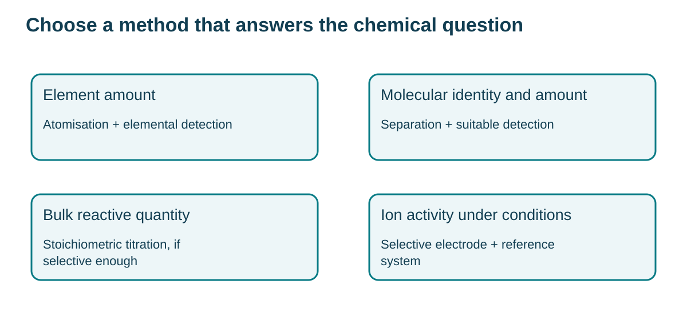
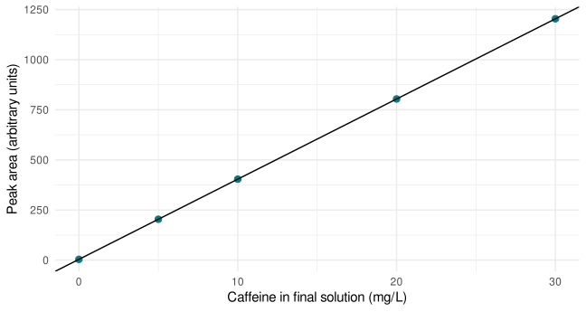
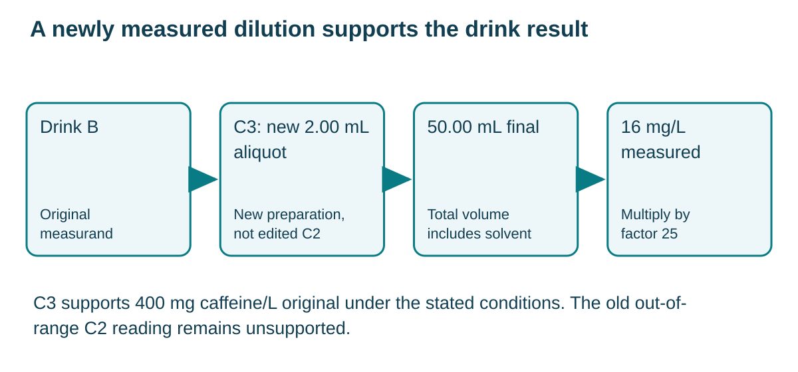
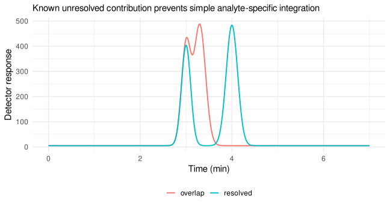
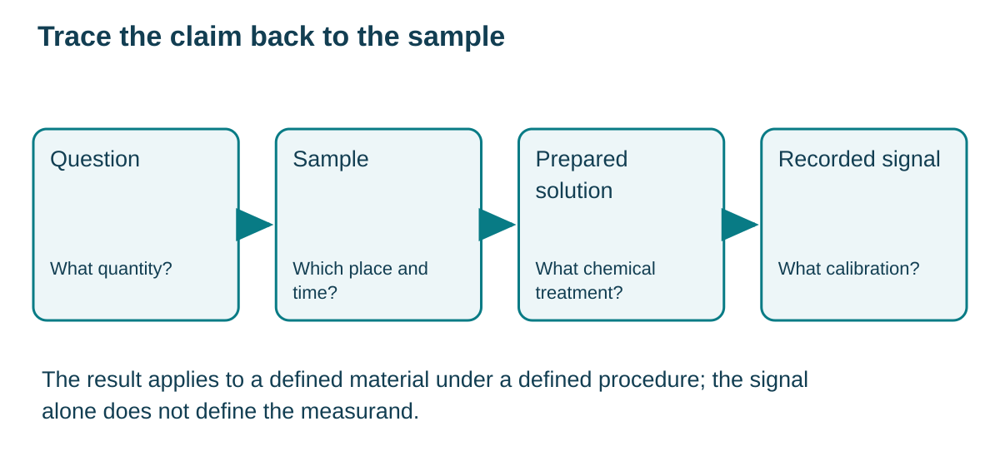
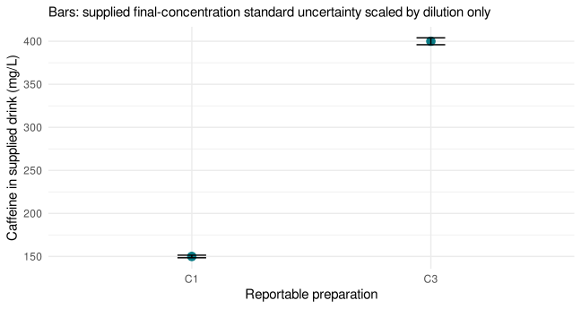
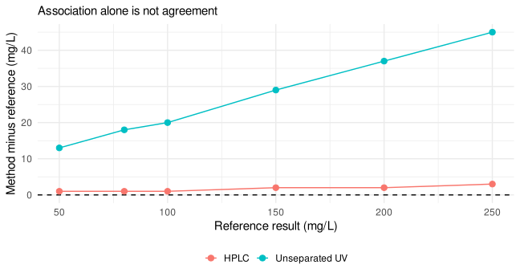
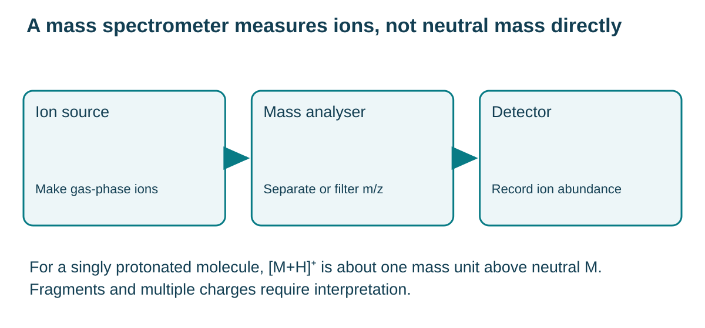
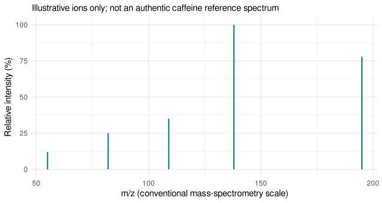

## About this lecture

Defend a caffeine concentration from sample record to conclusion.

- Use a new calibration and independent QC.
- Keep range, separation and preparation evidence attached.
- State uncertainty and unresolved actions.

::: notes
This is the integration case, not a new software framework. The exercise has a complete independent dataset. Its idealised standards do not imply zero measurement uncertainty.
:::

## Choose the method for the chemical quantity

Element amount and molecular caffeine identity require different evidence.

{width="63%" fig-align="center" fig-alt="The intended measurand and sample constraints determine which measurement principle can answer the question."}

::: notes
An atomising elemental measurement cannot preserve the original molecule. An unseparated UV response can include other absorbers. A suitable separation supports compound-specific interpretation but still needs identification, calibration and checks.
:::

## Use this case’s calibration and range

Area = **4 + 40 × caffeine concentration**, valid over **0–30 mg/L final**.

{width="63%" fig-align="center" fig-alt="The independent final-case calibration covers final caffeine concentrations from zero to thirty mg/L."}

::: notes
These are different coefficients from the previous HPLC example. Reusing a fit because the analyte has the same name is not calibration. The standards are rounded ideal teaching points; their zero residual does not establish zero real uncertainty.
:::

## Check independently before using the line

The 15.00 mg/L check recovers **100.67%**.

It passes the supplied **95–105%** exercise window.

{width="63%" fig-align="center" fig-alt="An independent known check tests calibration performance, while blanks and sample spikes address other questions."}

::: notes
The observed area 608 gives 15.1 mg/L. Passing this check supports response under its conditions; it does not prove recovery or selectivity in every beverage. The window is a supplied teaching criterion, not a universal validation rule.
:::

## Preparation history is chemical evidence

C1 and C2 use 5.00 mL to 50.00 mL.

C3 is a **new** 2.00 mL aliquot of the same drink as C2.

{width="63%" fig-align="center" fig-alt="A newly measured smaller aliquot of drink B has a different preparation record from the old out-of-range measurement."}

::: notes
A new smaller aliquot changes the measured solution and requires a new response. An old signal is not made valid by editing the dilution factor. Keep original sample ID and preparation ID separate.
:::

## C1 supports a conditional amount

Area604 → 15 mg/L final → **150 mg/L drink A**.

{width="63%" fig-align="center" fig-alt="C1’s response is within the final-solution calibration range."}

::: notes
The preparation factor is ten. Range, supplied resolution evidence and independent QC all pass. This remains conditional on the scenario identity and preparation assumptions.
:::

## C2 is an out-of-range candidate

Area1604 implies a candidate 40 mg/L final.

Do not report that extrapolated concentration.

{width="63%" fig-align="center" fig-alt="The calibration range ends at thirty mg/L final, so the old higher signal cannot establish a reported concentration."}

::: notes
Algebra can return a number outside a validated range. Keep it diagnostic and withhold the reported estimate. The needed action is an appropriate new dilution and measurement, not a cosmetically altered table.
:::

## C3 supplies new evidence

Area644 → 16 mg/L final.

Factor25 gives **400 mg/L drink B**.

{width="63%" fig-align="center" fig-alt="A newly measured two-millilitre aliquot made to fifty millilitres supports a factor of twenty-five."}

::: notes
This valid new preparation does not retroactively make C2 a valid extrapolation. Explain why the final concentration decreases but the returned original concentration is higher than C1’s.
:::

## C4 fails a different requirement

The area is inside range, but an unresolved component contributes.

Withhold the caffeine amount.

{width="63%" fig-align="center" fig-alt="Overlapping components can contribute to a response that would otherwise appear numerically in range."}

::: notes
A ratio, perfect fit or repeated injection cannot by itself recover selectivity. Better separation or justified selective evidence is needed. The source final-case C4 signal is a supplied record; the interactive model is a separately defined exploration.
:::

## Export reasons with the values

Withheld estimates are **not zero concentrations**.

Keep sample ID, preparation ID, factor and decision in the same table.

{width="63%" fig-align="center" fig-alt="An auditable result connects a defined quantity to collected material, preparation and recorded signal."}

::: notes
A reader should be able to audit an accepted result and understand an absent one. Missing values without explanations discard evidence; replacing them with zero creates a false chemical claim.
:::

## Read uncertainty on its stated scale

C1: standard uncertainty **1.5 mg/L original**.

C3: **4.0 mg/L original** from the supplied final uncertainty.

{width="63%" fig-align="center" fig-alt="Only supported preparations have plotted concentrations, with limited dilution-scaled standard uncertainty bars."}

::: notes
The case supplies final standard uncertainties .15 and .16 mg/L; scale by ten and twenty-five. These are not ninety-five percent intervals and exclude volumes, sampling and recovery. The demo separately uses .15 for each new ideal preparation, so its two-millilitre result has3.75, not4.0.
:::

## A conditional budget is not full method validation

Ideal calibration points cannot prove zero uncertainty.

What evidence is missing for the intended use?

{width="63%" fig-align="center" fig-alt="The measurement chain includes sources of uncertainty beyond a fitted line or reading repeatability."}

::: notes
Ask for specific missing contributions: standard preparation, volumes, sampling, matrix recovery, identity and selection. State what the supplied budget includes and omits instead of appending an unexplained plus/minus value.
:::

## Agreement is not association

Both methods track concentration; their differences tell different stories.

{width="63%" fig-align="center" fig-alt="Method-minus-reference differences reveal concentration-dependent discrepancies that correlation alone would conceal."}

::: notes
A high correlation can coexist with a large systematic discrepancy. Here nonspecific UV differs increasingly from the reference while HPLC differences are smaller. Reference uncertainty and required performance still matter.
:::

## A pattern motivates investigation; it does not prove cause

The UV discrepancy may motivate a matrix or selectivity study.

{width="63%" fig-align="center" fig-alt="A growing positive difference suggests a performance problem to investigate under the intended method scope."}

::: notes
Do not conclude the chemical mechanism solely from the difference plot. The simulated data encode a bias pattern, not independent proof that a particular interferent caused it.
:::

## What mass spectrometry can add

Ion source → mass analyser → detector.

The signal describes ions by **mass-to-charge**, not neutral mass directly.

{width="63%" fig-align="center" fig-alt="A mass-spectrometric signal path creates and filters ions before recording abundance."}

::: notes
This is a concise identity-evidence overview. It does not introduce a new advanced analysis workflow. Ionisation conditions determine which protonated, deprotonated, adducted or fragmented ions may appear.
:::

## Interpret a plausible caffeine ion carefully

Neutral nominal mass 194; singly protonated **[M+H]⁺ near m/z195**.

One nominal ion mass is not a unique identification.

{width="63%" fig-align="center" fig-alt="Illustrative ion sticks include m/z195, but the pattern is not an authentic reference spectrum for caffeine."}

::: notes
Multiple charges, adducts and fragments change interpretation. The displayed spectrum is illustrative, not an authentic caffeine library spectrum or a reference for identification. Combine suitable standard, retention and ion evidence where appropriate.
:::

## Write the analytical conclusion

Report supported values, explicit withheld reasons and the next action.

Render from original inputs in a fresh R session.

{width="63%" fig-align="center" fig-alt="The final result must remain traceable to the question, collected sample, preparation and measurement."}

::: notes
C1 and C3 support conditional150 and 400 mg/L. C2 needs the new preparation already supplied by C3; C4 needs improved selectivity. Source, data and output should travel together. A reproducible calculation can still be chemically invalid if its assumptions are wrong.
:::

## Test a decision before accepting it

[Exercise, embedded decision experiment and full solutions](exercise.qmd) · [Practice quiz](quiz.qmd)

What new evidence would change your decision?

::: notes
Ask for concrete evidence: new within-range measurement, successful independent checks, adequate separation, appropriate recovery study or a more complete uncertainty model. Avoid adding slides solely to occupy a duration.
:::
