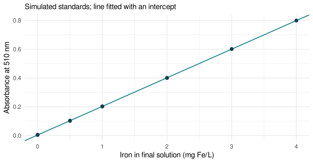

## Edit text and notes

This sandbox keeps authoring checks separate from teaching sources.

{width="65%" fig-alt="Illustrative iron complex stoichiometry."}

::: notes
Practice editing speaker notes here.
:::

## Generated figure

{width="65%" fig-alt="Calibration generated by R and locked for label editing."}

::: notes
This figure is named by a local R recipe, so the editor directs changes to the generator.
:::
