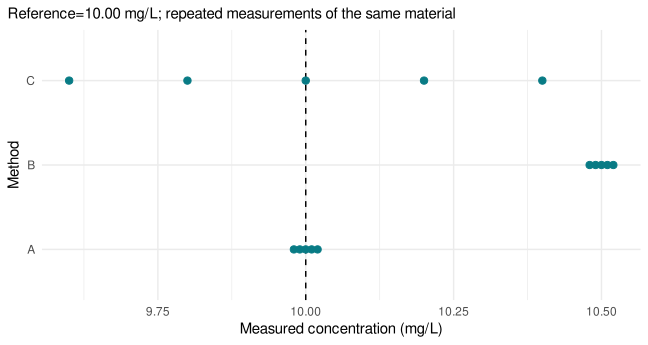
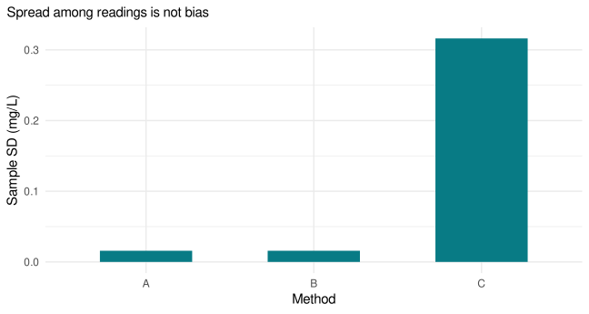
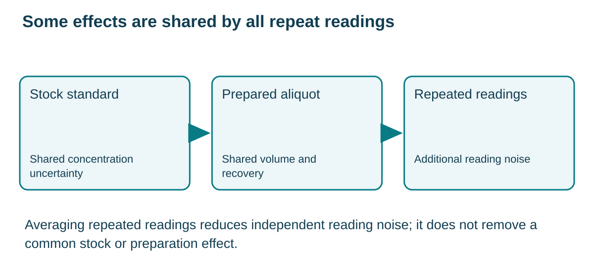
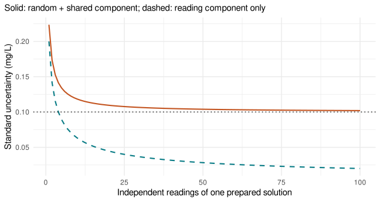
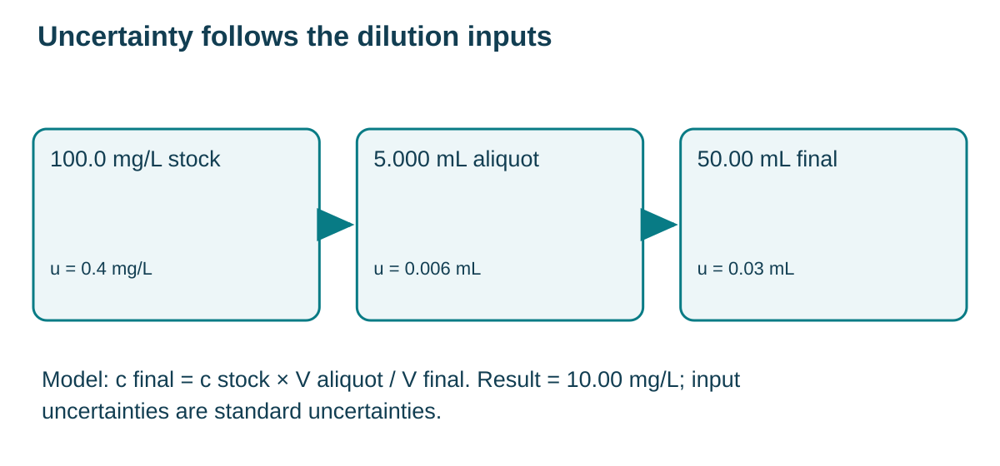
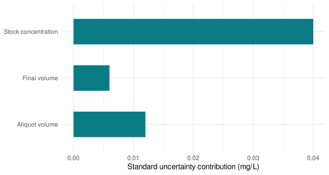

## Which method would you trust?

{width="65%" fig-align="center" fig-alt="Repeated reference measurements: A is near 10 mg/L, B is tightly grouped near 10.5, and C is spread around 10."}

The reference is 10.00 mg/L. Compare both location and spread.

::: notes
Ask for a justification before naming precision or bias. The series are repeat measurements of the same reference material.
:::

## Precision concerns repeated results

{width="65%" fig-align="center" fig-alt="A and B both have SD about 0.0158 mg/L, while C has SD about 0.316 mg/L."}

A and B both have SD ≈ **0.0158 mg/L**.

::: notes
Their repeatability is similar. Precision requires stated conditions; repeatability is not the same as all possible between-day or between-laboratory variation.
:::

## Bias concerns a suitable reference

{width="65%" fig-align="center" fig-alt="Repeated reference measurements: A is near 10 mg/L, B is tightly grouped near 10.5, and C is spread around 10."}

B mean = 10.50 mg/L: estimated bias **+0.50 mg/L**.

::: notes
Reference uncertainty is neglected only in this teaching comparison. A precise series can be displaced.
:::

## A mean close to the reference is not a guarantee

{width="65%" fig-align="center" fig-alt="Repeated reference measurements: A is near 10 mg/L, B is tightly grouped near 10.5, and C is spread around 10."}

C mean = 10.00 mg/L, but its SD ≈ **0.316 mg/L**.

::: notes
An accidentally close mean in five readings does not validate a method across samples and matrices.
:::

## Uncertainty describes doubt under a model

It is not the observed difference from a secretly known true value.

::: notes
A measurement model relates inputs to the reported quantity. Uncertainty requires relevant input uncertainties and their dependencies.
:::

## Retrieve grouped summaries

```r
summarise(n = n(), mean_mg_l = mean(measured_mg_l),
          sd_mg_l = sd(measured_mg_l))
```

::: notes
Ask students to interpret the units of SD and variance. SD has the concentration unit; variance has its square.
:::

## Spread of readings and uncertainty in a mean differ

For independent stable readings: $u_{reading}(\bar x)=s/\sqrt n$.

::: notes
Name the quantity carefully. This is the reading contribution to the mean, not the SD of future individual readings.
:::

## Do not divide shared effects by square root of n

{width="65%" fig-align="center" fig-alt="Averaging repeated readings reduces independent reading noise; it does not remove a common stock or preparation effect."}

A stock error is shared by every reading made from that stock.

::: notes
Trace the graph from stock through prepared aliquot to repeated readings. Identify which information new readings do and do not add.
:::

## More readings approach a floor

{width="65%" fig-align="center" fig-alt="Reading uncertainty decreases with more independent readings, while the combined uncertainty approaches a shared 0.10 mg/L floor."}

Which curve keeps decreasing? Which levels off?

::: notes
Solid combines reading uncertainty with a shared 0.10 mg/L component; dashed shows reading alone. These numbers are an independent illustration.
:::

## Choose the quantity before choosing the formula

{width="65%" fig-align="center" fig-alt="Averaging repeated readings reduces independent reading noise; it does not remove a common stock or preparation effect."}

One collected sample, several preparations and several readings need different treatment.

::: notes
The experimental unit comes first. Do not turn dependent data into independent evidence by running a familiar formula.
:::

## Write the dilution model

{width="65%" fig-align="center" fig-alt="Model: c final = c stock × V aliquot / V final. Result = 10.00 mg/L; input uncertainties are standard uncertainties."}

$c=c_sV_a/V_f$.

::: notes
Inputs: stock one hundred mg/L, aliquot five millilitres, final fifty millilitres. The result is ten mg/L.
:::

## Use standard uncertainties of the inputs

Stock: 0.4 mg/L; aliquot: 0.006 mL; final volume: 0.03 mL.

::: notes
They are supplied standard uncertainties, not tolerance bounds. If only a tolerance is available, a justified distribution model is needed before treating it as standard uncertainty.
:::

## Propagate each contribution onto the output scale

{width="65%" fig-align="center" fig-alt="Dilution standard uncertainty contributions: stock 0.040, aliquot 0.012 and final volume 0.006 mg/L."}

Stock contributes **0.040 mg/L**.

::: notes
Use concentration times relative stock uncertainty. All contributions must refer to the reported concentration before combining.
:::

## Volume contributions also survive averaging

{width="65%" fig-align="center" fig-alt="Dilution standard uncertainty contributions: stock 0.040, aliquot 0.012 and final volume 0.006 mg/L."}

Aliquot: **0.012 mg/L**; final volume: **0.006 mg/L**.

::: notes
Taking additional readings of the prepared flask does not remeasure its actual volume.
:::

## Combine independent contributions in quadrature

{width="65%" fig-align="center" fig-alt="Dilution standard uncertainty contributions: stock 0.040, aliquot 0.012 and final volume 0.006 mg/L."}

$u(c)=\sqrt{0.040^2+0.012^2+0.006^2}$ = **0.04219 mg/L**.

::: notes
The square-root-of-squares rule here assumes independent inputs and a valid first-order approximation. Correlated volumes require covariance terms.
:::

## Improve the dominant source first

{width="65%" fig-align="center" fig-alt="Dilution standard uncertainty contributions: stock 0.040, aliquot 0.012 and final volume 0.006 mg/L."}

Would a more precise final flask solve most of this budget?

::: notes
No: the stock is dominant in this particular example. Do not treat this ranking as universal.
:::

## Averaging is useful within its scope

{width="65%" fig-align="center" fig-alt="Reading uncertainty decreases with more independent readings, while the combined uncertainty approaches a shared 0.10 mg/L floor."}

More independent readings reduce the reading component.

::: notes
Show both curves again and ask where new preparation information would enter. This is not an argument against replication, but for appropriate replication.
:::

## An interval needs a meaning

Standard uncertainty $u$; expanded uncertainty $U=ku$; confidence interval for a mean.

::: notes
Ask which one the previous number represents. It is a standard uncertainty. Do not label every plus/minus quantity as ninety-five percent.
:::

## A small-sample mean uses its sampling model

$\bar x\pm t_{0.975,n-1}s/\sqrt n$.

::: notes
This interval assumes independent readings under an appropriate normal model. It does not supply sampling or recovery uncertainty missing from the measurement design.
:::

## Treat a known bias as a problem to investigate

{width="65%" fig-align="center" fig-alt="Repeated reference measurements: A is near 10 mg/L, B is tightly grouped near 10.5, and C is spread around 10."}

An arbitrary error bar does not correct a systematically displaced method.

::: notes
A justified bias correction has its own uncertainty. Ask which evidence would support correction rather than automatically recentering every dataset.
:::

## Report precision that the uncertainty supports

10.000 mg/L; standard uncertainty **0.042 mg/L** under the stated model.

::: notes
Retain full numerical precision in code. Round in the report consistently with uncertainty and purpose. State omitted sources.
:::

## Transfer: halve the stock uncertainty

{width="65%" fig-align="center" fig-alt="Dilution standard uncertainty contributions: stock 0.040, aliquot 0.012 and final volume 0.006 mg/L."}

Replace 0.4 by 0.2 mg/L. What happens to combined uncertainty?

::: notes
New standard uncertainty is 0.02408 mg/L, not exactly half of 0.04219 because other components remain.
:::

## What still lies outside the budget?

{width="65%" fig-align="center" fig-alt="Averaging repeated readings reduces independent reading noise; it does not remove a common stock or preparation effect."}

Sampling, recovery, matrix effects and unmodelled preparation variation.

::: notes
Connect this list to the measurand. An uncertainty estimate can be arithmetically correct but incomplete for the decision.
:::

## Practise the chemical argument

[Open the exercise](exercise.qmd).

Save the calculation and a chemical interpretation in your reproducible report.

[Interactive experiment](exercise.qmd#explore) · Predict, change, explain.

::: notes
Harris and Lucy reading: 3–4. Source and dataset assumptions are linked in the student page. Keep longer coding in the practical, rather than reading a script aloud. Slide count is not a duration target; allow thinking time where the question warrants it.
:::
