## About this lecture

Choose how an analyte can enter and move through a column.

Then ask which sources of variation an internal standard can actually track.

::: notes
Retrieve separation principles before instrument names. The worked caffeine case is simulated and conditional on its supplied separation and QC evidence. We retain the introcomputing vocabulary: CSV import, mutate, lm, labelled plots.
:::

## Follow the GC sample

Carrier gas → inlet → column in an oven → detector.

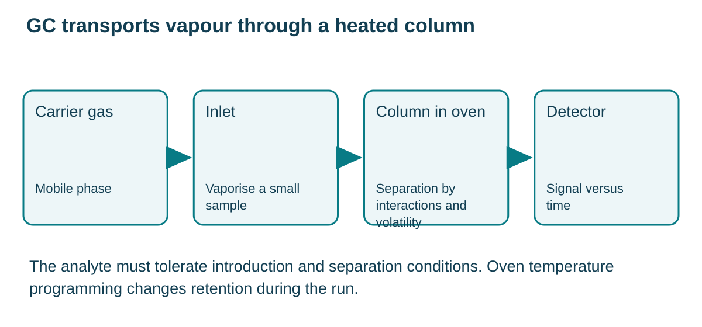{width="63%" fig-align="center" fig-alt="A GC flow path carries vaporised analyte in gas through an oven-controlled column to a detector."}

::: notes
Conventional GC requires analyte entry into the gas phase and acceptable stability under introduction and separation conditions. Inlet and oven conditions are part of the method, not just hardware details. The drawing is schematic.
:::

## Volatility concerns what is introduced

Headspace sampling can introduce volatiles above a nonvolatile matrix.

Retention depends on stationary-phase interactions as well as volatility.

{width="63%" fig-align="center" fig-alt="A schematic GC flow path supports discussion of sample entry, volatility and stationary-phase interactions."}

::: notes
The entire original sample need not be volatile. A headspace result depends on sampling partition and conditions. Temperature programming changes retention during a run, but retention order is not a universal boiling-point list.
:::

## Follow the HPLC sample

Solvent reservoirs → controlled flow and injection → packed column → detector.

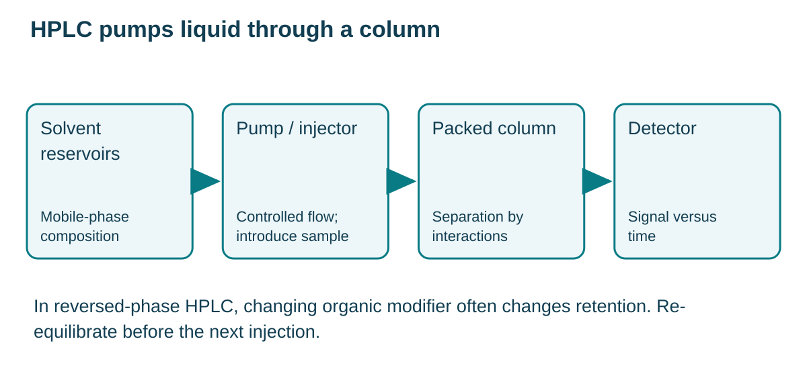{width="63%" fig-align="center" fig-alt="A liquid mobile phase is pumped through an injected sample, packed HPLC column and detector."}

::: notes
HPLC accommodates many compounds not suited to ordinary GC, provided solubility, stability and interactions suit the selected conditions. High pressure moves the liquid through the packed bed; it does not by itself create chemical selectivity.
:::

## Reversed phase is an interaction regime

A relatively nonpolar stationary phase meets a more polar mobile phase.

Increasing organic modifier often reduces retention for appropriately retained compounds.

{width="63%" fig-align="center" fig-alt="An HPLC flow path is used to connect phase chemistry with controlled liquid transport."}

::: notes
State the qualification. Ionisation and solvent/analyte chemistry can alter behaviour. Do not use a one-sentence rule as a method-development algorithm.
:::

## A gradient must include the next starting state

Composition changes during a gradient; an isocratic run holds it fixed.

Return and re-equilibrate before the next injection.

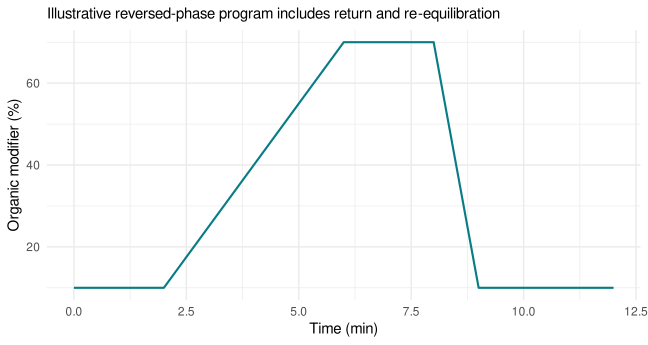{width="63%" fig-align="center" fig-alt="An illustrative HPLC gradient rises from ten to seventy percent organic, then returns and re-equilibrates."}

::: notes
The plotted program is illustrative, not a validated caffeine procedure. Its late return to ten percent organic supports repeating the initial conditions. Flow, column, temperature, solvent and injection settings also belong to the method.
:::

## Detection adds another selectivity condition

UV absorption, flame-ionisation current and mass-to-charge signals are different responses.

{width="63%" fig-align="center" fig-alt="A detector receives separated components, but its response depends on its measurement principle."}

::: notes
A UV detector requires absorption at the selected wavelength. FID is useful for many organics in GC; MS detects ions. Their areas have method-specific response factors, so an area is not a universal number of molecules.
:::

## Calibrate integrated caffeine area

Final-solution standards span **0–40 mg/L**.

Area = **3 + 50 × caffeine concentration**.

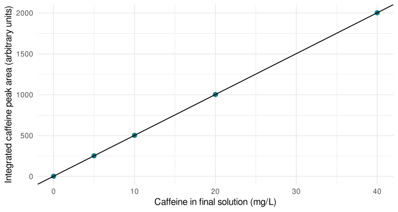{width="63%" fig-align="center" fig-alt="Integrated caffeine area is linear with final-solution concentration in the simulated calibration."}

::: notes
The supplied areas come from integration under assumed appropriate baseline and resolution. We fit area as response to known final concentration and retain the intercept. The result is not yet original drink concentration.
:::

## A smaller injection need not mean a weaker vial

Two injections of D1 give external estimates **15.00 and 12.00 mg/L final**.

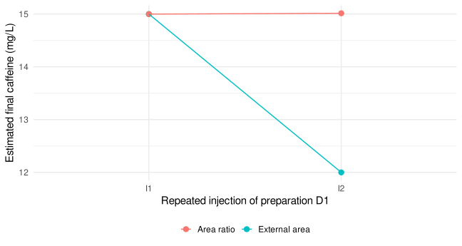{width="63%" fig-align="center" fig-alt="External-area estimates vary between two injections of one prepared solution."}

::: notes
The same prepared solution is injected twice. Changes in introduced amount can change area while vial concentration remains unchanged. They are repeated injections, not independently collected drinks.
:::

## Add a distinguishable internal standard

Every final standard and sample here has **10 mg/L internal standard**.

Both peaks must be appropriately resolved.

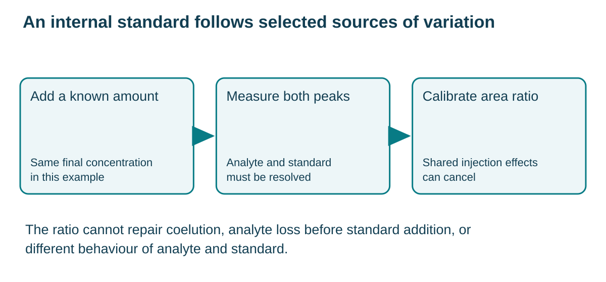{width="63%" fig-align="center" fig-alt="An internal standard shares selected preparation and measurement steps with the analyte."}

::: notes
The standard should follow the sources of variation it is intended to compensate. It must also be distinguishable from native matrix components. Addition timing is central to which losses it experiences.
:::

## Calibrate the matched ratio

$R=A_{caffeine}/A_{IS}=0.006+0.100c$.

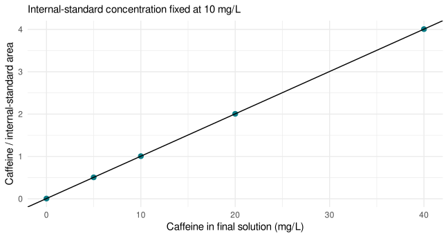{width="63%" fig-align="center" fig-alt="A retained-intercept ratio calibration relates caffeine concentration to caffeine/internal-standard area ratio."}

::: notes
With constant IS concentration, ratio versus analyte concentration is appropriate for this example. If IS concentration varies, a concentration-ratio model is required. A ratio alone has no universal concentration unit.
:::

## Compare the repeated-injection estimates

Ratio estimates: **15.000 and 15.015 mg/L final**.

The common injection effect mostly cancels.

{width="63%" fig-align="center" fig-alt="Area-ratio estimates remain close while the external estimates change substantially."}

::: notes
The retained constant analyte offset prevents perfect cancellation: it does not scale with the injection factor. Keep this small residual distinct from an unshared matrix or extraction effect.
:::

## Return to the original drink

The preparation factor is 10, giving about **150 mg caffeine/L original**.

{width="63%" fig-align="center" fig-alt="Calibration and the recorded dilution factor connect measured peak areas to the original drink basis."}

::: notes
Invert the fitted ratio first, then multiply by the correct preparation factor. Do not apply an extra factor because the internal standard itself has a concentration. The fixed-standard calibration already includes that design.
:::

## Timing determines which loss is tracked

A standard added after extraction cannot establish recovery of native analyte through that extraction.

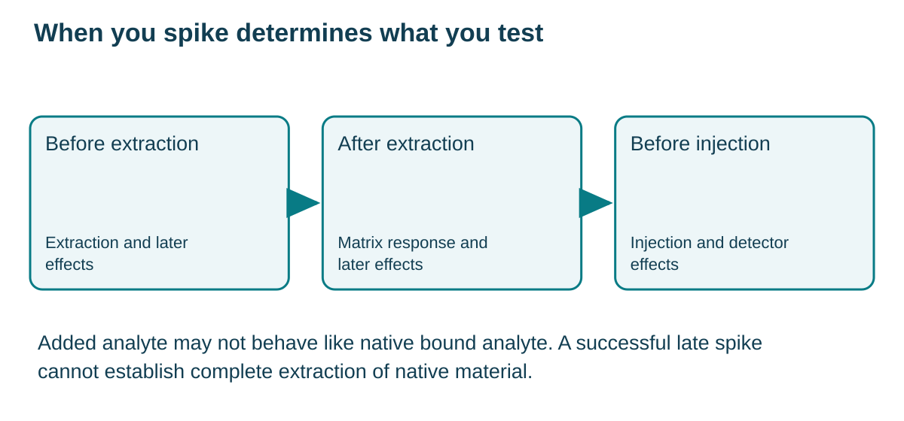{width="63%" fig-align="center" fig-alt="A spike or internal standard passes through only the steps following its point of addition."}

::: notes
Even an early freely added standard may differ from native bound analyte. Equivalent behaviour is an assumption requiring evidence. The embedded demo lets students compare timing under an explicit equal-recovery idealisation.
:::

## Ratios cannot restore missing selectivity

I3 is unresolved. I4 has failed QC.

Both concentration results are withheld despite calculable areas and ratios.

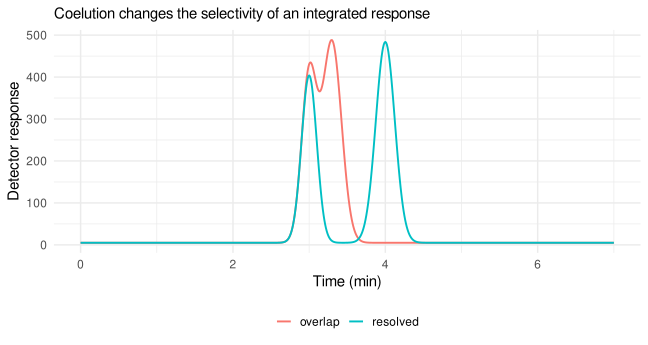{width="63%" fig-align="center" fig-alt="Coelution can invalidate a compound-specific area even when a ratio can be calculated."}

::: notes
The flags in the exercise are supplied outcomes of separation and QC review, not switches chosen to retain a desired answer. An interfering peak can contaminate either analyte or standard area.
:::

## Encode the chemical decision

```r
reportable <- resolved & qc_pass & in_range
```

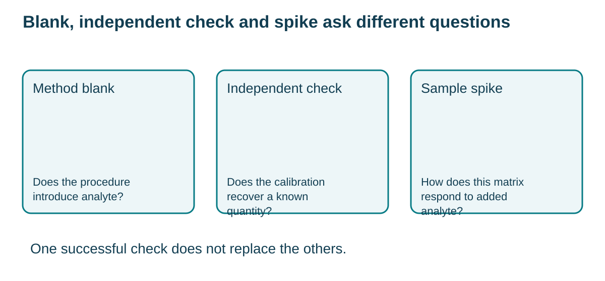{width="63%" fig-align="center" fig-alt="Independent checks and sample-specific evidence address different aspects of analytical validity."}

::: notes
A reproducible decision should preserve IDs, preparation factors and reasons. A missing withheld estimate is not zero analyte. Do not manufacture a complete uncertainty from the few repeat injections provided.
:::

## Predict before exploring

Change only injection amount. Then introduce a loss that occurs before a late internal standard.

Which error cancels, and which remains?

{width="63%" fig-align="center" fig-alt="The comparison plot motivates separating shared injection effects from unshared chemical effects."}

::: notes
Use the embedded exercise experiment. Shared injection gives nearly constant ratio estimates. A late standard cannot cancel earlier analyte recovery loss, and differential analyte response does not cancel either.
:::

## Transfer the calibrated ratio

Areas 903 and 600; same IS concentration; original-to-final factor 5.

What amount would you report, and what could still prevent reporting?

{width="63%" fig-align="center" fig-alt="The ratio model supports a transfer calculation only under its matched-standard and selectivity assumptions."}

::: notes
Ratio1.505; final 14.99 mg/L; original 74.95 mg/L. If a known unresolved absorber contributes, withhold the simple caffeine interpretation. The same equation cannot fix the selectivity failure.
:::

## Choose the complete method

Volatile solvent mixture versus heat-sensitive nonvolatile solutes.

[Exercise and embedded exploration](exercise.qmd) · [Practice quiz](quiz.qmd)

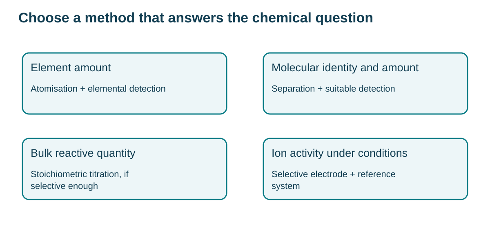{width="63%" fig-align="center" fig-alt="Different chemical questions and sample constraints call for different measurement strategies."}

::: notes
GC is a plausible starting point for the volatile solvent mixture and LC for the heat-sensitive nonvolatile solutes. Matrix, sample entry, detector, selectivity and uncertainty requirements refine the choice. Read Harris and Lucy by GC/HPLC topic.
:::
