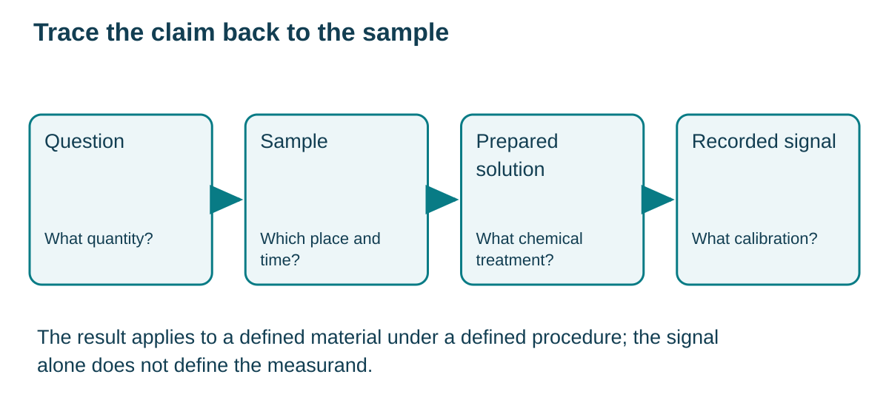

Use the lecture, quiz, exercise and embedded experiment together. Start with the chemical question, predict what a measurement should show, then use R to test and explain it.

[Download the student project](downloads/analyticalchem-project.zip), extract it and open `analyticalchem.Rproj`. Work from that project root. The [R reference](reference/r.qmd) retrieves the CSV, plotting and regression workflow from introductory computing. Student reports use R Markdown.

## Topics {#topics}

| Topic | Analytical question | Materials |
| --- | --- | --- |
| From sample to answer | Define the chemical quantity before calculating it | [Lecture](sample-answer/lec.qmd) · [Quiz](sample-answer/quiz.qmd) · [Exercise](sample-answer/exercise.qmd) · [Demo](sample-answer/exercise.qmd#explore) |
| Sampling and preparation | Follow the material through sampling, extraction and dilution | [Lecture](sampling-preparation/lec.qmd) · [Quiz](sampling-preparation/quiz.qmd) · [Exercise](sampling-preparation/exercise.qmd) · [Demo](sampling-preparation/exercise.qmd#explore) |
| Error and uncertainty | Separate spread, bias and uncertainty in a result | [Lecture](error-uncertainty/lec.qmd) · [Quiz](error-uncertainty/quiz.qmd) · [Exercise](error-uncertainty/exercise.qmd) · [Demo](error-uncertainty/exercise.qmd#explore) |
| Calibration and quality control | Decide whether a signal can support a concentration | [Lecture](calibration-qc/lec.qmd) · [Quiz](calibration-qc/quiz.qmd) · [Exercise](calibration-qc/exercise.qmd) · [Demo](calibration-qc/exercise.qmd#explore) |
| Equilibrium and titration | Use reaction stoichiometry and a justified endpoint | [Lecture](titration/lec.qmd) · [Quiz](titration/quiz.qmd) · [Exercise](titration/exercise.qmd) · [Demo](titration/exercise.qmd#explore) |
| Electrodes and potentiometry | Read a logarithmic response without losing the chemistry | [Lecture](potentiometry/lec.qmd) · [Quiz](potentiometry/quiz.qmd) · [Exercise](potentiometry/exercise.qmd) · [Demo](potentiometry/exercise.qmd#explore) |
| UV and visible absorption | Measure iron through a specified coloured complex | [Lecture](uv-visible/lec.qmd) · [Quiz](uv-visible/quiz.qmd) · [Exercise](uv-visible/exercise.qmd) · [Demo](uv-visible/exercise.qmd#explore) |
| Matrix effects and recovery | Find why a good calibration can still give a biased sample result | [Lecture](matrix-recovery/lec.qmd) · [Quiz](matrix-recovery/quiz.qmd) · [Exercise](matrix-recovery/exercise.qmd) · [Demo](matrix-recovery/exercise.qmd#explore) |
| Atomic measurements | Report an element amount through atomisation and detection | [Lecture](atomic-methods/lec.qmd) · [Quiz](atomic-methods/quiz.qmd) · [Exercise](atomic-methods/exercise.qmd) · [Demo](atomic-methods/exercise.qmd#explore) |
| Separation principles | Connect phase exchange to retention, width and resolution | [Lecture](separations/lec.qmd) · [Quiz](separations/quiz.qmd) · [Exercise](separations/exercise.qmd) · [Demo](separations/exercise.qmd#explore) |
| GC and HPLC | Choose an introduction and separation, then calibrate peak area | [Lecture](gc-hplc/lec.qmd) · [Quiz](gc-hplc/quiz.qmd) · [Exercise](gc-hplc/exercise.qmd) · [Demo](gc-hplc/exercise.qmd#explore) |
| Choosing and defending a result | Build and defend the complete analytical argument | [Lecture](defending-results/lec.qmd) · [Quiz](defending-results/quiz.qmd) · [Exercise](defending-results/exercise.qmd) · [Demo](defending-results/exercise.qmd#explore) |

## Follow a result back to its origin

{fig-alt="A result links the question, sampled material, preparation and measured signal."}{fig-alt="The analytical question, material, preparation and measured signal form a traceable measurement chain."}

The examples use simulated data. Keep the original inputs, preparation records, R code, derived tables and report together. Read the [data dictionary](reference/data.qmd) before interpreting a file. Use the [glossary](dictionary.qmd) to distinguish terms such as precision, recovery and uncertainty.

Selected reading follows Harris and Lucy, *Quantitative Chemical Analysis*, by topic: sampling and preparation; error and calibration; equilibrium and titration; electrochemistry; spectroscopy; chromatography. Chapter numbering depends on the edition, which remains to be confirmed for the planned course.
