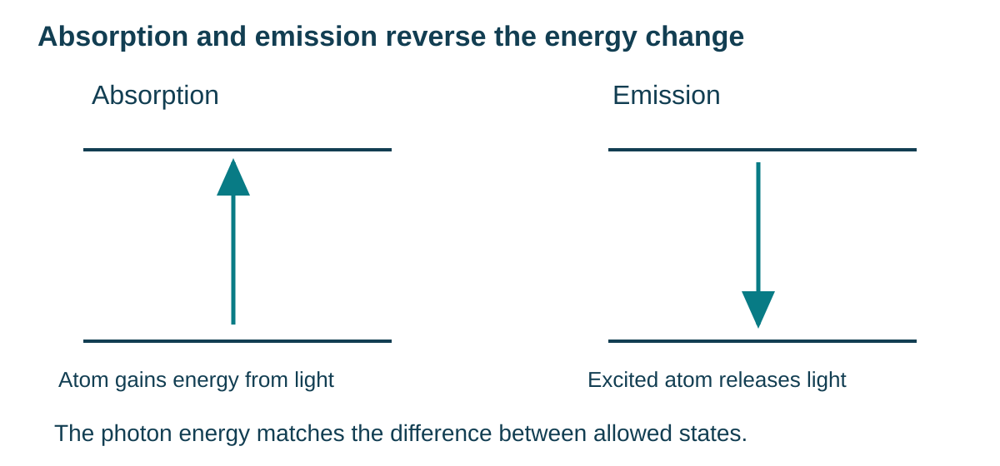
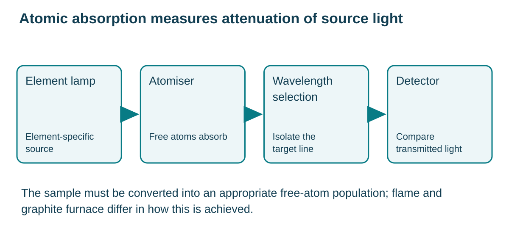
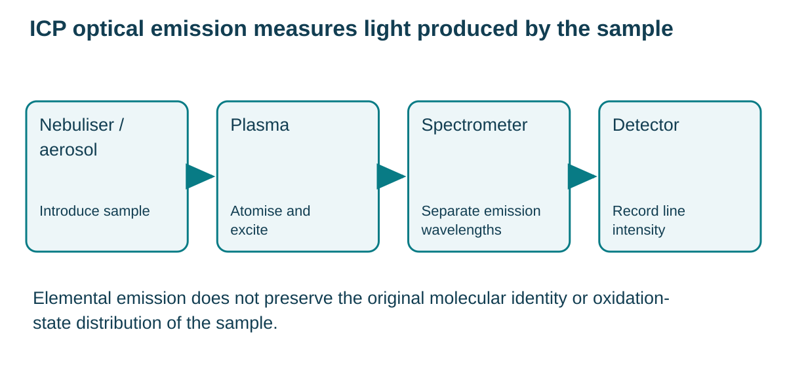
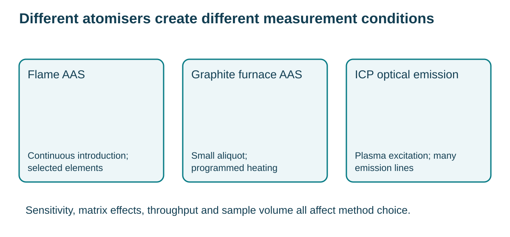
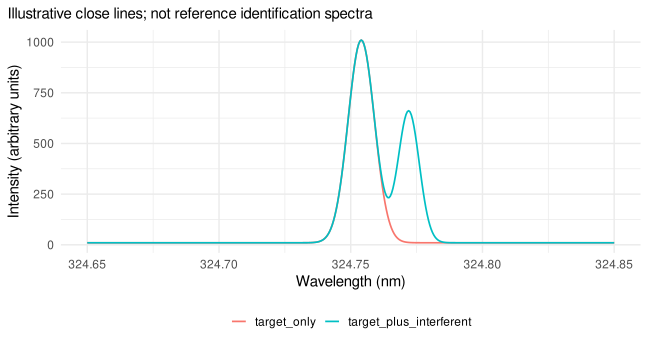
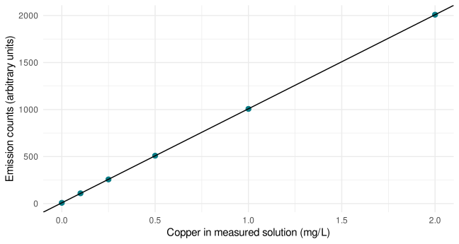
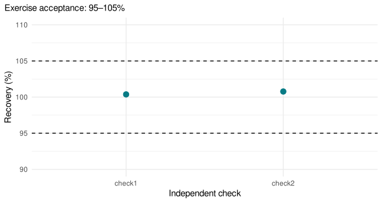
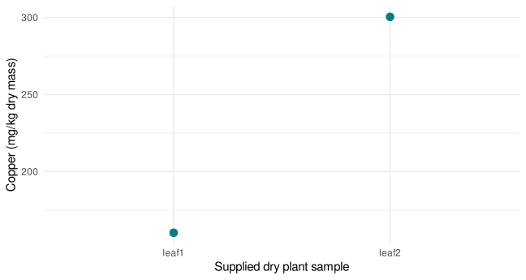

::: {.callout-note}
## Interactive experiment

[Explore the browser demo](../demos/atomic-methods.html): How do background, a neighbouring line and preparation factors affect an elemental result?
Predict first, change one condition, then explain the result. Export a CSV to
reproduce one calculation or plot in R.
:::


## Measure an element rather than its original molecule

An elemental method can report copper in plant material after an appropriate
preparation. It does not preserve the original molecules or prove which
oxidation state the copper had. You will compare atomic absorption and emission,
then calculate copper per dry sample mass from a digest and a further dilution.

{fig-alt="Absorption raises atomic energy using incident light; emission releases light from an excited population."}

In atomic absorption, an element-specific source provides light absorbed by
free atoms. In optical emission, an excited population emits photons at
characteristic wavelengths. Both require suitable sample introduction and
control of interferences. Absorption and emission are not simply two names for
the coloured-solution method: atomisation changes the sample substantially.

## Follow each instrument's signal path

{fig-alt="AAS compares source light transmitted through a population of free atoms."}

A flame supplies a continuously introduced atom population. A graphite furnace
uses a small aliquot and a heating program with drying, matrix removal and
atomisation stages. The useful response and interferences depend on those
conditions. Small sample volume alone does not determine fitness for purpose.

{fig-alt="ICP optical emission introduces an aerosol into a plasma and separates the emitted wavelengths."}

ICP-OES uses plasma excitation and a spectrometer to distinguish emission
wavelengths. Multi-element measurement is possible, but line choice, background,
transport effects and spectral overlap still need attention.
[Manufacturer description of the ICP-OES signal path](https://www.thermofisher.com/us/en/home/industrial/spectroscopy-elemental-isotope-analysis/spectroscopy-elemental-isotope-analysis-learning-center/trace-elemental-analysis-tea-information/icp-oes-information/icp-oes-system-technologies.html)

{fig-alt="Flame, furnace and plasma approaches differ in introduction and atomisation conditions."}

The cheapest or most sensitive instrument is not automatically the best
choice. Consider required range, matrix, available sample amount, number of
elements, throughput and preparation. ICP-MS would detect ions by mass-to-charge
rather than the emitted optical signal; do not confuse it with ICP-OES.

## Spectral selectivity has limits

A neighbouring element line or structured background can contribute near a
selected wavelength. An apparently stable signal can still be biased. Examine
a suitable spectral window, alternative lines or an appropriate interference
correction under the method, rather than attributing every count to copper.

{fig-alt="An illustrative neighbouring line alters the spectrum around the target emission."}

These profiles are simulated illustrations near 324.75 nm, not identification
reference spectra. A real line assignment and correction require validated
wavelength and instrument information. Chemical and transport effects can also
change the atom population without producing a visibly separate optical peak.

## Calibrate the measured solution

The supplied standards describe copper in the solution introduced for emission
measurement, in mg/L. The sample data include an independently processed method
blank and independent QC materials. All counts are raw on the exercise's
instrument response scale; the fitted intercept is retained.

```{r}
library(readr)
library(dplyr)
library(ggplot2)
standards <- read_csv("data/course/atomic-standards.csv", show_col_types = FALSE)
fit <- lm(emission_counts ~ copper_mg_l, data = standards)
a <- unname(coef(fit)[1])
b <- unname(coef(fit)[2])
qc <- read_csv("data/course/atomic-qc.csv", show_col_types = FALSE) |>
  mutate(estimated_mg_l = (emission_counts - a) / b,
         recovery_percent = 100 * estimated_mg_l / reference_mg_l,
         qc_pass = recovery_percent >= recovery_lower &
                   recovery_percent <= recovery_upper)
qc
```

{fig-alt="The calibration describes copper in the introduced solution, not directly in the dry plant."}

{fig-alt="Both independent checks pass the supplied 95–105% exercise window."}

A passing dissolved check tests response under its conditions. It does not prove
complete digestion of plant material. The plant result below is conditional on
quantitative transfer/recovery; a suitable reference material or recovery study
would be needed to establish that assumption for real samples.

## Reverse dilution, then subtract the correct blank basis

A1 begins with 0.2500 g dry material made to 50.00 mL digest. A further twofold
dilution is measured. The method blank is a separately processed digest measured
**without** that further dilution. First convert both signals to concentration;
undo the sample's further dilution; then subtract the method blank on the
**digest concentration** basis.

```{r}
digests <- read_csv("data/course/atomic-digests.csv", show_col_types = FALSE)
blank_digest_mg_l <- (digests$emission_counts[digests$sample_id == "method_blank"] - a) / b
results <- digests |>
  mutate(measured_mg_l = (emission_counts - a) / b,
         in_range = measured_mg_l >= 0 & measured_mg_l <= 2,
         digest_corrected_mg_l = measured_mg_l * further_dilution -
                                  blank_digest_mg_l,
         copper_mg_kg = if_else(sample_id != "method_blank" & in_range &
                                 all(qc$qc_pass),
           digest_corrected_mg_l * (digest_ml / 1000) / (dry_mass_g / 1000),
           NA_real_))
results
write_csv(results, "output/copper-dry-mass.csv", na = "NA")
```

A1's measured concentration is about 0.40189 mg/L; digest concentration after
undoing dilution and subtracting the blank is 0.80179 mg/L. The digest contains
0.04009 mg Cu. Divide by 0.0002500 kg dry material to obtain **160.36 mg/kg dry
mass**. The method blank has no dry sample mass and no mg/kg sample result.

{fig-alt="Derived plant results use the original dry-mass basis."}

Do not subtract a blank twice or multiply its concentration by a dilution it
never underwent. An uncertain or variable blank needs its own contribution to
the uncertainty budget. “mg/L in digest” and “mg/kg dry material” are different
results even when they refer to the same preparation.

## Practical and transfer

Report both plant results, the full preparation calculation, QC interpretation
and the role of the method blank. Explain why an elemental amount does not
identify a molecular species. Identify missing recovery and uncertainty evidence
before claiming a validated total-copper result.

A separate sample uses 0.2000 g dry material made to 25.00 mL. Its measured
fivefold dilution gives 0.0800 mg/L Cu; the undiluted method-blank digest is
0.0100 mg/L. Calculate the blank-corrected dry-mass result.

::: {.callout-tip collapse="true"}
## Check the mass balance

The sample digest is $0.0800\times5-0.0100=0.3900$ mg/L. It contains
0.009750 mg Cu, giving **48.75 mg/kg dry mass**. The supplied A1 and A2 results
are 160.36 and 300.42 mg/kg respectively, conditional on the stated recovery.
:::


Selected Harris and Lucy reading: **atomic spectroscopy**. Read by topic; the planned course edition is not yet confirmed.

[Slides](../slides/atomic-methods.qmd) · [Course project](../downloads/analyticalchem-project.zip) · [R reference](../reference/r.qmd)

[Previous: Matrix effects and recovery](matrix-recovery.qmd) · [Next: Separation principles](separations.qmd)
