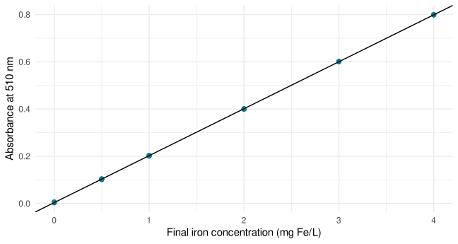
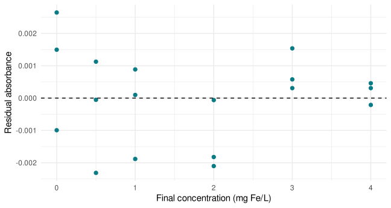
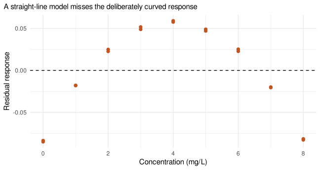
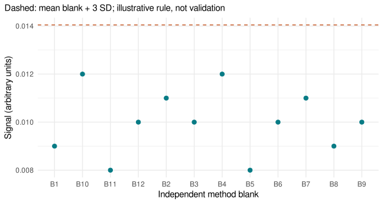

::: {.callout-note}
## Interactive experiment

[Explore the browser demo](../demos/calibration-qc.html): Can a plausible concentration survive a curved calibration, range failure, or failed check?
Predict first, change one condition, then explain the result. Export a CSV to
reproduce one calculation or plot in R.
:::


## Can this response support a concentration?

A calibration relates known analyte quantities to measured responses. You will
retrieve the straight-line fit from introductory computing, inspect whether its
assumptions suit the data, and distinguish working range, blank response and
independent checks. We reuse the iron standards later measured in the UV/visible
unit: concentrations refer to mg elemental Fe/L in the final coloured solution;
absorbance is already reagent-blank referenced.

## Fit the response model in the measured direction

```{r}
library(readr)
library(dplyr)
library(ggplot2)
standards <- read_csv("data/standards.csv", show_col_types = FALSE)
fit <- lm(absorbance ~ standard_mg_l, data = standards)
a <- unname(coef(fit)[1])
b <- unname(coef(fit)[2])
coef(fit)
```

{fig-alt="Known final concentrations and independently prepared standard responses define a fitted line."}

We set concentration and observe absorbance. The model is $A=a+bc+e$, with
response error $e$. Its least-squares fit gives $a\approx0.003874$ and
$b\approx0.198799$ L/mg Fe. The fitted offset is retained. A near-zero
concentration does not force a precisely zero measured response.

Calibration standards should bracket the intended measurements. Use an
independently sourced check where possible: if every standard and check comes
from the same wrongly assigned stock, their agreement can conceal the problem.

## Look at the residuals, not just a summary statistic

```{r}
standards <- standards |>
  mutate(fitted = fitted(fit), residual = residuals(fit))
ggplot(standards, aes(standard_mg_l, residual)) +
  geom_hline(yintercept = 0, linetype = "dashed") +
  geom_point() +
  labs(x = "Final iron concentration (mg Fe/L)", y = "Residual absorbance") +
  theme_minimal()
```

{fig-alt="Residuals in the selected range have no obvious curved pattern."}

A large $R^2$ can coexist with systematic curvature. Residuals should be assessed
against concentration or fitted response, looking for curvature, changing
spread or an unusual observation. Investigate records and measurement conditions
before excluding a point. If response variance changes strongly with
concentration, ordinary unweighted fitting may be inappropriate; recognise that
limitation rather than automatically adopting a more complicated model.

{fig-alt="A second deliberately curved dataset leaves patterned residuals after a straight-line fit."}

In `nonlinear-calibration.csv`, the curve is an intentional teaching fault.
One option is a justified narrower range with adequate standards; another is a
validated alternative model. Deleting high standards simply to obtain a prettier
line is not validation. Keep model choice and working-range evidence explicit.

## Invert the line, then check its applicability

For a mean unknown absorbance, $\hat c=(\bar A-a)/b$. This is an inverse estimate
from a model of response. Reversing the regression to `c ~ A` is a different
least-squares problem and is not the same calculation.

```{r}
unknown_absorbance <- c(0.47922, 0.48041, 0.48223)
response_limits <- predict(fit,
  newdata = data.frame(standard_mg_l = c(0, 4)))
in_range <- all(unknown_absorbance >= response_limits[1] &
                unknown_absorbance <= response_limits[2])
unknown_mg_l <- if (in_range) (mean(unknown_absorbance) - a) / b else NA_real_
unknown_mg_l
```

The result is about 2.398 mg Fe/L **in the final solution**. It says nothing
about the original sample concentration until its preparation factors are
applied. Passing this range rule does not establish selectivity in a different
sample matrix.

## Three quality-control questions

{fig-alt="A blank, independent check and sample spike diagnose different aspects of the process."}

A method blank goes through the preparation without the sample and detects
introduced contamination or background. A reagent blank used as the optical
reference and a whole-procedure method blank are not always the same material.
An independent check challenges calibration accuracy under the check's
conditions. A sample spike probes response to added analyte in that matrix and
from its point of addition onward. State preselected acceptance criteria and
what happens when a check fails; do not invent a criterion after viewing results.

## Detection is not reliable quantification

A weak signal can be distinguishable from blanks while still having unacceptable
relative uncertainty for quantification. Detection and quantification limits
depend on the procedure, noise model, decision probabilities and performance
requirements. The following is only an **indicative teaching calculation** in a
separate ideal response model with sensitivity 0.200 signal units per mg/L.

```{r}
blanks <- read_csv("data/course/blank-signals.csv", show_col_types = FALSE)
s_blank <- sd(blanks$signal)
indicative <- data.frame(
  blank_mean = mean(blanks$signal), blank_sd = s_blank,
  detection_mg_l = 3 * s_blank / 0.200,
  quantification_mg_l = 10 * s_blank / 0.200)
indicative
```

{fig-alt="The illustrative mean-plus-three-SD signal threshold is shown against independent blank responses."}

The blank mean is 0.0100 and SD 0.001348 signal units. The corresponding rough
3-SD and 10-SD concentration increments are 0.02023 and 0.06742 mg/L.
The signal threshold includes the blank mean; these concentration increments
are relative to that blank, not a second correction to the iron dataset.
These multipliers are not universal validation criteria. A below-limit result
is not evidence of exactly zero analyte.

## Include uncertainty in inverse estimation

```{r}
source("R/inverse-calibration.R")
unknown_uncertainty <- inverse_calibration(fit, unknown_absorbance)
unknown_uncertainty
write_csv(unknown_uncertainty, "output/calibration-unknown.csv")
```

The supplied helper includes reading noise and the slope/intercept covariance
in a first-order inverse calculation. It assumes a correct linear model,
independent normal constant-variance response errors, negligible uncertainty in
standard concentrations, and a well-determined positive slope. Its approximate
95% interval is about 2.3886–2.4077 mg Fe/L, before preparation uncertainty.
A forward response prediction interval is not itself a concentration interval.
[NIST inverse-calibration guidance](https://www.itl.nist.gov/div898/handbook/pmd/section5/pmd521.htm)

## Practical and transfer

Report the line with units, residual interpretation, unknown concentration and
its conditional interval. Write decisions for (a) a sample beyond range,
(b) a failed independent check, and (c) a weak response below an established
quantification limit. For the curved dataset, make the residual plot and explain
what additional evidence a proposed narrower range would need.

As a transfer calculation, a signal SD of 0.004 and sensitivity 0.500 give which
rough 3-SD concentration increment? Would doubling the number of readings of
one blank establish the whole method's detection performance?

::: {.callout-tip collapse="true"}
## Check the calculation and scope

$3(0.004)/0.500=0.024$ mg/L. Reading one blank more often does not assess
between-preparation blank variation, contamination or performance in real
samples. More repeat readings and more independent method blanks are different
designs.
:::


Selected Harris and Lucy reading: **5**. Read by topic; the planned course edition is not yet confirmed.

[Slides](../slides/calibration-qc.qmd) · [Course project](../downloads/analyticalchem-project.zip) · [R reference](../reference/r.qmd)

[Previous: Error and uncertainty](error-uncertainty.qmd) · [Next: Equilibrium and titration](titration.qmd)
