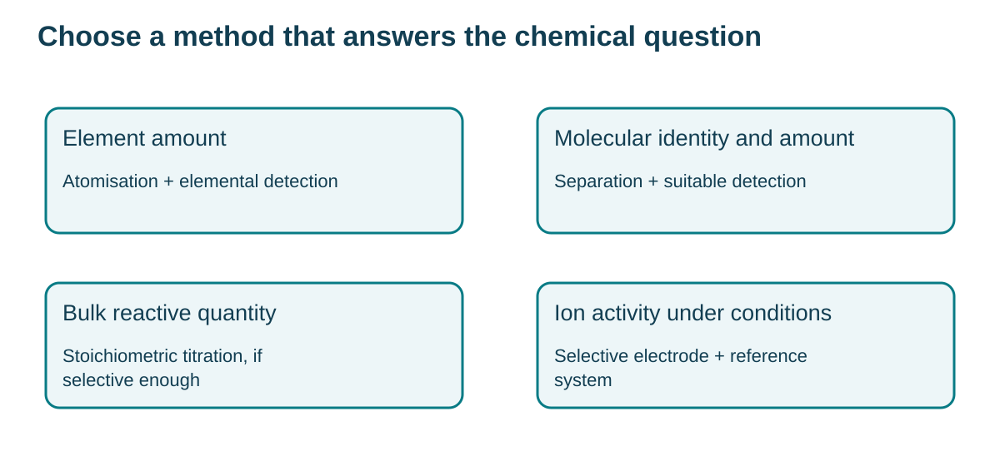
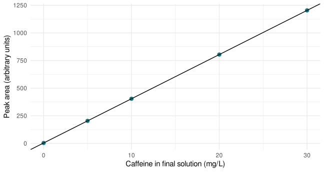
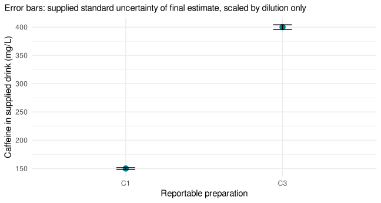
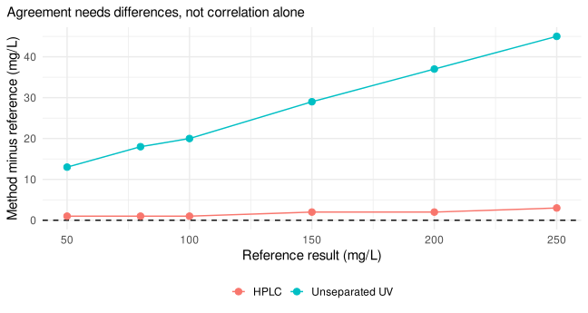
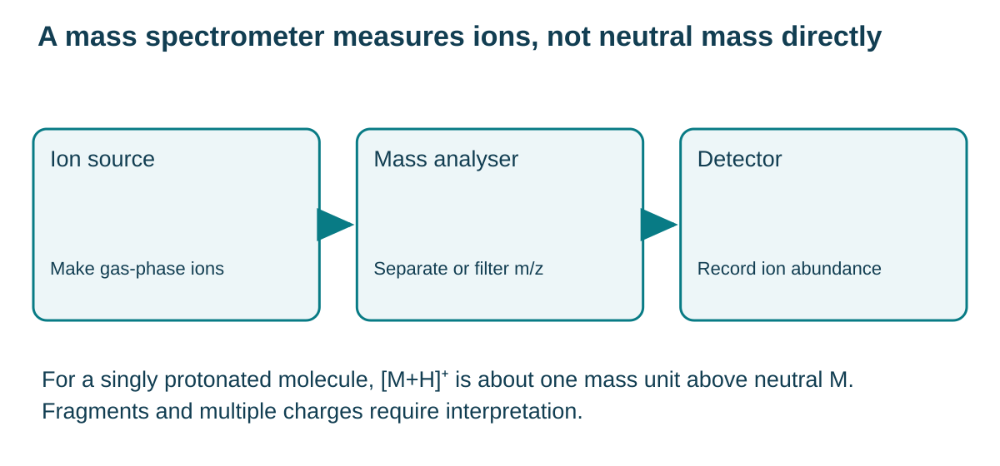
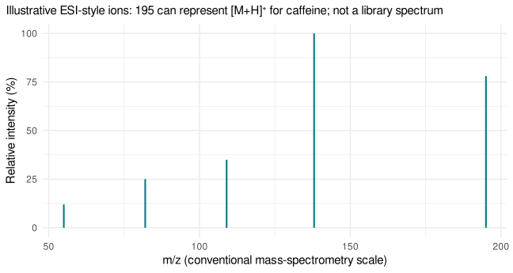

::: {.callout-note}
## Interactive experiment

[Explore the browser demo](../demos/defending-results.html): Which evidence allows a result, and when do you need a genuinely new measurement?
Predict first, change one condition, then explain the result. Export a CSV to
reproduce one calculation or plot in R.
:::


## Finish with the analytical argument

The final case provides new caffeine standards, sample responses, preparation
records and an independent check. You will choose which results can be
reported, identify the need for a new dilution or better separation, and write
a reproducible conclusion. Keep the analytical question in view: caffeine mass
concentration in each supplied beverage, not simply an area printed by software.

{fig-alt="The chemical quantity and sample constraints determine which type of method can answer the question."}

The case uses a supplied HPLC separation and UV response. The candidate peak
has supporting standard-retention evidence and explicit separation decisions.
The scenario assumes the accepted peaks represent caffeine. No instrument
method is claimed to be validated for every beverage. The file dictionary
records the assumptions behind the supplied flags and uncertainty inputs.

## Decide on the method before fitting data

An elemental method would destroy the molecular information needed to identify
caffeine. A nonspecific single-wavelength absorbance of a complex drink could
include several absorbing components. A suitable separation can make a detector
response more selective. Method choice involves the required range, matrix,
identity evidence, preparation recovery, uncertainty and available sample.
The most sensitive instrument can still answer the wrong measurand.

## Calibrate and check this independent dataset

```{r}
library(readr)
library(dplyr)
library(ggplot2)
standards <- read_csv("data/course/case-standards.csv", show_col_types = FALSE)
fit <- lm(area ~ caffeine_mg_l, data = standards)
a <- unname(coef(fit)[1])
b <- unname(coef(fit)[2])
qc <- read_csv("data/course/case-qc.csv", show_col_types = FALSE) |>
  mutate(estimated_mg_l = (area - a) / b,
         recovery_percent = 100 * estimated_mg_l / reference_mg_l,
         pass = recovery_percent >= acceptance_low &
                  recovery_percent <= acceptance_high)
qc
```

{fig-alt="The new case has its own calibration and range, separate from the earlier HPLC exercise."}

The case line is area = 4 + 40 × concentration, valid over 0–30 mg/L under the
supplied assumptions. The independent 15.00 mg/L check recovers about 100.67%,
within the supplied 95–105% exercise window. These standards are deliberately
idealised: their zero residual is not evidence of zero real measurement
uncertainty. The case supplies separate standard uncertainties for final
concentration estimates. Do not derive a perfect uncertainty from these rounded
teaching points.

## Make the decision before exporting a number

```{r}
samples <- read_csv("data/course/case-samples.csv", show_col_types = FALSE)
results <- samples |>
  mutate(final_estimate_mg_l = (area - a) / b,
         in_range = final_estimate_mg_l >= 0 & final_estimate_mg_l <= 30,
         reportable = in_range & resolved & qc_pass & all(qc$pass),
         dilution_factor = final_ml / aliquot_ml,
         original_mg_l = if_else(reportable,
                                 final_estimate_mg_l * dilution_factor, NA_real_),
         u_original_mg_l = if_else(reportable,
           u_final_concentration_mg_l * dilution_factor, NA_real_),
         decision = case_when(!qc_pass | !all(qc$pass) ~ "withhold: QC",
                              !resolved ~ "withhold: coelution",
                              !in_range ~ "remeasure: outside range",
                              TRUE ~ "conditional result"))
results |> select(preparation_id, sample_id, original_mg_l, u_original_mg_l, decision)
write_csv(results, "output/final-case-results.csv", na = "NA")
```

C1 gives 15 mg/L in the final solution and 150 mg/L in drink A. C2 exceeds range
and cannot establish drink B's concentration. C3 is a **new preparation** of
B using 2.00 mL made to 50.00 mL, rather than C2's 5.00 mL. Its valid final
estimate is 16 mg/L, yielding 400 mg/L original. C4 has an unresolved interfering
peak and no reportable caffeine concentration despite passing range and QC.

{fig-alt="Supported preparations have concentrations and scaled standard uncertainties; withheld ones do not appear as zero."}

C1's supplied final-concentration standard uncertainty is 0.15 mg/L and C3's
is 0.16 mg/L. Scaling by dilution gives 1.5 and 4.0 mg/L respectively. This is a
**limited budget**, neglecting volumes, sampling and preparation recovery.
The error bars are standard uncertainties, not 95% confidence intervals.
Identify what would need to be established before claiming the full method's
uncertainty is fit for the intended decision.

## Agreement is not the same as association

The comparison dataset measures six separate reference samples by HPLC and a
nonspecific unseparated UV method. Both methods increase with reference
concentration, but their differences tell different stories.

```{r}
comparison <- read_csv("data/course/method-comparison.csv", show_col_types = FALSE) |>
  mutate(hplc_difference = hplc_mg_l - reference_mg_l,
         uv_difference = nonspecific_uv_mg_l - reference_mg_l)
ggplot(comparison, aes(reference_mg_l, uv_difference)) +
  geom_hline(yintercept = 0, linetype = "dashed") + geom_point() +
  labs(x = "Reference result (mg/L)", y = "Unseparated UV minus reference (mg/L)") +
  theme_minimal()
```

{fig-alt="The nonspecific method's positive discrepancy grows with concentration, whereas the HPLC discrepancy is much smaller."}

A high correlation would not establish interchangeability or acceptable bias.
The pattern may motivate matrix/selectivity investigations; the plot alone does
not prove the chemical cause. Reference uncertainty, sample scope and the
required performance must be considered before accepting a method comparison.

## Where mass spectrometry adds evidence

{fig-alt="An ion source creates ions; a mass analyser separates or filters m/z; a detector records abundance."}

A mass spectrometer measures ions by mass-to-charge, not neutral molecular mass
directly. In positive electrospray a singly protonated caffeine ion can occur
near $m/z$ 195, whereas neutral caffeine has nominal mass 194. Multiple charges,
adducts and fragments change the interpretation. Chromatography-MS combines a
retention dimension with ion information, but an ion signal still needs a
suitable calibration for quantification.
[Waters guide to ionisation and mass-to-charge](https://help.waters.com/content/dam/waters/fr/support/usermanuals/2003/USRM1853027/platform_lc_guide_issue2.pdf)

{fig-alt="An illustrative ion spectrum is a teaching pattern, not an authentic library match for caffeine."}

Do not identify a molecule from a single nominal mass or from this deliberately
illustrative spectrum. Authentic reference spectra, exact-mass or fragmentation
evidence where appropriate, blanks and suitable standards can strengthen an
identity claim. More instrument detail is optional here: the core task is to
understand which evidence addresses identity and which addresses amount.

## Your final report

Use the supplied `course-report.Rmd` template at the project root. Include the
measurand and sample scope; preparation factors; calibration direction and range;
QC results; a table of supported results and explicit withheld reasons; standard
uncertainty with its omissions; and a conclusion explaining the next action
for each unresolved sample. Explain what evidence supports caffeine identity.

Render after restarting R. Ask a peer to render from the original data in a new
folder. A reader should be able to follow a reported number back to the signal,
preparation record and chemical assumption. Do not replace the chemical
interpretation with a pasted R summary.

For a new accepted sample with area 804 and a 4.00 mL aliquot made to 40.00 mL,
calculate original concentration. Then explain what changes if its integration
window contains an unresolved second absorbing compound.

::: {.callout-tip collapse="true"}
## Check your result and next action

Final concentration is $(804-4)/40=20$ mg/L and the factor is 10, giving
**200 mg/L original**, conditional on the stated method and accepted evidence.
With an unresolved contributing compound, that area no longer supports the
same caffeine estimate. Improve separation or obtain justified additional
selective evidence before reporting it.
:::


Selected Harris and Lucy reading: **integration and selected mass spectrometry**. Read by topic; the planned course edition is not yet confirmed.

[Slides](../slides/defending-results.qmd) · [Course project](../downloads/analyticalchem-project.zip) · [R reference](../reference/r.qmd)

[Previous: GC and HPLC](gc-hplc.qmd)
