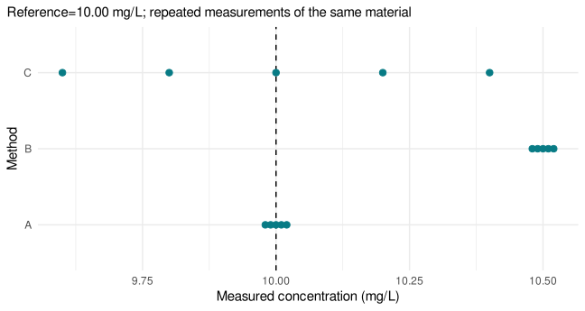
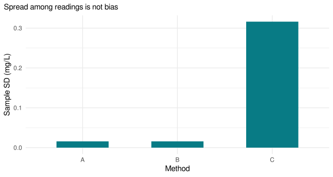
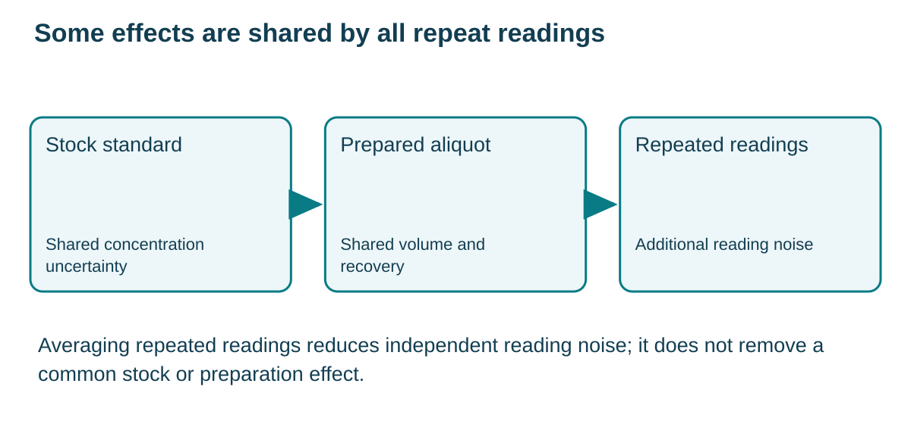
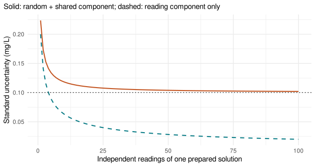
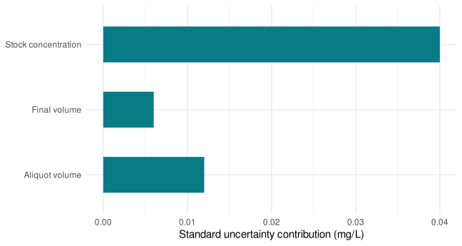

::: {.callout-note}
## Interactive experiment

[Explore the browser demo](../demos/error-uncertainty.html): Which uncertainty decreases with averaging, and which effects remain shared?
Predict first, change one condition, then explain the result. Export a CSV to
reproduce one calculation or plot in R.
:::


## Reproducible is not necessarily close to the reference

Three methods repeatedly measure the same reference material at 10.00 mg/L.
You will compare their bias and spread, then propagate uncertainty through a
dilution. The goal is to explain what improves when readings are repeated and
what remains shared by all readings.

**Precision** concerns closeness among repeated measurements under specified
conditions. **Bias** is a systematic departure estimated against a suitable
reference. **Measurement uncertainty** expresses doubt about a result under
its measurement model. It is not the difference from a secretly known true
value. An uncertainty budget needs the relevant sources, including sources not
visible in a short set of repeat readings.

{fig-alt="Method B is precise but displaced from the reference; method C is more dispersed."}

```{r}
library(readr)
library(dplyr)
library(ggplot2)
measurements <- read_csv("data/course/precision.csv", show_col_types = FALSE)
summary_precision <- measurements |>
  group_by(method) |>
  summarise(n = n(), mean_mg_l = mean(measured_mg_l),
            sd_mg_l = sd(measured_mg_l),
            u_mean_mg_l = sd_mg_l / sqrt(n),
            bias_mg_l = mean_mg_l - first(reference_mg_l),
            .groups = "drop")
summary_precision
```

A and B both have SD about 0.0158 mg/L, but B's mean is 10.50 mg/L: its estimated
bias is +0.50 mg/L. C has mean 10.00 mg/L but SD about 0.316 mg/L. A mean close
to the reference in one small series does not prove the method is unbiased in
all matrices. Here reference uncertainty is neglected for the comparison;
real bias evaluation must include it.

{fig-alt="The same small SD for A and B does not reveal B's bias."}

## Which uncertainty does dividing by square root of n estimate?

For independent readings of one stable prepared solution, $s/\sqrt n$ estimates
the reading contribution to uncertainty in their mean. It does not describe
the spread among future individual readings, nor does it reduce a shared
standard-concentration error or lost analyte. Independence and the quantity
being averaged matter more than the availability of `sqrt()`.

{fig-alt="Stock concentration and preparation effects are shared by repeat readings."}

If reading uncertainty is $0.20/\sqrt n$ mg/L and another independent shared
component is 0.10 mg/L, the combined standard uncertainty is
$\sqrt{0.20^2/n+0.10^2}$. More readings approach a floor of 0.10 mg/L, not zero.
This is an illustrative model; the numbers are not estimated from the earlier
reference-material table.

{fig-alt="Repeating readings reduces the dashed reading contribution but not the shared component in the solid curve."}

## Propagate a transparent dilution model

A stock concentration is 100.0 mg/L with standard uncertainty 0.4 mg/L.
A 5.000 mL aliquot has standard uncertainty 0.006 mL; final volume 50.00 mL
has standard uncertainty 0.03 mL. Treat the three inputs as independent for
this example. The model is $c=c_sV_a/V_f$, giving 10.00 mg/L.

For small independent uncertainties, add squared contributions:

$$u(c)=c\sqrt{\left(\frac{u(c_s)}{c_s}\right)^2+
\left(\frac{u(V_a)}{V_a}\right)^2+
\left(\frac{u(V_f)}{V_f}\right)^2}$$

The sign of a derivative matters when covariances are present; in this independent
example its squared contribution is positive. Two volumes from a shared
calibration or common temperature effect need not be independent. The formula
is conditional on the model, not a licence to ignore correlations.

```{r}
c_stock <- 100
u_stock <- 0.4
v_aliquot <- 5
u_aliquot <- 0.006
v_final <- 50
u_final <- 0.03
c_final <- c_stock * v_aliquot / v_final
contributions <- c(stock = c_final * u_stock / c_stock,
                   aliquot = c_final * u_aliquot / v_aliquot,
                   final = c_final * u_final / v_final)
u_c <- sqrt(sum(contributions^2))
c(concentration_mg_l = c_final, standard_uncertainty_mg_l = u_c)
```

{fig-alt="The stock concentration dominates this particular dilution budget."}

The contributions are 0.040, 0.012 and 0.006 mg/L. Combined $u(c)=0.04219$ mg/L.
If improvement is needed, reducing the dominant stock uncertainty is more
promising than taking more readings of the already prepared solution.
[Eurachem uncertainty guidance](https://www.eurachem.org/index.php/tskmu)

## State what your interval means

A standard uncertainty is expressed on an SD-like scale. An expanded uncertainty
is $U=ku$ with a stated coverage factor and justification. A confidence interval
for an estimated mean is another construction, using its sampling model. Do not
call every “±” number a 95% interval.

For a normal mean based on independent readings, an appropriate t interval uses
$\bar x\pm t_{0.975,n-1}s/\sqrt n$. For the small dilution budget above, simply
multiplying by 2 may be a useful approximate expanded uncertainty under further
conditions, but those conditions and the intended coverage must be stated.
A known significant bias is investigated or corrected with appropriate
uncertainty; adding an arbitrary error bar does not correct it.

Keep unrounded quantities in code. A concise reported dilution result could be
10.000 mg/L with standard uncertainty 0.042 mg/L under the stated independent-
input model. The reporting precision should match the uncertainty and purpose,
not the maximum digits printed by R.

## Practical and transfer

Save the method summaries, dilution inputs and uncertainty contributions in
`output/`. Report one example of good repeatability with bias, and explain why
the dilution model is incomplete for an extracted environmental sample.

```{r}
write_csv(summary_precision, "output/precision-summary.csv")
write_csv(data.frame(source = names(contributions),
                     u_mg_l = as.numeric(contributions)),
          "output/dilution-budget.csv")
```

For a new stock with the same concentration but standard uncertainty 0.2 mg/L,
recompute the combined uncertainty. Separately, calculate C's uncertainty in
its mean from its five readings. Explain why the two answers describe different
measurement processes.

::: {.callout-tip collapse="true"}
## Numerical checks

The improved stock gives $u(c)=\sqrt{0.020^2+0.012^2+0.006^2}$ = **0.02408 mg/L**.
Method C's reading contribution is **0.1414 mg/L**. Neither number incorporates
sampling, matrix recovery or an unknown common bias.
:::

Ask yourself: what quantity has SD 0.316 mg/L, what quantity has uncertainty
0.141 mg/L, and which effect would remain after infinitely many readings?


Selected Harris and Lucy reading: **3–4**. Read by topic; the planned course edition is not yet confirmed.

[Slides](../slides/error-uncertainty.qmd) · [Course project](../downloads/analyticalchem-project.zip) · [R reference](../reference/r.qmd)

[Previous: Sampling and preparation](sampling-preparation.qmd) · [Next: Calibration and quality control](calibration-qc.qmd)
