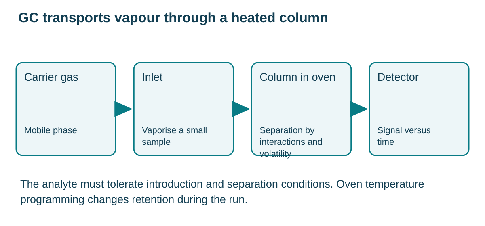
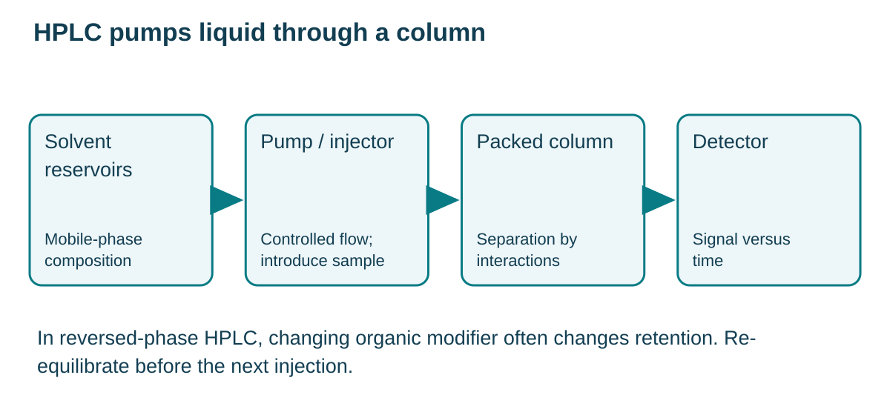
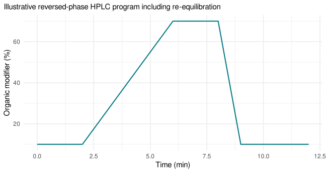
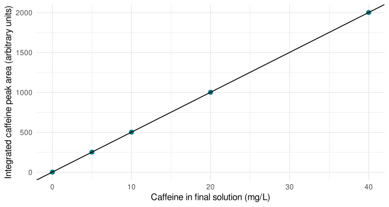
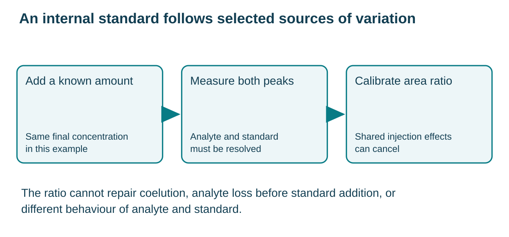
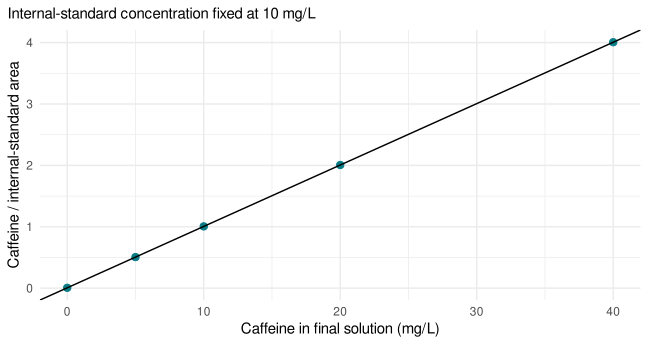
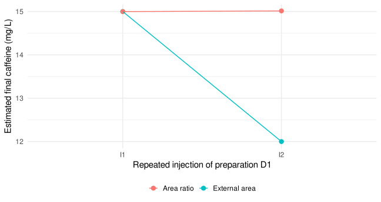

::: {.callout-note}
## Interactive experiment

[Explore the browser demo](../demos/gc-hplc.html): When does an internal-standard ratio cancel a shared error, and when does it fail?
Predict first, change one condition, then explain the result. Export a CSV to
reproduce one calculation or plot in R.
:::


## Choose how the analyte can enter and move

Gas chromatography carries a vapour in a gas; liquid chromatography carries
solute in a liquid. Both use differential interaction with a stationary phase,
then detect the arriving components. Method choice must account for sample
introduction, stability, selectivity, matrix and detection, not just whether a
column is available.

{fig-alt="Carrier gas moves a vaporised sample through an oven-controlled GC column to a detector."}

Conventional GC suits analytes that can enter the gas phase and tolerate the
relevant introduction and separation conditions. Headspace can introduce
volatile components above a complex sample; the entire matrix need not be
volatile. Temperature programming changes retention over a run. Stationary
phase chemistry also matters: boiling point alone does not define retention.
[Agilent introduction to headspace sampling](https://www.agilent.com/en/product/gas-chromatography/gc-sample-preparation-introduction/what-is-headspace)

{fig-alt="HPLC pumps a controlled liquid mobile phase through an injected sample and packed column."}

HPLC can accommodate many analytes unsuited to ordinary GC, provided they are
soluble and stable under the chosen conditions. In reversed-phase HPLC a
relatively nonpolar stationary phase interacts with solutes in a more polar
mobile phase. Increasing organic modifier often reduces retention of suitably
retained compounds, but ionisation, solvent choice and analyte chemistry affect
the actual behaviour.

## A program belongs to a complete method

An isocratic LC run keeps mobile-phase composition fixed. A gradient changes
composition during the run. The supplied illustrative program begins at 10%
organic, rises to 70%, holds, then returns to 10% and re-equilibrates before
the next injection. It is not a validated caffeine method or a pump setup
instruction.

{fig-alt="The illustrative gradient includes a return to initial conditions and time for re-equilibration."}

Flow, column, temperature, injection solvent and detector settings also belong
to the method. Changing them can alter retention or response. A retention-time
comparison made under a different method is not a controlled identification
comparison.

A flame-ionisation detector measures an ion-current response useful for many
organic compounds in GC. A UV detector measures absorbance for compounds that
absorb at the chosen wavelength. MS records ions separated by mass-to-charge.
These responses differ in selectivity and response factors. A chromatographic
area is not a universal count of molecules.

## Calibrate integrated caffeine peak area

The simulated HPLC standards have known caffeine concentration in the final
solution. Peak areas are supplied from integration, not calculated by counting
CSV rows. Assume adequate separation, an appropriate baseline, and a linear
response over 0–40 mg/L for this example.

```{r}
library(readr)
library(dplyr)
library(ggplot2)
standards <- read_csv("data/course/hplc-standards.csv", show_col_types = FALSE)
fit_external <- lm(caffeine_area ~ caffeine_mg_l, data = standards)
coef(fit_external)
```

{fig-alt="External calibration relates integrated caffeine area to final-solution concentration."}

The fitted relationship is area = 3 + 50 × concentration. Area depends on the
introduced analyte amount and detector response. If an injection introduces
less of the same solution, an external-area calibration can give a different
estimated concentration even though the vial concentration did not change.

## Use an internal standard for a specific shared effect

An internal standard is a distinguishable compound added in known amount. In
this exercise every final standard and sample has 10 mg/L internal standard.
Assume resolved peaks and sufficiently similar responses to a shared injection
variation. Calibrate the analyte/internal-standard **area ratio** against
analyte concentration under that fixed internal-standard concentration.

{fig-alt="The standard and analyte share selected measurement steps; the calibrated ratio can cancel common variation."}

```{r}
standards <- standards |>
  mutate(area_ratio = caffeine_area / internal_standard_area)
fit_ratio <- lm(area_ratio ~ caffeine_mg_l, data = standards)
injections <- read_csv("data/course/hplc-injections.csv", show_col_types = FALSE) |>
  mutate(area_ratio = caffeine_area / internal_standard_area,
         final_external_mg_l = (caffeine_area - coef(fit_external)[1]) /
                                 coef(fit_external)[2],
         final_ratio_mg_l = (area_ratio - coef(fit_ratio)[1]) /
                              coef(fit_ratio)[2])
injections |> select(injection_id, preparation_id, final_external_mg_l,
                      final_ratio_mg_l)
```

{fig-alt="Area-ratio calibration requires matched internal-standard concentration and a retained intercept."}

I1 and I2 are repeated injections of D1. External-area estimates are 15.00 and
12.00 mg/L. Area-ratio estimates are 15.000 and 15.015 mg/L: a shared injection
effect has mostly cancelled. The small difference remains because the simulated
signals include a response offset. This is useful compensation, not exact
invariance under every error.

{fig-alt="Two injections of the same preparation agree much better after the matched ratio correction."}

An internal standard cannot repair analyte extraction loss that occurred before
it was added. It also cannot resolve overlapping peaks or cancel an effect that
changes analyte and standard differently. If its concentration differs between
standards and samples, this simple ratio-versus-concentration calibration needs
a different concentration-ratio model. [Manufacturer discussion of calibration approaches](https://www.mt.com/no/no/home/library/applications/laboratory-weighing/hplc.html)

## Guard results with separation, QC and range evidence

```{r}
results <- injections |>
  mutate(in_range = final_ratio_mg_l >= 0 & final_ratio_mg_l <= 40,
         reportable = resolved & qc_pass & in_range,
         original_mg_l = if_else(reportable,
                                 final_ratio_mg_l * dilution_factor, NA_real_))
results |> select(injection_id, preparation_id, original_mg_l, reportable)
write_csv(results, "output/hplc-results.csv", na = "NA")
```

The accepted D1 preparation gives about 150 mg/L in the supplied drink after
its tenfold dilution. I3's candidate caffeine peak is not resolved; I4 belongs
to a failed QC condition. Both have withheld concentration results despite
algebraically calculable ratios. The supplied flags represent decisions from
the exercise's separation and QC evidence; in real work they must come from
records, not convenient booleans assigned after seeing an answer.

## Practical and transfer

Compare GC and HPLC for a volatile solvent mixture and an aqueous mixture of
nonvolatile, heat-sensitive compounds. Explain how matrix and detector choice
could change your answer. Report external and internal-standard estimates for
D1, while distinguishing a repeated injection from a new preparation.

For transfer, a new accepted injection has caffeine area 903, internal-standard
area 600, internal-standard concentration 10 mg/L and dilution factor 5. Use
the fitted ratio model to estimate the original concentration. Would you use
that answer if its caffeine peak overlapped a matrix peak?

::: {.callout-tip collapse="true"}
## Numerical and decision checks

The ratio is 1.505 and the fitted ratio relation is
$R=0.006+0.100c$. Final caffeine is 14.99 mg/L, giving **74.95 mg/L original**.
An unresolved contributing matrix peak invalidates that simple analyte-area
interpretation; the ratio is not a cure for coelution.
:::


Selected Harris and Lucy reading: **gas and liquid chromatography**. Read by topic; the planned course edition is not yet confirmed.

[Slides](../slides/gc-hplc.qmd) · [Course project](../downloads/analyticalchem-project.zip) · [R reference](../reference/r.qmd)

[Previous: Separation principles](separations.qmd) · [Next: Choosing and defending a result](defending-results.qmd)
