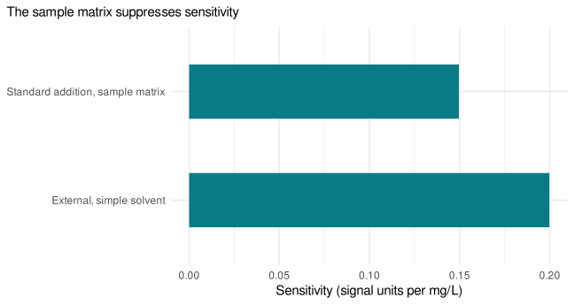
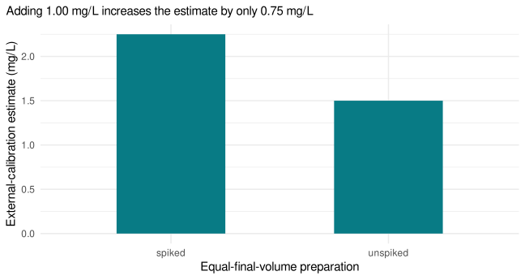
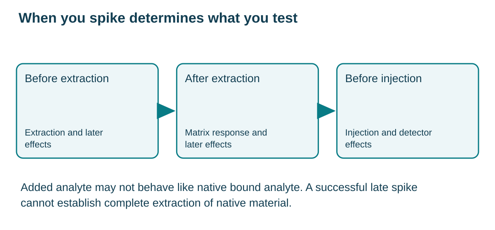
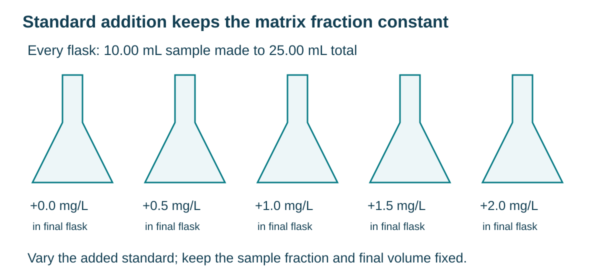
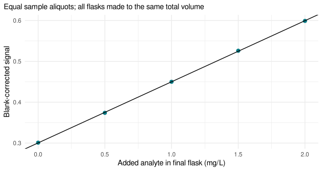
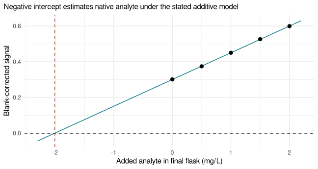

::: {.callout-note}
## Interactive experiment

[Explore the browser demo](../demos/matrix-recovery.html): Which matrix effects can standard addition address, and which can bias its intercept?
Predict first, change one condition, then explain the result. Export a CSV to
reproduce one calculation or plot in R.
:::


## Why did a plausible result come out low?

External standards in a simple solvent give one response per unit analyte.
The same analyte in a sample matrix can give a different response. A good
straight line in the standards does not prove the calibration transfers to
the sample. Here you will compare sensitivities, calculate spike recovery,
and use a fixed-volume standard-addition model.

The simulated assay measures a dissolved analyte after matched preparation.
All signals in this unit are **already background corrected**. Equal sample
aliquots are made to equal final volumes. Those definitions are necessary for
the intercept calculation below.

{fig-alt="External standards and the sample matrix give different response sensitivities."}

A **multiplicative** matrix effect changes sensitivity. An **additive**
interference contributes signal not proportional to the analyte being added.
Standard addition can compensate for some multiplicative effects under suitable
conditions. It cannot automatically distinguish native analyte signal from an
unrelated additive signal.

## Use a spike to ask a limited question

Suppose two otherwise matched final solutions contain the same sample fraction.
The second includes an extra 1.00 mg/L analyte in its final volume. External
calibration estimates 1.50 mg/L for the first and 2.25 mg/L for the second.

$$\mathrm{recovery}(\%)=100\,
\frac{c_{spiked,estimated}-c_{unspiked,estimated}}{c_{added}}$$

```{r}
library(readr)
library(dplyr)
library(ggplot2)
spikes <- read_csv("data/course/spike-recovery.csv", show_col_types = FALSE)
recovery_percent <- 100 * diff(spikes$externally_estimated_mg_l_final) /
                          diff(spikes$added_mg_l_final)
recovery_percent
```

{fig-alt="Adding 1.00 mg/L increases the external-calibration estimate by only 0.75 mg/L."}

The incremental recovery is 75%. These two records have explicitly ordered
unspiked/spiked roles and equal final volume; a general dataset should be matched
by its preparation identifiers and roles, not arbitrary row order. No universal
acceptance window is assumed here. This result flags a response problem under
the example conditions.

{fig-alt="A spike before extraction probes different losses from a spike added immediately before injection."}

A late spike does not pass through earlier extraction losses. A freely dissolved
spike may also differ from native bound analyte. State what the spike tested,
when it was added and what chemical equivalence you assume.

## Construct standard additions with fixed sample fraction

Each flask receives 10.00 mL of the same sample and is made to 25.00 mL total.
Added standard is expressed as mg/L **in that final flask**. Thus the native
sample concentration in every flask is $c_s(10/25)$.

{fig-alt="Equal sample aliquots and equal final volumes keep the sample matrix fraction fixed across additions."}

For an additive linear response with sensitivity $b$ and correctly removed
background,

$$y=b\left(c_s\frac{V_s}{V_f}+c_{added,final}\right)$$

Fitting $y=a+b c_{added,final}$ gives negative x-intercept $-a/b$.
Its magnitude estimates the native concentration **after the sample's dilution
into the flask**. Recover the original concentration by multiplying by $V_f/V_s$.
[IUPAC standard-addition terminology](https://doi.org/10.1351/goldbook.08030)

```{r}
additions <- read_csv("data/course/standard-addition.csv", show_col_types = FALSE)
fit_sa <- lm(blank_corrected_signal ~ spike_mg_l_final, data = additions)
a_sa <- unname(coef(fit_sa)[1])
b_sa <- unname(coef(fit_sa)[2])
x_intercept <- -a_sa / b_sa
original_mg_l <- -x_intercept * 25.00 / 10.00
c(x_intercept_mg_l_final = x_intercept, original_mg_l = original_mg_l)
```

{fig-alt="Measured additions give a line whose intercept depends on the native analyte already present."}

The fitted intercept is 0.3004, slope 0.1496, and x-intercept about −2.0080 mg/L.
The original concentration is therefore **5.020 mg/L**. It is a conditional
point estimate; neither the intercept nor the dilution volumes are exact.

{fig-alt="The negative intercept is a model-based extrapolation specific to the standard-addition design."}

We do not physically prepare negative analyte. Extrapolation is justified only
through this specified signal model and design. Curvature, changing matrix
fraction, poor background correction or different behaviour of added and native
analyte can invalidate it. Ordinary unknowns beyond an external-calibration
range still need new measurements; this design is a different inference problem.

## Compare the external-calibration answer

```{r}
external <- read_csv("data/course/external-matrix.csv", show_col_types = FALSE)
fit_ext <- lm(blank_corrected_signal ~ c_mg_l, data = external)
external_final <- (additions$blank_corrected_signal[1] - coef(fit_ext)[1]) /
                    coef(fit_ext)[2]
external_original <- unname(external_final) * 25 / 10
external_original
write_csv(data.frame(standard_addition_mg_l = original_mg_l,
                     external_calibration_mg_l = external_original,
                     incremental_spike_recovery_percent = recovery_percent),
          "output/matrix-comparison.csv")
```

The external estimate is about 3.761 mg/L. The lower matrix sensitivity explains
its low result under the simulation model. This is not a reason to divide every
unknown by a single recovery factor: samples can have different matrices, and
an observed failure need not have the assumed cause.

## Practical and transfer

Report both calibration answers, the spike calculation, standard-addition plot,
negative-intercept interpretation and dilution correction. Explain why the
background assumption matters and list one failure that standard addition would
not solve. For this introductory unit, retain the point-estimate status and
identify the uncertain intercept/slope and volumes; do not call the fitted
intercept's response interval a concentration interval.

For a new fixed-volume design, 5.00 mL sample is made to 20.00 mL total in every
flask. The line is $y=0.240+0.120 c_{added,final}$. Calculate the original
concentration. What if all flasks instead received different final volumes
without a volume correction?

::: {.callout-tip collapse="true"}
## Numerical and design checks

$x_0=-2.00$ mg/L; original concentration is **8.00 mg/L**. Different final
volumes change native concentration and matrix fraction, so the simple
fixed-volume intercept formula no longer applies directly.
:::


Selected Harris and Lucy reading: **calibration and spectrophotometric applications**. Read by topic; the planned course edition is not yet confirmed.

[Slides](../slides/matrix-recovery.qmd) · [Course project](../downloads/analyticalchem-project.zip) · [R reference](../reference/r.qmd)

[Previous: UV and visible absorption](uv-visible.qmd) · [Next: Atomic measurements](atomic-methods.qmd)
