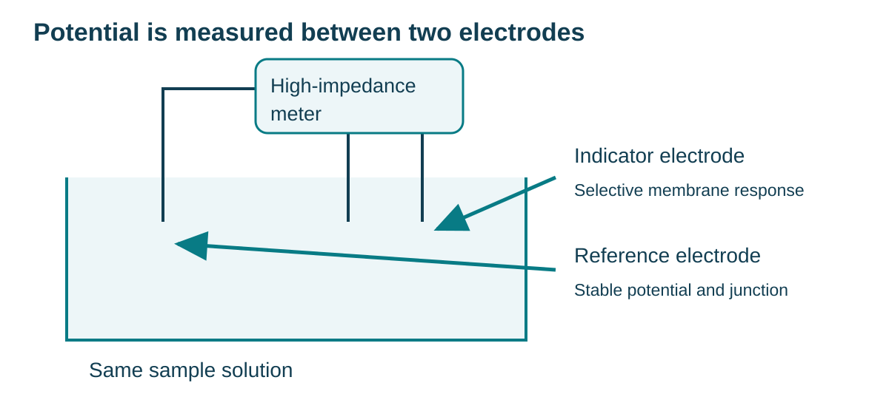
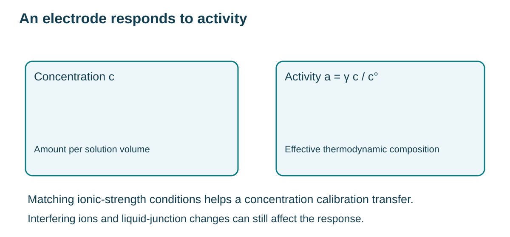
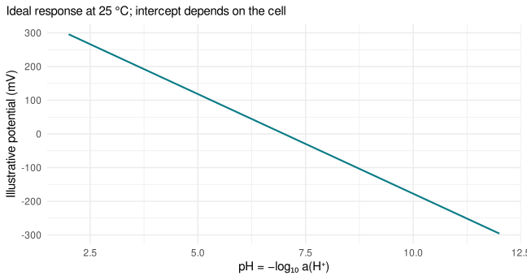
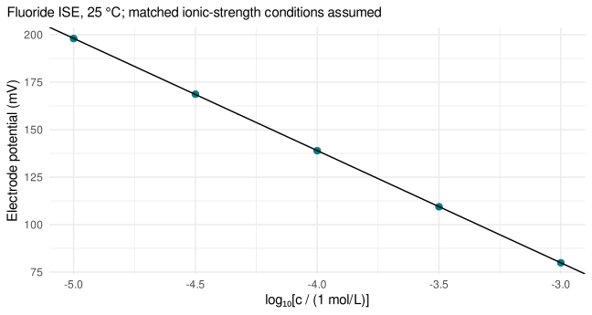
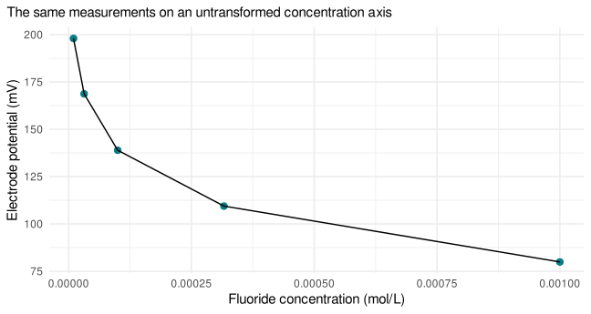
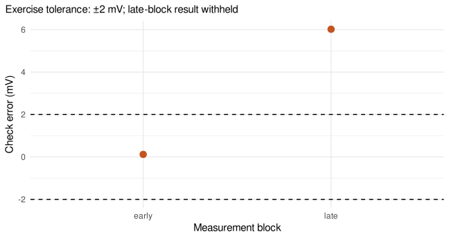

::: {.callout-note}
## Interactive experiment

[Explore the browser demo](../demos/potentiometry.html): Can a reference check pass while sample-specific activity still biases the concentration?
Predict first, change one condition, then explain the result. Export a CSV to
reproduce one calculation or plot in R.
:::


## A voltage depends on the complete cell

A potentiometric measurement compares an indicator electrode with a reference
electrode using a high-input-impedance meter. The useful analytical response is
a potential difference at negligible net measurement current. A combined pH
electrode packages both functions together; it does not eliminate the reference.
You will fit a log-concentration calibration, invert it, and use an independent
check to detect a later drift.

{fig-alt="An indicator and reference electrode contact the sample and connect to a high-impedance meter."}

The indicator membrane responds preferentially to a chemical species. The
reference provides a comparatively stable potential and contacts the sample
through a junction. Membrane state, junction conditions, temperature and
interfering ions can affect the measured voltage. A number in mV is not a
concentration until a suitable relation and calibration are established.

## Activity explains why matching conditions matters

For an ideal ion-selective response,

$$E=K+\frac{2.303RT}{zF}\log_{10}a_i$$

Here $z$ is the signed ion charge and $a_i$ is dimensionless activity, related
to concentration by $a_i=\gamma_i c_i/c^\circ$. At 25 °C the ideal magnitude
for a monovalent ion is about 59.16 mV per decade. With this potential convention
an anion such as fluoride has a negative slope. Instrument polarity and cell
conventions should always be stated rather than guessed from a sign.
[HORIBA electrode principle](https://www.horiba.com/usa/water-quality/support/ion-cartridge/measurement-principle/)

{fig-alt="Activity depends on concentration and its activity coefficient; matched conditions support calibration transfer."}

A concentration calibration assumes the activity relationship is sufficiently
consistent between standards and samples. An ionic-strength adjustment can
help under a specified procedure; it does not make every interference disappear.
Do not equate free-ion response with total element concentration when complexes,
precipitation or different species are present.

For hydrogen ion, pH is $-\log_{10}a_{H^+}$. A one-unit increase means a tenfold
activity decrease. Calibrate a pH system with appropriate buffers at the
measurement temperature, and check performance across the required range.

{fig-alt="An ideal pH response is linear in pH, which is already a logarithmic activity quantity."}

## Fit the fluoride data in logarithmic coordinates

These standards have supplied fluoride concentrations in mol/L under matched
ionic-strength conditions at 25 °C. Their response is linear over the stated
$10^{-5}$–$10^{-3}$ mol/L range. That is a scenario assumption, not a universal
range for every fluoride electrode.

```{r}
library(readr)
library(dplyr)
library(ggplot2)
standards <- read_csv("data/course/electrode-standards.csv",
                      show_col_types = FALSE) |>
  mutate(log_c = log10(fluoride_mol_l))
fit <- lm(potential_mv ~ log_c, data = standards)
a <- unname(coef(fit)[1])
b <- unname(coef(fit)[2])
coef(fit)
ggplot(standards, aes(log_c, potential_mv)) +
  geom_point() + geom_abline(intercept = a, slope = b) +
  labs(x = "log10[c / (1 mol/L)]", y = "Potential (mV)") +
  theme_minimal()
```

{fig-alt="The fitted fluoride response has slope about −59.10 mV per concentration decade."}

`log10()` takes a logarithm, not a new unit conversion. Numerically we use the
value of concentration expressed in mol/L relative to 1 mol/L. If you change the
concentration unit without changing the calibration intercept, the inverse
estimate will be wrong. Zero and negative concentrations have no finite
logarithm; they cannot be used as ordinary log-calibration points.

{fig-alt="The same standards do not form a straight line on an untransformed concentration axis."}

## Undo the logarithm after inversion

The fitted model is $E=a+b\log_{10}[c/(1\,\mathrm{mol/L})]$. First calculate
$(E-a)/b$, then raise 10 to that power. For a 121.2 mV measurement in the accepted
early block, the estimate is about $2.00\times10^{-4}$ mol/L.

```{r}
unknown_mv <- 121.2
unknown_mol_l <- 10^((unknown_mv - a) / b)
in_range <- unknown_mol_l >= min(standards$fluoride_mol_l) &
            unknown_mol_l <= max(standards$fluoride_mol_l)
c(unknown_mol_l = unknown_mol_l, in_range = in_range)
```

A tenfold change is about 59 mV here; a twofold change is about 17.8 mV.
Voltage uncertainty maps multiplicatively to concentration. Symmetric voltage
limits generally become asymmetric concentration limits after exponentiation.
Do not attach a voltage SD directly to a concentration result.

## A late check detects drift

The check material is $1.00\times10^{-4}$ mol/L. A supplied exercise rule accepts
an absolute potential error no greater than 2.0 mV. This is a check rule for the
example, not a universal electrode specification.

```{r}
checks <- read_csv("data/course/electrode-checks.csv", show_col_types = FALSE) |>
  mutate(expected_mv = a + b * log10(check_fluoride_mol_l),
         error_mv = potential_mv - expected_mv,
         check_pass = abs(error_mv) <= allowed_abs_error_mv)
checks
write_csv(checks, "output/electrode-checks.csv")
```

{fig-alt="The early check differs by about 0.12 mV; the later check differs by about 6.02 mV and fails."}

Do not report the late sample from the earlier calibration after this failure.
Investigate electrode conditioning, reference/junction effects, temperature and
sample/standard conditions as appropriate; establish satisfactory calibration
and checks, then remeasure. A changed voltage alone does not identify which
cause occurred.

## Place other electrochemical methods

Potentiometry reads potential with negligible measurement current.
Amperometry reads current under specified potential conditions. Voltammetry
records current while varying potential, and coulometry measures charge.
Their signals therefore require different models. In coulometry the ideal
amount relationship $n=Q/(zF)$ also requires the intended reaction to account
for the charge. A current reading is not a pH measurement with a different unit.

## Practical and transfer

Save the calibration coefficients, early concentration and check table. Explain
the activity/concentration assumption, slope sign, inverse calculation and
reason for withholding the later result. Compare the same calibration on linear
and logarithmic concentration axes.

For transfer, decrease the accepted sample voltage by 17.8 mV using the fitted
line. Predict the concentration factor before calculating it. Is a result for
free fluoride necessarily total fluorine in a complex sample?

::: {.callout-tip collapse="true"}
## Check the result

The factor is $10^{-17.8/(-59.10)}\approx2.001$, so the estimate is about
$4.00\times10^{-4}$ mol/L. A free-ion-responsive procedure does not establish
total fluorine across all chemical forms.
:::


Selected Harris and Lucy reading: **selected electrochemistry and electrodes**. Read by topic; the planned course edition is not yet confirmed.

[Slides](../slides/potentiometry.qmd) · [Course project](../downloads/analyticalchem-project.zip) · [R reference](../reference/r.qmd)

[Previous: Equilibrium and titration](titration.qmd) · [Next: UV and visible absorption](uv-visible.qmd)
