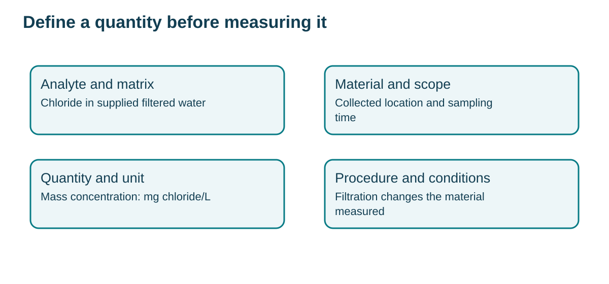
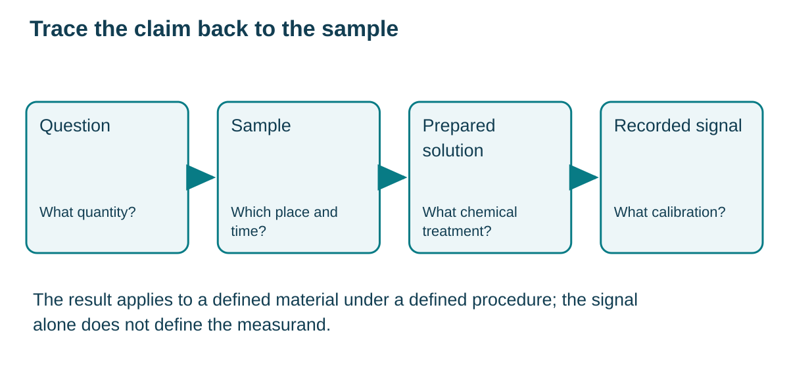
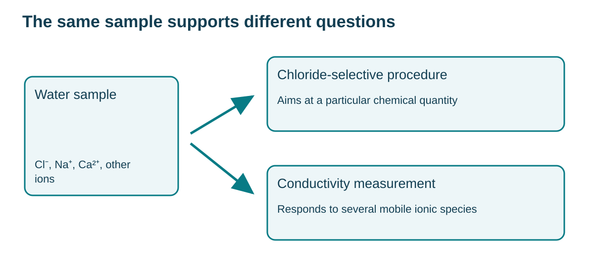
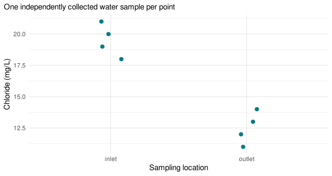
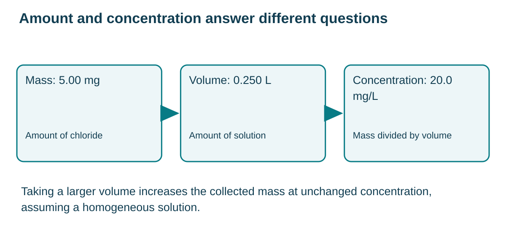
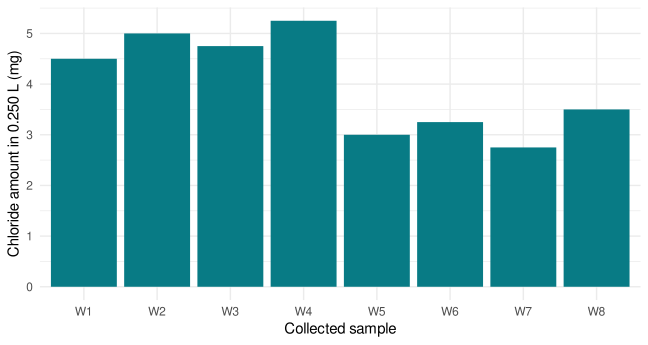

::: {.callout-note}
## Interactive experiment

[Explore the browser demo](../demos/sample-answer.html): Does changing the amount of solution change concentration, total analyte amount, or both?
Predict first, change one condition, then explain the result. Export a CSV to
reproduce one calculation or plot in R.
:::


## Start with a question that has a unit

A water sample gives a number on an instrument. What does that number represent?
Before choosing software, define the **measurand**: the quantity intended to be
measured. Here it is chloride mass concentration, in mg chloride/L, in water
collected at a named location and time. The analyte is chloride; the matrix is
water and everything else it contains. A response in volts or absorbance is a
signal, not yet that chemical quantity.

By the end, you should be able to state a measurand, distinguish concentration
from amount, inspect an analytical table in R, and make a restrained comparison
of collected samples.

{fig-alt="A measurement claim requires a defined sample, quantity, unit and procedure."}

“Total iron”, “dissolved iron” and “iron(II)” are different questions. A filter
changes the material entering a procedure; a reduction can change oxidation
state. A report needs enough preparation information to tell the reader what
was actually measured. More decimal places cannot repair an ambiguous question.

## Follow the analytical process

{fig-alt="Question, sample, prepared solution and recorded signal form a traceable chain."}

A useful sequence is: define the question; obtain material that represents it;
prepare a known part; obtain a selective enough signal; calibrate and check the
measurement; calculate back to the original material; state uncertainty and
limitations. R makes the calculations reproducible. It cannot restore analyte
lost during storage or establish selectivity from a spreadsheet column name.

A **qualitative** question asks whether evidence supports the presence or
identity of a substance. A **quantitative** question asks how much. A matching
retention time is evidence of identity under the stated conditions, but another
compound can share it. Quantification requires the intended analyte to account
for the measured response well enough for the question.

{fig-alt="Conductivity and a chloride-selective procedure respond to different properties of the same water."}

For example, conductivity responds to several mobile ionic species. A low
conductivity reading is not automatically a low chloride concentration.
Choose a procedure whose response can be related to the proposed measurand.

## Retrieve the R workflow

Download the course project from the link below, extract it, and open
`analyticalchem.Rproj`. Run R in the R console. Files in `data/` are untouched
inputs; save derived results in `output/`. All datasets in this course are
**simulated teaching data**. Read `data/course/README.md` for their chemical
assumptions and column definitions.

```{r}
library(readr)
library(dplyr)
library(ggplot2)
water <- read_csv("data/course/water.csv", show_col_types = FALSE)
glimpse(water)
stopifnot(!anyDuplicated(water$sample_id),
          all(water$collected_l > 0), !anyNA(water$chloride_mg_l))
```

One row is one independently collected sample. The four inlet and four outlet
samples are not matched pairs. Their row order does not establish a before/after
design. Check IDs, units, missing values and the meaning of a row before doing
statistics. This supplied table is complete; a missing measurement in another
table must not silently become zero.

```{r}
summary_water <- water |>
  group_by(location) |>
  summarise(n_samples = n(), mean_mg_l = mean(chloride_mg_l),
            sd_mg_l = sd(chloride_mg_l), .groups = "drop")
summary_water

ggplot(water, aes(location, chloride_mg_l)) +
  geom_point(position = position_jitter(width = 0.08, height = 0, seed = 7)) +
  labs(x = "Sampling location", y = "Chloride (mg/L)") +
  theme_minimal()
```

{fig-alt="Individual collected samples show the location difference and the spread within each location."}

The means are 19.5 and 12.5 mg/L. That is a **7.0 mg/L descriptive difference**
for these collected samples. The design does not establish a treatment effect
or represent every time of day. Start with the individual observations, units,
and sampling scope. There is no need to add a hypothesis test to every table.

## Convert units without changing the quantity

For a homogeneous solution, mass concentration $c=m/V$, so mass $m=cV$.
A 0.250 L portion at 20.0 mg/L contains 5.00 mg analyte. Taking twice the volume
at the same concentration doubles the collected amount, not the concentration.

{fig-alt="Five milligrams in a quarter litre corresponds to twenty milligrams per litre."}

```{r}
water <- water |>
  mutate(chloride_g_l = chloride_mg_l / 1000,
         chloride_mg = chloride_mg_l * collected_l)
water |> select(sample_id, chloride_mg_l, chloride_g_l, chloride_mg)
write_csv(water, "output/water-derived.csv")
```

Keep the unit in the variable name or dictionary, and in every plotted axis.
Here 20 mg/L = 0.020 g/L. Converting mg to g without also changing the reported
unit would give a thousand-fold error. Do not label every concentration “ppm”:
mg/L is a mass-per-volume quantity, whereas a mass fraction needs a mass basis.
For dilute water they can sometimes be approximately related using density,
but they are not definitions of the same quantity.

{fig-alt="Each quarter-litre collected sample contains a calculated amount of chloride."}

## Practical and transfer

Create `course-report.Rmd` at the project root from the supplied template.
State the measurand and what one row represents. Include the individual-point
plot, a location summary with sample counts, one unit conversion, and a paragraph
about what the design supports. Save your table and render the report after
restarting R.

For a separate unknown, the analysis establishes 0.0750 mg chloride in a
25.00 mL portion. Calculate mg/L. Then state which extra information would be
needed to claim a location-wide mean or an uncertainty for the result.

::: {.callout-tip collapse="true"}
## Check your result

$0.0750/0.02500=3.00$ mg/L. The arithmetic alone supplies neither representative
sampling nor an uncertainty estimate. For the supplied water table the inlet
mean is 19.5 mg/L and outlet mean 12.5 mg/L; both use four collected samples.
:::

## Explain before moving on

- Why does filtering a sample matter to the measurand? It changes the material
  analysed; retained particles do not enter the filtered-water result.
- Why plot observations before comparing means? It exposes spread, unusual
  values and how much evidence supports the summary.
- Could a perfectly reproducible report have a wrong result? Yes: a wrong
  unit, inappropriate method or unrepresentative sample can be reproduced too.


Selected Harris and Lucy reading: **0–2**. Read by topic; the planned course edition is not yet confirmed.

[Slides](../slides/sample-answer.qmd) · [Course project](../downloads/analyticalchem-project.zip) · [R reference](../reference/r.qmd)

[Next: Sampling and preparation](sampling-preparation.qmd)
