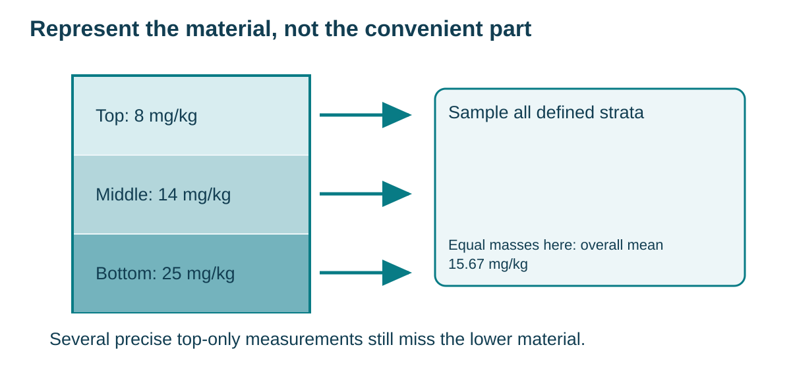
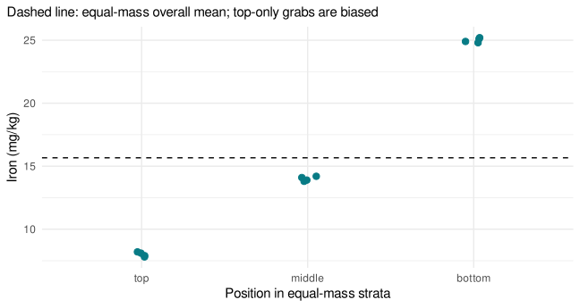
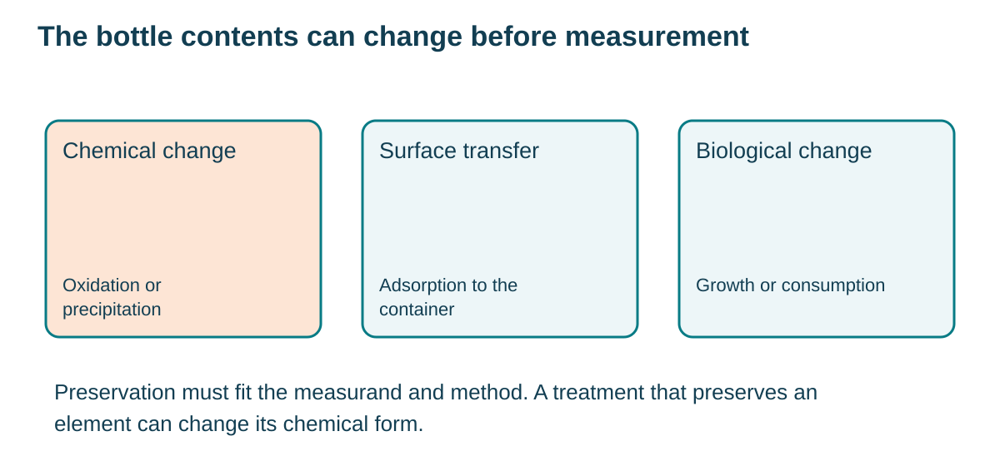
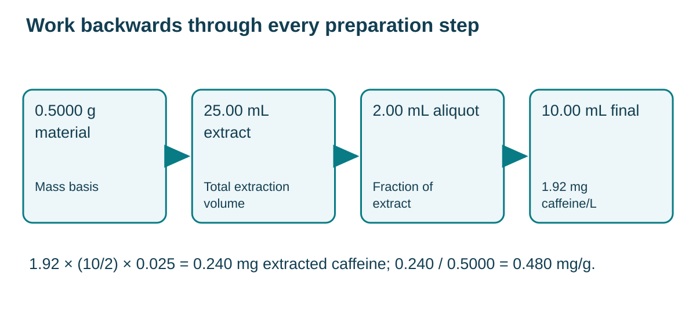
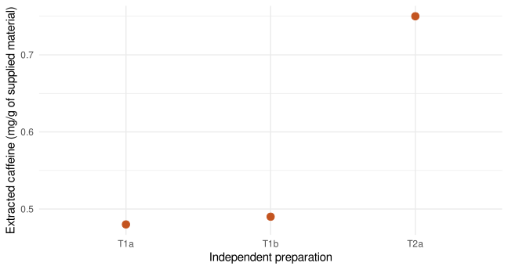
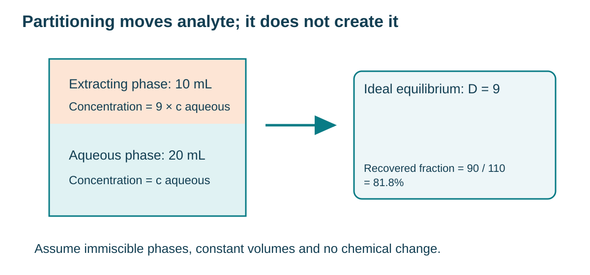
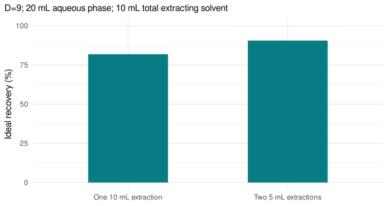

::: {.callout-note}
## Interactive experiment

[Explore the browser demo](../demos/sampling-preparation.html): Can extra measurements repair a sampling design that misses part of the material?
Predict first, change one condition, then explain the result. Export a CSV to
reproduce one calculation or plot in R.
:::


## Does the aliquot represent the material?

A precise instrument only measures what reaches it. If you take all your
material from the top of a heterogeneous container, repeating the measurement
will not discover what is at the bottom. This unit follows the sample from the
sampling target through preparation to a reported mass fraction. You will use
R to preserve preparation identities and reverse each dilution and extraction
step.

{fig-alt="The top, middle and bottom have different concentrations in a deliberately heterogeneous material."}

The supplied strata have equal masses. Their mean concentrations are 8, 14 and
25 mg Fe/kg, giving an equal-mass overall mean of 15.67 mg/kg. Sampling only the
top would give about 8 mg/kg even if every measurement were extremely precise.
If the stratum masses differed, the simple average would be wrong: use the
known mass fractions. If those fractions are unknown, more arithmetic cannot
supply them.

```{r}
library(readr)
library(dplyr)
library(ggplot2)
grabs <- read_csv("data/course/sampling.csv", show_col_types = FALSE)
strata <- grabs |>
  group_by(position) |>
  summarise(mean_mg_kg = mean(iron_mg_kg), .groups = "drop")
strata
equal_mass_mean <- mean(strata$mean_mg_kg)
equal_mass_mean
```

{fig-alt="Within-stratum repeatability is much smaller than the difference between positions."}

A composite can combine increments in specified proportions to estimate a bulk
quantity. It also hides the original spatial variation: one composite is not
several independent samples. Decide whether the question concerns a bulk mean,
variation among locations, or a maximum before combining material.
Sampling contributes to uncertainty when the result refers beyond the material
actually measured. [Eurachem sampling guidance](https://www.eurachem.org/index.php/euwgs/samp-mu)

## Preserve the quantity you intend to measure

During storage, oxidation, precipitation, adsorption and biological processes
can alter composition. A preservation treatment must fit the intended
measurand. Acidifying an elemental-analysis sample can help retain material in
solution, but it does not preserve every original chemical species. Record
collection, container, treatment and elapsed time with the sample ID.

{fig-alt="Chemical reactions, surfaces and biological processes can change a stored sample."}

Filtration, extraction and digestion do different things. Filtration separates
material by a stated operation. Extraction transfers accessible analyte to
another phase. Digestion breaks down material for an elemental measurement,
and can destroy molecular information. None guarantees complete recovery just
because the resulting solution is clear.

## Back-calculate an extraction

The supplied caffeine exercise starts with a weighed dry teaching material.
Assume no analyte loss in transfer and that the reported final concentration
is valid for the prepared solution. We call the result **extracted caffeine**:
complete recovery of native caffeine has not been independently established.

{fig-alt="A weighed sample gives an extract, then a diluted aliquot for measurement."}

For T1a, 0.5000 g material gives 25.00 mL extract; 2.00 mL of that extract is made
to 10.00 mL. The final concentration is 1.92 mg/L. Work backwards:

$$c_{extract}=c_{final}\frac{V_{final}}{V_{aliquot}},\qquad
m_{extracted}=c_{extract}V_{extract},\qquad
w_{extracted}=\frac{m_{extracted}}{m_{sample}}$$

The extract is 9.60 mg/L, containing 0.240 mg caffeine. Dividing by 0.5000 g gives
0.480 mg/g. The extract volume must be in **litres** when multiplying mg/L.

```{r}
prep <- read_csv("data/course/extractions.csv", show_col_types = FALSE)
stopifnot(!anyDuplicated(prep$preparation_id),
          all(prep$mass_g > 0), all(prep$aliquot_ml > 0))
results <- prep |>
  mutate(extract_mg_l = final_caffeine_mg_l * final_ml / aliquot_ml,
         extracted_mg = extract_mg_l * extract_ml / 1000,
         caffeine_mg_g = extracted_mg / mass_g)
results
write_csv(results, "output/extracted-caffeine.csv")
```

{fig-alt="Independent preparations give extracted caffeine per gram, rather than concentration in the measured flask."}

T1a and T1b are independent preparations from the same supplied material T1.
T2a comes from another supplied material. Do not describe three preparations
as three independently obtained materials. Keep sample ID, preparation ID and
reading ID separate so later joins preserve the correct mass and volumes.

## Why can several extractions help?

For two immiscible phases at an ideal equilibrium, let
$D=c_{extracting}/c_{aqueous}$. The fraction left in an aqueous volume $V_a$
after extraction with volume $V_o$ is $V_a/(V_a+D V_o)$. This follows by writing
the total analyte amount as $c_aV_a+(D c_a)V_o$.

{fig-alt="The distribution ratio describes concentrations, while recovery also depends on phase volumes."}

For $D=9$, 20 mL aqueous phase and 10 mL extracting phase, recovery is 81.8%.
Two successive 5 mL extractions leave the fraction
$[20/(20+9\times5)]^2$, giving 90.5% total recovery with the same total solvent
volume. These ideal calculations assume equilibrium, constant phase volumes,
no reaction, and complete separation between extractions. Real emulsions,
incomplete equilibration, ionisation and bound analyte can change recovery.

```{r}
one_recovery <- 1 - 20 / (20 + 9 * 10)
two_recovery <- 1 - (20 / (20 + 9 * 5))^2
100 * c(one = one_recovery, two = two_recovery)
```

{fig-alt="Two smaller ideal extractions recover more than one extraction with the same total solvent."}

## Practical and transfer

Report the three extracted-caffeine results, the complete volume chain, and
which assumptions prevent you from claiming total native caffeine. Add a
sampling diagram for a heterogeneous material and explain whether your target
is a bulk mean or spatial variation.

For a new preparation, 0.4000 g material is extracted to 40.00 mL. A 1.00 mL
aliquot made to 10.00 mL gives 1.50 mg/L. Calculate extracted caffeine in mg/g.
Then explain whether a successful spike **after extraction** proves complete
extraction of native analyte.

::: {.callout-tip collapse="true"}
## Check your result and interpretation

The new extract contains 15.0 mg/L × 0.04000 L = 0.600 mg, or **1.50 mg/g**.
A spike added after extraction does not pass through the extraction step and
cannot establish its recovery. The supplied results are 0.480, 0.490 and
0.750 mg/g. These are extracted amounts under the given preparation.
:::

Before moving on, explain why top-only sampling can be biased despite a tiny
SD, why the same total solvent can give different recovery, and why a retained
raw preparation table is part of the analytical evidence.


Selected Harris and Lucy reading: **1–2 and sampling/preparation**. Read by topic; the planned course edition is not yet confirmed.

[Slides](../slides/sampling-preparation.qmd) · [Course project](../downloads/analyticalchem-project.zip) · [R reference](../reference/r.qmd)

[Previous: From sample to answer](sample-answer.qmd) · [Next: Error and uncertainty](error-uncertainty.qmd)
