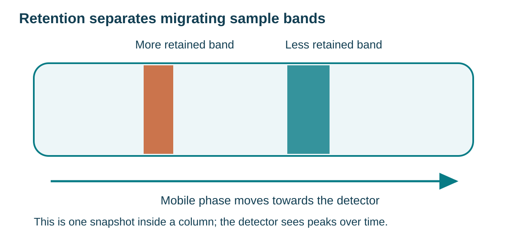
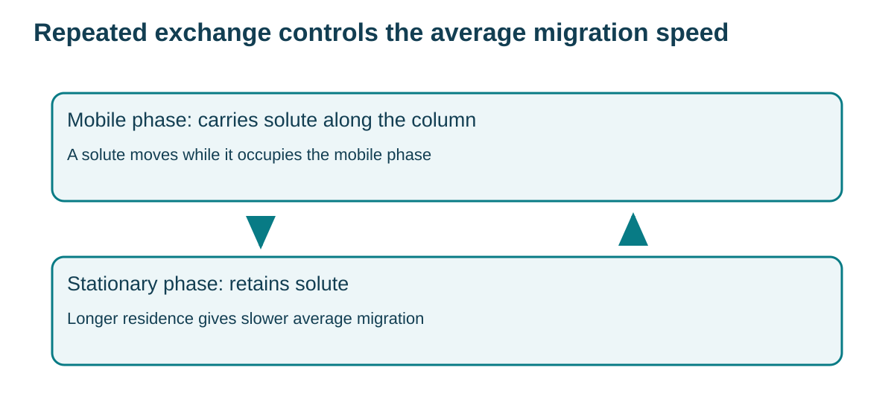
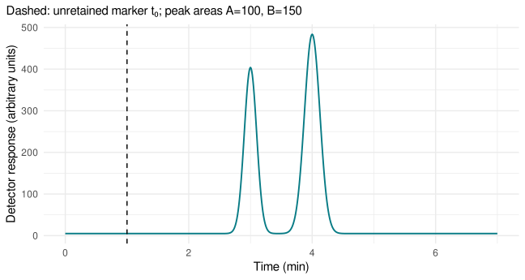
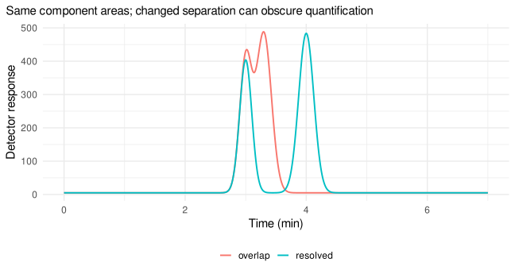
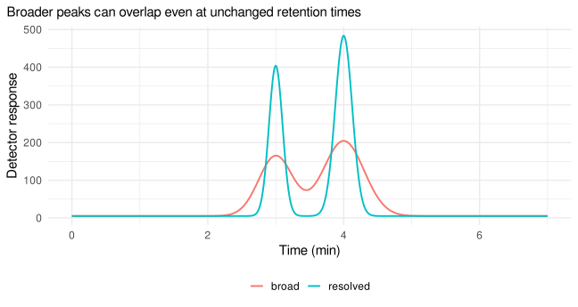
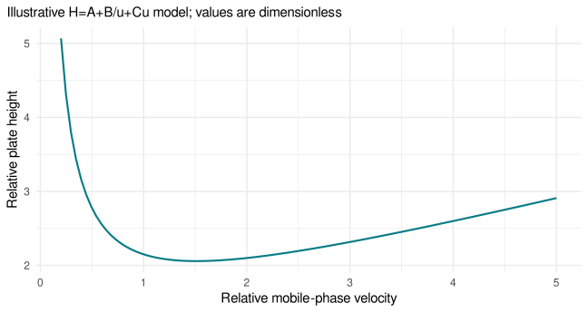

::: {.callout-note}
## Interactive experiment

[Explore the browser demo](../demos/separations.html): Can the same component amounts give peaks that no longer support separate quantification?
Predict first, change one condition, then explain the result. Export a CSV to
reproduce one calculation or plot in R.
:::


## A mixture becomes a sequence of signals

A detector can respond to more than one component. Chromatography changes when
components reach it, allowing their responses to be distinguished if the
separation is adequate. You will connect phase exchange with retention, calculate
retention factors and resolution, and explain why an integrated area may cease
to be analyte-specific when peaks overlap.

{fig-alt="Different bands occupy different positions inside a column before they reach the detector."}

This is a snapshot **inside** the column. A chromatogram is a detector response
**over time** at its outlet. The less retained band reaches the outlet earlier;
the more retained band spends a larger fraction of time in the stationary phase.
The bands also spread during migration, so different mean retention times alone
do not guarantee useful separation.

## Repeated exchange sets the average speed

{fig-alt="Solute exchanges between a moving phase and a stationary phase."}

The mobile phase carries dissolved or gaseous solute along. Interaction with the
stationary phase delays migration. In a simple equilibrium picture the retained
amount relative to the amount in mobile phase gives a retention factor. Phase
chemistry, temperature and mobile-phase composition can affect that balance.
Not every compound has the same selectivity under a given set of conditions.

The unretained marker time $t_0$ estimates mobile-phase transit. A component's
retention time $t_R$ includes this transit plus its additional retention:

$$k=\frac{t_R-t_0}{t_0}$$

For $t_0=1.00$ min and $t_R=3.00$ min, $k=2.00$. Using $t_R/t_0$ instead would
give 3 and include the transit time in what is intended to measure extra
retention. [IUPAC retention factor](https://doi.org/10.1351/goldbook.R05359)

## Read a chromatogram with its axes

```{r}
library(readr)
library(dplyr)
library(ggplot2)
chrom <- read_csv("data/course/chromatograms.csv", show_col_types = FALSE)
ggplot(filter(chrom, run == "resolved"), aes(time_min, response)) +
  geom_line() + geom_vline(xintercept = 1, linetype = "dashed") +
  labs(x = "Time (min)", y = "Detector response (arbitrary units)") +
  theme_minimal()
```

{fig-alt="A resolved chromatogram has an unretained marker at one minute and peaks near three and four minutes."}

The marker line is not an analyte peak. Retention time can support identity
when conditions and a suitable standard agree, but another component can
coelute. A chromatogram row is one time position within a run. Hundreds of
rows do not mean hundreds of independently sampled materials.

Peak **area** integrates response over time after an appropriate baseline is
established. Peak height is a different quantity. With a fixed amount and
response factor, broader peaks can be lower while retaining their area.
Neither height nor area is directly concentration until calibrated.

## Calculate resolution using the stated width definition

For baseline widths $w_1,w_2$ and $t_{R2}>t_{R1}$,

$$R_s=\frac{2(t_{R2}-t_{R1})}{w_1+w_2}$$

The formula is dimensionless when all times use the same unit. It uses
**baseline widths**. A formula using half-height widths has a different
coefficient. Do not substitute a width just because it is available in an export.
[IUPAC peak resolution](https://doi.org/10.1351/goldbook.P04465)

```{r}
peaks <- read_csv("data/course/peak-summary.csv", show_col_types = FALSE) |>
  mutate(k = (t_r_min - t0_min) / t0_min)
resolution <- peaks |>
  group_by(run) |>
  summarise(k_A = k[compound == "A"], k_B = k[compound == "B"],
            alpha = k_B / k_A,
            resolution = 2 * (t_r_min[compound == "B"] -
                               t_r_min[compound == "A"]) /
                          sum(baseline_width_min), .groups = "drop")
resolution
write_csv(resolution, "output/chromatographic-resolution.csv")
```

The resolved run has $R_s=2.222$ with $k_A=2$, $k_B=3$ and selectivity
$\alpha=1.5$. Values near 1.5 are often used as a useful reference for roughly
similar Gaussian peaks, but adequacy depends on shape, relative amount and
required quantification accuracy. Do not adopt one threshold as proof of purity.

{fig-alt="Changing peak spacing causes overlap despite unchanged component areas."}

The overlap run has $R_s=0.667$. If the detector responds to both components,
a combined area does not identify their separate amounts. Drawing a vertical
split between maxima is a modelling choice, not new chemical selectivity.
Changing separation conditions or using justified additional evidence is
preferable to presenting an unsupported single-analyte result.

## Band broadening is another route to lost resolution

{fig-alt="Unchanged mean retention times can still produce overlap when the bands broaden."}

The broad run has the same retention times as the resolved run but $R_s=0.909$.
Both peak spacing and widths matter. Poor injection conditions, extra-column
volume, dispersion and mass-transfer limitations can broaden peaks.

An ideal Gaussian plate estimate uses $N=16(t_R/w_b)^2$ with baseline width
$w_b$ under its stated assumptions. Higher efficiency means narrower bands for
a given retention, but selectivity can be more important than making an
already unsuitable separation slightly sharper.

{fig-alt="An illustrative plate-height curve balances diffusion and mass-transfer contributions."}

The conceptual van Deemter relation $H=A+B/u+Cu$ explains why very low and very
high mobile-phase velocities can both broaden bands through different effects.
The plotted values are dimensionless illustrations, not measured optimal
settings for an instrument. Real method changes also affect time, pressure,
selectivity and sample compatibility.

## Practical and transfer

Plot the three runs and calculate their retention factors and resolutions.
Explain why the lower peak height in the broad run does not automatically mean
less analyte. State what evidence would be needed to report a caffeine amount
from a peak at the expected retention time in a new beverage matrix.

For a new pair with $t_0=0.80$ min, $t_{R1}=2.40$ min, $t_{R2}=3.20$ min and
baseline widths 0.40 and 0.60 min, calculate both retention factors, selectivity
and resolution. Which quantities would change if both widths doubled while
retention times stayed fixed?

::: {.callout-tip collapse="true"}
## Numerical checks

$k_1=2.00$, $k_2=3.00$, $\alpha=1.50$, and $R_s=1.60$.
Doubling both widths halves $R_s$ to 0.80 but leaves retention factors and
selectivity unchanged. It therefore changes separation adequacy without changing
the mean retention order.
:::


Selected Harris and Lucy reading: **analytical separations**. Read by topic; the planned course edition is not yet confirmed.

[Slides](../slides/separations.qmd) · [Course project](../downloads/analyticalchem-project.zip) · [R reference](../reference/r.qmd)

[Previous: Atomic measurements](atomic-methods.qmd) · [Next: GC and HPLC](gc-hplc.qmd)
