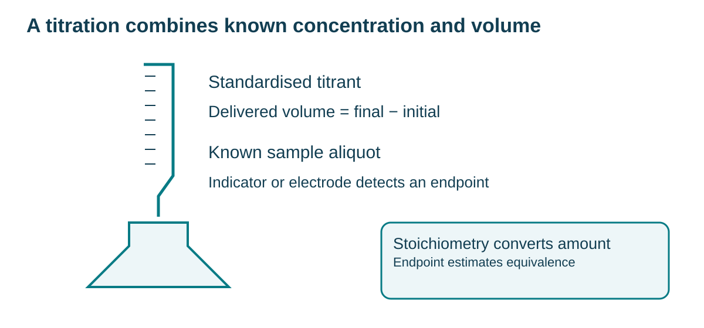
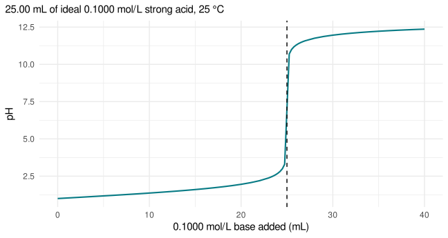
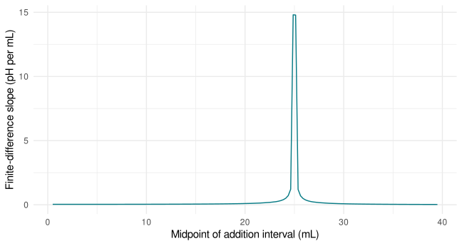
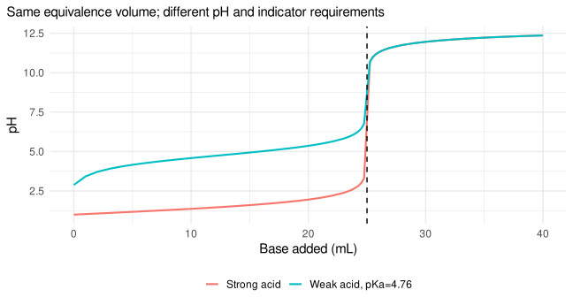
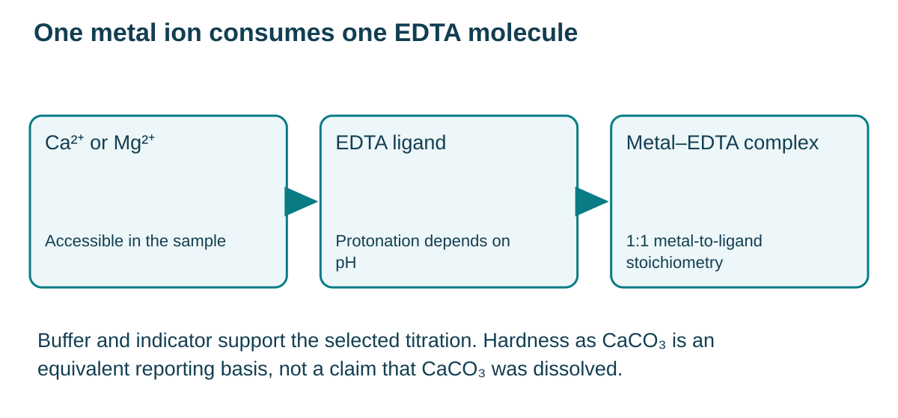
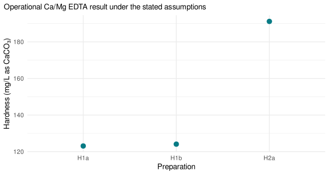

::: {.callout-note}
## Interactive experiment

[Explore the browser demo](../demos/titration.html): How does the chosen endpoint differ from stoichiometric equivalence?
Predict first, change one condition, then explain the result. Export a CSV to
reproduce one calculation or plot in R.
:::


## Use a reaction to count analyte

In a titration, a standardised reagent reacts with a known sample portion. Its
concentration and delivered volume establish the amount consumed. The chemical
reaction converts that amount to analyte amount. A signal change identifies an
**endpoint** intended to estimate the stoichiometric **equivalence point**.
The two are related but not identical by definition.

You will calculate a strong-acid concentration, inspect pH curves, and report
an EDTA hardness result with its stated equivalent basis.

{fig-alt="A burette delivers a measured volume of standardised titrant to a known sample aliquot."}

Read the initial and final burette positions. Delivered volume is their
difference, not the final reading alone. Remove any justified method-blank
consumption on the same volume basis. Titrant concentration must be established:
we supply a standardised value rather than assuming a nominal bottle label is
exact. Meniscus reading, transfer, standardisation and endpoint detection all
contribute uncertainty.

## Strong acid and base give a simple amount balance

For $\mathrm{H^++OH^-\rightarrow H_2O}$, the equivalence condition is
$n_{acid}=n_{base}$. With an acid aliquot $V_a$ and standardised base
concentration $c_b$, $c_a=c_bV_{eq}/V_a$ for this 1:1 reaction.

The example uses 25.00 mL acid and 0.1000 mol/L base. A supplied endpoint estimate
of 25.00 mL gives 0.1000 mol/L acid. Volumes can be in the same unit in their
ratio; converting to amounts in mol requires litres.

```{r}
library(readr)
library(dplyr)
library(ggplot2)
curve <- read_csv("data/course/acid-titration.csv", show_col_types = FALSE)
ggplot(curve, aes(volume_ml, ph)) +
  geom_line() +
  labs(x = "0.1000 mol/L base added (mL)", y = "pH") +
  theme_minimal()
c_acid <- 0.1000 * 25.00 / 25.00
c_acid
```

{fig-alt="The ideal strong-acid curve changes rapidly near the equivalence volume."}

Before equivalence, excess acid controls pH; after it, excess base does. Near
neutrality the water equilibrium matters, so a naive subtraction followed by
`-log10(0)` fails. The generator includes water autoionisation and charge balance
at 25 °C. At equivalence this ideal strong-acid/strong-base system has pH 7;
that is not a universal titration rule.

## An endpoint is an estimate with a procedure

The steep part makes a small volume change observable. An indicator changes
colour over a pH interval; choose one whose transition is appropriate to the
curve and desired endpoint accuracy. An electrode gives a series from which
an endpoint algorithm can be defined. A slope maximum is a useful exploratory
check, not a proof of a chemically correct endpoint.

```{r}
slopes <- data.frame(
  midpoint_ml = (head(curve$volume_ml, -1) + tail(curve$volume_ml, -1)) / 2,
  ph_per_ml = diff(curve$ph) / diff(curve$volume_ml))
ggplot(slopes, aes(midpoint_ml, ph_per_ml)) +
  geom_line() +
  labs(x = "Midpoint of addition interval (mL)", y = "Change in pH per mL") +
  theme_minimal()
```

`diff()` subtracts consecutive values. Divide by the actual volume difference:
our additions are more closely spaced near equivalence. Treating every row as
one millilitre would give a distorted derivative. Differencing also amplifies
measurement noise, so a real procedure needs a specified endpoint method.

{fig-alt="Finite differences identify a steep region, with the volume spacing included explicitly."}

For a weak acid, its conjugate base affects pH at equivalence. Before
equivalence a buffer region can appear. The comparison below uses the same
initial amount and base, with supplied pKa 4.76 for the weak acid.

{fig-alt="Strong and weak acids share the same equivalence volume here but not the same pH curve."}

The equivalent amount follows stoichiometry; pH follows the equilibrium
composition. A weaker acid does not automatically require less base if its
initial amount is the same. Use the curve to reason about indicator choice,
not to redefine the reaction stoichiometry.

## EDTA counts metal equivalents

EDTA forms a 1:1 complex with each accessible metal ion in this simplified
hardness exercise. Its protonation and the metal's competing reactions affect
the effective binding under the chosen conditions. A pH buffer supports a
large enough conditional formation constant and an appropriate indicator
response. Merely writing the overall formation constant is not enough to
establish performance at every pH.

{fig-alt="One EDTA molecule binds one metal ion; hardness is then expressed on an equivalent CaCO₃ mass basis."}

Assume the supplied titration selectively counts Ca and Mg under its specified
buffer/indicator conditions. The combined amount is reported **as CaCO₃**, using
100.09 g/mol. This does not identify Ca and Mg individually or establish that
carbonate is present. Other accessible metals or masked species can change
which quantity the procedure measures.

```{r}
hardness <- read_csv("data/course/edta.csv", show_col_types = FALSE) |>
  mutate(delivered_ml = final_burette_ml - initial_burette_ml,
         corrected_ml = delivered_ml - blank_ml,
         moles_metal = edta_mol_l * corrected_ml / 1000,
         hardness_mg_l_CaCO3 = moles_metal * 100.09 * 1000 /
                                (sample_ml / 1000))
hardness
write_csv(hardness, "output/hardness.csv")
```

H1a delivers 6.20 mL; subtracting the 0.05 mL blank leaves 6.15 mL.
At 0.01000 mol/L this is $6.15\times10^{-5}$ mol in 50.00 mL sample, or
**123.11 mg/L as CaCO₃**. H1b is another preparation of H1, not another
independently obtained water.

{fig-alt="Hardness results preserve preparation identity and the explicit CaCO₃ reporting basis."}

## Practical and transfer

Report the acid concentration, pH curve, finite-difference interpretation and
three hardness results. Explain which volume is an endpoint estimate and why
“pH 7” is not a general endpoint rule. List the assumptions connecting EDTA
consumption to Ca/Mg hardness and one relevant source of uncertainty beyond
repeatability.

A new 25.00 mL water sample consumes 4.10 mL EDTA after the initial/final
burette subtraction. A matched blank consumes 0.10 mL; EDTA is 0.01000 mol/L.
Calculate hardness, then predict the direction of error from forgetting the
blank.

::: {.callout-tip collapse="true"}
## Numerical and chemical checks

Corrected volume is 4.00 mL, giving **160.14 mg/L as CaCO₃**. Omitting the
blank biases the result high in this consumption model. Supplied results:
H1a 123.11, H1b 124.11 and H2a 191.17 mg/L as CaCO₃. A weak-acid equivalence
point can have pH above 7 despite 1:1 neutralisation.
:::


Selected Harris and Lucy reading: **selected equilibrium and titration topics**. Read by topic; the planned course edition is not yet confirmed.

[Slides](../slides/titration.qmd) · [Course project](../downloads/analyticalchem-project.zip) · [R reference](../reference/r.qmd)

[Previous: Calibration and quality control](calibration-qc.qmd) · [Next: Electrodes and potentiometry](potentiometry.qmd)
