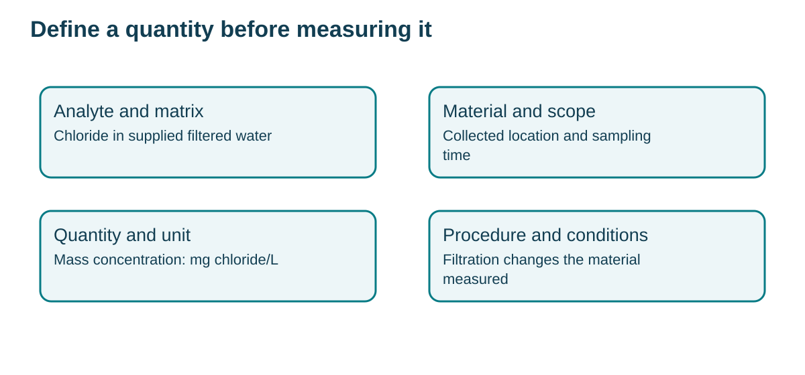
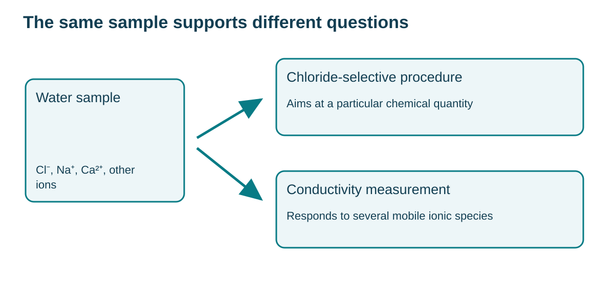
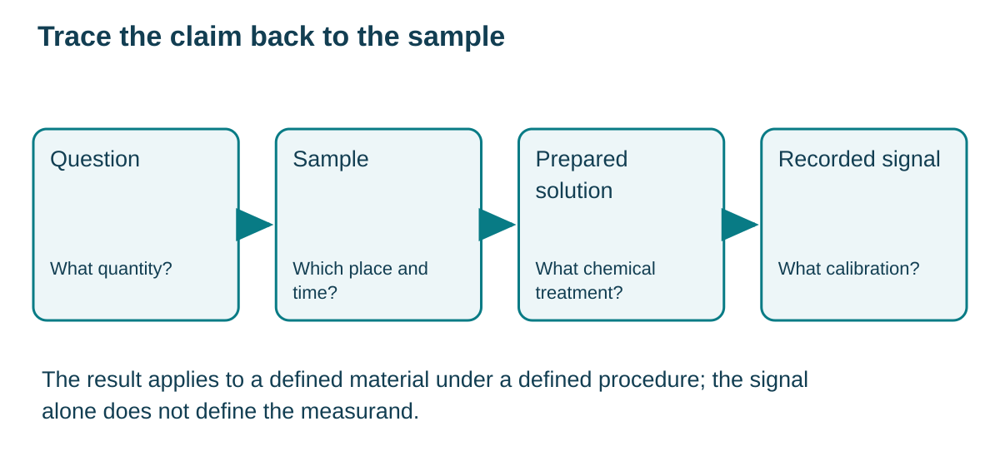
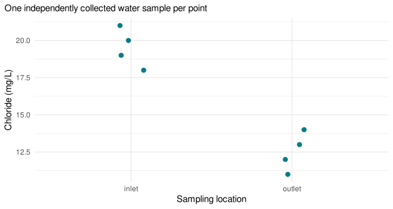
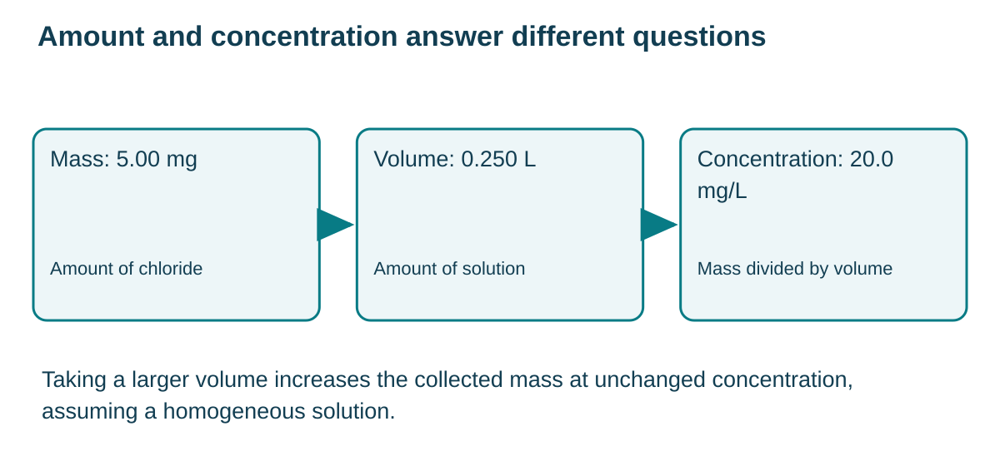
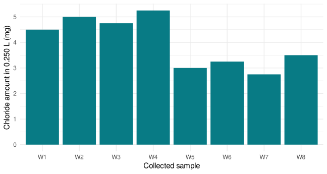

## A number needs a chemical question

{width="65%" fig-align="center" fig-alt="Four parts of a measurand: analyte and matrix, material scope, quantity and unit, and procedure."}

What quantity will our result describe?

::: notes
Ask for quantity, material scope and unit before naming an instrument. Use a bottle of water as the concrete example.
:::

## Separate analyte from matrix

{width="65%" fig-align="center" fig-alt="A selective chloride procedure and conductivity do not have the same measurand."}

Chloride is the analyte. Water and other dissolved components form the matrix.

::: notes
The matrix is not necessarily inert. It can change selectivity, recovery or response.
:::

## The same sample can answer different questions

{width="65%" fig-align="center" fig-alt="A selective chloride procedure and conductivity do not have the same measurand."}

Conductivity and chloride concentration are different measurands.

::: notes
Ask whether higher conductivity proves more chloride. Several mobile ionic species contribute. A calibration for one property cannot be transferred without a chemical relation.
:::

## Include place and time

{width="65%" fig-align="center" fig-alt="Four parts of a measurand: analyte and matrix, material scope, quantity and unit, and procedure."}

A result from the supplied bottle is not automatically a river-wide mean.

::: notes
Ask students what claim is justified if all material came from a single location at one time. This introduces sampling without inventing a representative design.
:::

## Preparation belongs in the definition

{width="65%" fig-align="center" fig-alt="The result applies to a defined material under a defined procedure; the signal alone does not define the measurand."}

Filtered iron, unfiltered iron and original Fe(II) need different evidence.

::: notes
Filtration changes material entering the procedure; reduction changes species. Later lessons will make the assumptions explicit.
:::

## Qualitative and quantitative claims

**Identity:** what evidence supports the substance?

**Amount:** what relates the selective response to a quantity?

::: notes
A peak at an expected retention time is evidence, but coelution is possible. Amount needs both identification/selectivity and a suitable response calibration.
:::

## Follow the result backwards

{width="65%" fig-align="center" fig-alt="The result applies to a defined material under a defined procedure; the signal alone does not define the measurand."}

Which record connects this reported concentration to the collected material?

::: notes
Trace question, collected sample, preparation, signal, calibration and back-calculation. R cannot repair a missing preparation record.
:::

## One row means one collected sample

{width="65%" fig-align="center" fig-alt="Eight collected waters show inlet chloride of 18–21 mg/L and outlet chloride of 11–14 mg/L."}

Eight rows: four inlet samples and four outlet samples.

::: notes
These are simulated independent collected samples in the teaching design. They are not before/after pairs merely because row positions can be matched.
:::

## Retrieve the familiar import

```r
water <- read_csv("data/course/water.csv")
glimpse(water)
```

::: notes
Check types, IDs, units, missing values and the experimental unit. Keep raw data unchanged. Use the R project to establish relative paths.
:::

## Show the observations first

{width="65%" fig-align="center" fig-alt="Eight collected waters show inlet chloride of 18–21 mg/L and outlet chloride of 11–14 mg/L."}

What is the difference between the locations? What variation remains?

::: notes
Means are 19.5 and 12.5 mg/L. Individual observations make sample size and spread visible. Do not jump to a p-value.
:::

## Summarise with a count

```r
water |> group_by(location) |>
  summarise(n = n(), mean_mg_l = mean(chloride_mg_l))
```

::: notes
Read the numerical means as summaries of four collected samples each. A count of missing results would also be necessary in incomplete data.
:::

## Make a restrained claim

{width="65%" fig-align="center" fig-alt="Eight collected waters show inlet chloride of 18–21 mg/L and outlet chloride of 11–14 mg/L."}

The descriptive difference is **7.0 mg/L** for these samples.

::: notes
Ask what additional sampling would support a broader temporal or spatial claim. The available design does not establish a treatment effect.
:::

## Concentration is amount per volume

{width="65%" fig-align="center" fig-alt="Taking a larger volume increases the collected mass at unchanged concentration, assuming a homogeneous solution."}

$c=m/V$; therefore $m=cV$.

::: notes
Before revealing the example, ask whether taking a larger volume changes concentration or collected amount. Assume a homogeneous solution.
:::

## Calculate the collected amount

{width="65%" fig-align="center" fig-alt="Taking a larger volume increases the collected mass at unchanged concentration, assuming a homogeneous solution."}

20.0 mg/L × 0.250 L = **5.00 mg**.

::: notes
Cancel litres explicitly. At unchanged concentration, a half-litre portion would contain ten milligrams.
:::

## Convert the unit and the number together

20 mg/L = **0.020 g/L**.

::: notes
A thousand-fold conversion error is not fixed by additional decimal places. Keep units in labels and the dictionary.
:::

## A different graph answers a different question

{width="65%" fig-align="center" fig-alt="Calculated chloride amount in equal quarter-litre collected samples, retaining each sample ID."}

This axis is amount in a collected portion, not concentration.

::: notes
All portions are 0.250 L here. If volumes varied, amount comparisons could differ from concentration comparisons.
:::

## Keep evidence portable

{width="65%" fig-align="center" fig-alt="The result applies to a defined material under a defined procedure; the signal alone does not define the measurand."}

Raw data → saved code → derived table → rendered report.

::: notes
Restart R and render. A console-only object makes a report dependent on session history. Reproducibility preserves reasoning; it does not guarantee the reasoning is correct.
:::

## Transfer: a new portion

{width="65%" fig-align="center" fig-alt="Taking a larger volume increases the collected mass at unchanged concentration, assuming a homogeneous solution."}

0.0750 mg in 25.00 mL. What is the concentration?

::: notes
Allow a calculation before answering: 3.00 mg/L. Then ask what is missing for a location-wide mean and an uncertainty statement.
:::

## What would make this conclusion wrong?

Name one sampling, chemical and computing failure.

::: notes
Possible answers: top-only sampling; nonspecific response; wrong volume unit or unmatched preparation record. Recover the whole argument, not a list of commands.
:::

## Practise the chemical argument

[Open the exercise](exercise.qmd).

Save the calculation and a chemical interpretation in your reproducible report.

[Interactive experiment](exercise.qmd#explore) · Predict, change, explain.

::: notes
Harris and Lucy reading: 0–2. Source and dataset assumptions are linked in the student page. Keep longer coding in the practical, rather than reading a script aloud. Slide count is not a duration target; allow thinking time where the question warrants it.
:::
