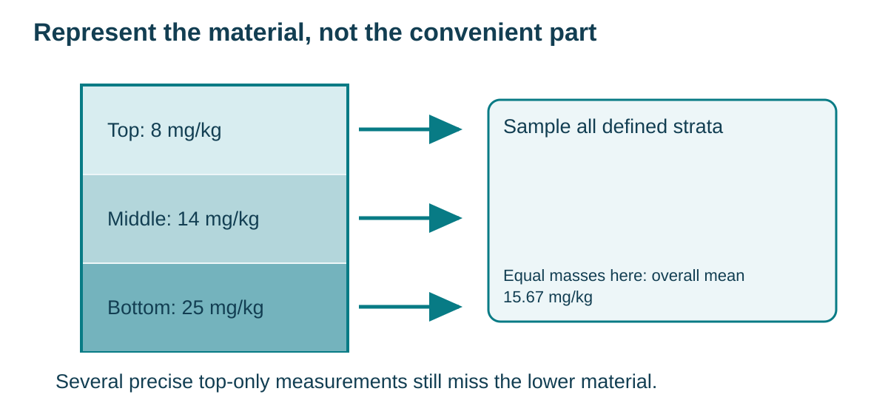
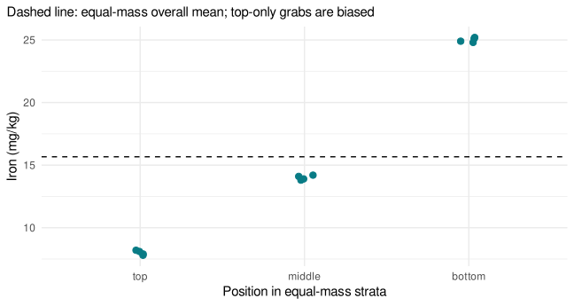
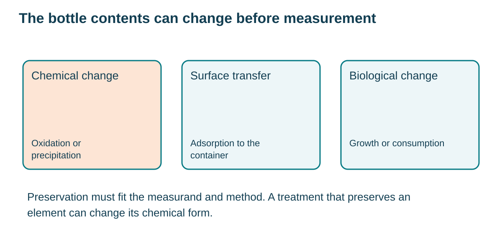
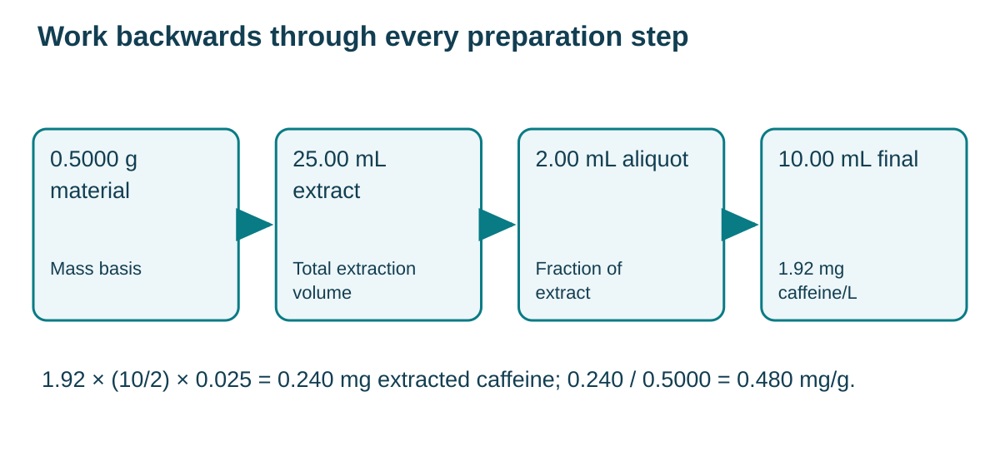
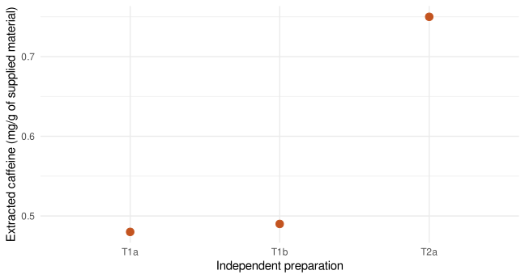
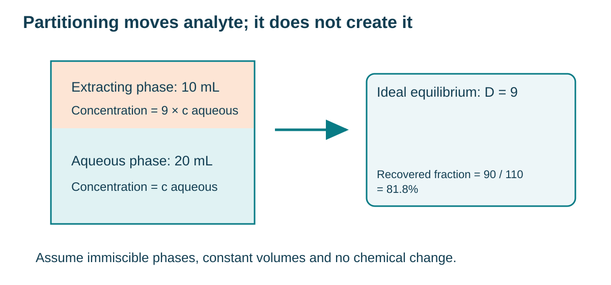
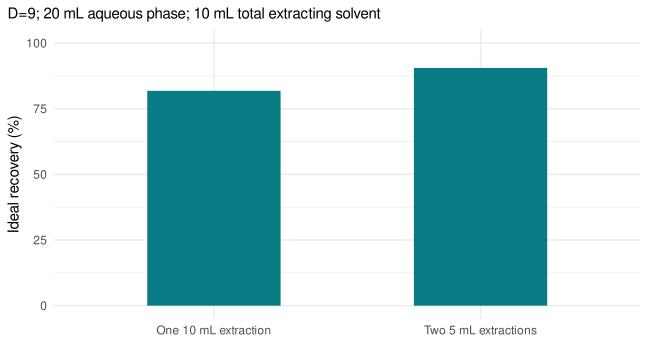
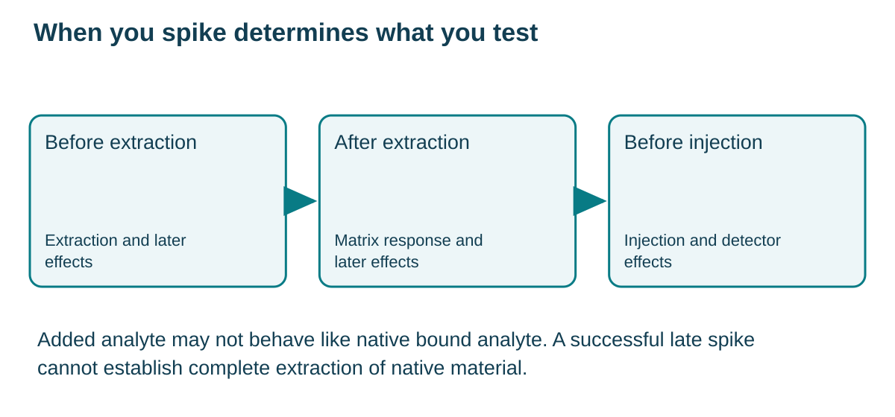

## Precision cannot rescue an unrepresentative sample

{width="65%" fig-align="center" fig-alt="Equal-mass top, middle and bottom strata have different iron concentrations. Top-only sampling is biased."}

Where would you take material from this container?

::: notes
Ask students to state the target quantity before choosing grabs. Equal stratum masses are given for the example.
:::

## Look within and between positions

{width="65%" fig-align="center" fig-alt="Iron averages 8, 14 and 25 mg/kg in equal-mass top, middle and bottom strata, with small within-stratum scatter."}

Which variation dominates?

::: notes
Top means eight, middle fourteen, bottom twenty-five mg/kg. The within-position variation is much smaller.
:::

## Define the sampling target

{width="65%" fig-align="center" fig-alt="Equal-mass top, middle and bottom strata have different iron concentrations. Top-only sampling is biased."}

Bulk mean, spatial variation and maximum are different questions.

::: notes
A single composite may be suitable for one question but erase information needed for another.
:::

## Weight the material you mean to represent

{width="65%" fig-align="center" fig-alt="Equal-mass top, middle and bottom strata have different iron concentrations. Top-only sampling is biased."}

Equal masses: $(8+14+25)/3=15.67$ mg/kg.

::: notes
If masses differ, use their known fractions. A simple mean across arbitrary grabs need not be a bulk mass mean.
:::

## More top-only grabs repeat the same mistake

{width="65%" fig-align="center" fig-alt="Iron averages 8, 14 and 25 mg/kg in equal-mass top, middle and bottom strata, with small within-stratum scatter."}

A small SD can coexist with a large sampling bias.

::: notes
The top-only mean remains about eight mg/kg. Repetition is useful only within a design that addresses the target.
:::

## A composite is one combined material

{width="65%" fig-align="center" fig-alt="Equal-mass top, middle and bottom strata have different iron concentrations. Top-only sampling is biased."}

Combining increments does not create independent collected samples.

::: notes
Ask what is lost when all positions are combined. One composite cannot estimate spatial variability by itself.
:::

## Storage can change what reaches the instrument

{width="65%" fig-align="center" fig-alt="Storage can change composition by reactions, adsorption or biological processes. Preservation is method dependent."}

Which process could change an oxidation-state result?

::: notes
Oxidation can change species. Adsorption can remove dissolved analyte. Biological changes can alter several chemical quantities.
:::

## Preservation must fit the measurand

{width="65%" fig-align="center" fig-alt="Storage can change composition by reactions, adsorption or biological processes. Preservation is method dependent."}

An acid treatment can preserve an elemental amount while changing chemical form.

::: notes
Do not offer a universal preservation recipe. The approved method specifies container, treatment, time and other relevant conditions.
:::

## Filtration, extraction and digestion differ

{width="65%" fig-align="center" fig-alt="1.92 × (10/2) × 0.025 = 0.240 mg extracted caffeine; 0.240 / 0.5000 = 0.480 mg/g."}

A clear solution is not proof of complete analyte recovery.

::: notes
Filtration separates material; extraction transfers accessible solute; digestion breaks down material. Each changes the interpretation of the result.
:::

## Keep the whole preparation chain

{width="65%" fig-align="center" fig-alt="1.92 × (10/2) × 0.025 = 0.240 mg extracted caffeine; 0.240 / 0.5000 = 0.480 mg/g."}

What unit belongs at each stage?

::: notes
Dry material has a mass basis. Extract and final solution have mass-per-volume bases. Ask students to identify each quantity before calculating.
:::

## Begin at the measured flask

{width="65%" fig-align="center" fig-alt="1.92 × (10/2) × 0.025 = 0.240 mg extracted caffeine; 0.240 / 0.5000 = 0.480 mg/g."}

T1a final concentration: **1.92 mg caffeine/L**.

::: notes
The final flask is ten millilitres containing a two-millilitre extract aliquot. This is not yet caffeine per gram.
:::

## Undo the aliquot dilution

{width="65%" fig-align="center" fig-alt="1.92 × (10/2) × 0.025 = 0.240 mg extracted caffeine; 0.240 / 0.5000 = 0.480 mg/g."}

1.92 × 10.00/2.00 = **9.60 mg/L extract**.

::: notes
Use final total volume, including reagents and solvent. Explain why the factor multiplies when returning to the more concentrated extract.
:::

## Recover extracted amount

{width="65%" fig-align="center" fig-alt="1.92 × (10/2) × 0.025 = 0.240 mg extracted caffeine; 0.240 / 0.5000 = 0.480 mg/g."}

9.60 mg/L × 0.02500 L = **0.240 mg**.

::: notes
Cancel litres. Ask what thousand-fold error would occur if twenty-five millilitres were used as twenty-five litres.
:::

## Report on the original material basis

{width="65%" fig-align="center" fig-alt="Extracted caffeine results of 0.480, 0.490 and 0.750 mg/g for three identified preparations."}

0.240 mg / 0.5000 g = **0.480 mg/g**.

::: notes
Call this extracted caffeine. Complete recovery of native caffeine has not been independently established.
:::

## Keep preparation identities

{width="65%" fig-align="center" fig-alt="Extracted caffeine results of 0.480, 0.490 and 0.750 mg/g for three identified preparations."}

T1a and T1b are two preparations of T1.

::: notes
Do not call the three preparations three independent supplied materials. The table contains two preparations of T1 and one of T2.
:::

## Write the mass balance in R

```r
mutate(extract_mg_l = final_caffeine_mg_l * final_ml / aliquot_ml,
       extracted_mg = extract_mg_l * extract_ml / 1000,
       caffeine_mg_g = extracted_mg / mass_g)
```

::: notes
Read one expression chemically. The factor of one thousand converts millilitres to litres; it is not an empirical correction.
:::

## Partitioning depends on concentrations and volumes

{width="65%" fig-align="center" fig-alt="Two immiscible phases share analyte at distribution ratio nine. The organic ten millilitres holds 81.8 percent of the mass."}

$D=c_o/c_a$; analyte amount exists in both phases.

::: notes
The distribution ratio is nine in this ideal example. Concentration ratio alone is not recovery.
:::

## Recover the fraction from a mass balance

{width="65%" fig-align="center" fig-alt="Two immiscible phases share analyte at distribution ratio nine. The organic ten millilitres holds 81.8 percent of the mass."}

$f_o=DV_o/(V_a+DV_o)$.

::: notes
With twenty millilitres aqueous and ten millilitres extracting solvent, the recovered fraction is ninety over one hundred ten, or 81.8 percent.
:::

## Use the same total solvent differently

{width="65%" fig-align="center" fig-alt="Ideal recovery rises from 81.8 percent for one 10 mL extraction to 90.5 percent for two 5 mL extractions."}

One 10 mL extraction: **81.8%**. Two 5 mL extractions: **90.5%**.

::: notes
For successive extractions multiply the fractions left behind, assuming equilibration and complete phase separation each time.
:::

## Recognise the idealisation

{width="65%" fig-align="center" fig-alt="Two immiscible phases share analyte at distribution ratio nine. The organic ten millilitres holds 81.8 percent of the mass."}

What could invalidate the simple partition calculation?

::: notes
Emulsions, incomplete equilibrium, changing phase volumes, chemical reaction, ionisation or binding can alter the distribution and recovery.
:::

## A late spike misses early losses

{width="65%" fig-align="center" fig-alt="Added analyte may not behave like native bound analyte. A successful late spike cannot establish complete extraction of native material."}

Adding analyte after extraction cannot establish extraction recovery.

::: notes
Native bound analyte may behave differently even from a pre-extraction spike. State the point of addition and the equivalence assumption.
:::

## Transfer the volume chain

{width="65%" fig-align="center" fig-alt="1.92 × (10/2) × 0.025 = 0.240 mg extracted caffeine; 0.240 / 0.5000 = 0.480 mg/g."}

0.4000 g → 40.00 mL extract → 1.00 mL to 10.00 mL → 1.50 mg/L.

::: notes
Give time to derive 1.50 mg/g extracted caffeine. Ask what extra evidence would justify total caffeine.
:::

## Choose an improvement that addresses the failure

Would you change sampling, extraction, or repeat readings?

::: notes
Use three cases: top-only bias, incomplete extraction, noisy stable readings. Match the intervention to the source instead of assuming more instrument replicates solve everything.
:::

## Practise the chemical argument

[Open the exercise](exercise.qmd).

Save the calculation and a chemical interpretation in your reproducible report.

[Interactive experiment](exercise.qmd#explore) · Predict, change, explain.

::: notes
Harris and Lucy reading: 1–2 and sampling/preparation. Source and dataset assumptions are linked in the student page. Keep longer coding in the practical, rather than reading a script aloud. Slide count is not a duration target; allow thinking time where the question warrants it.
:::
