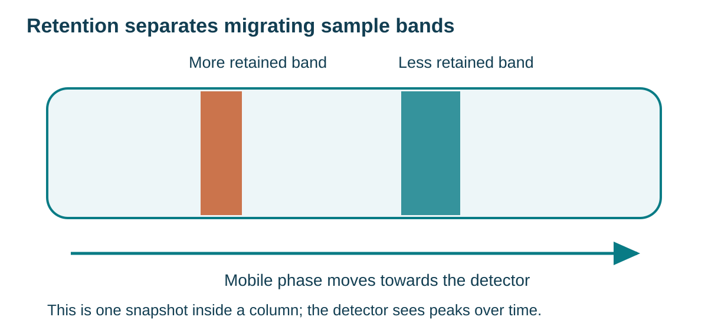
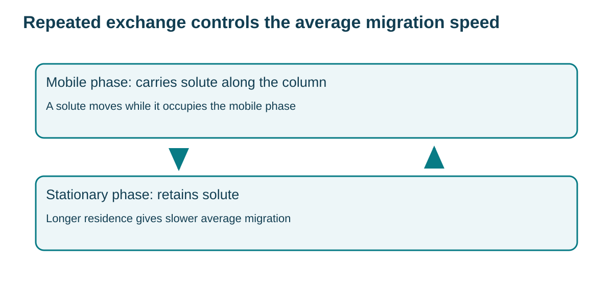
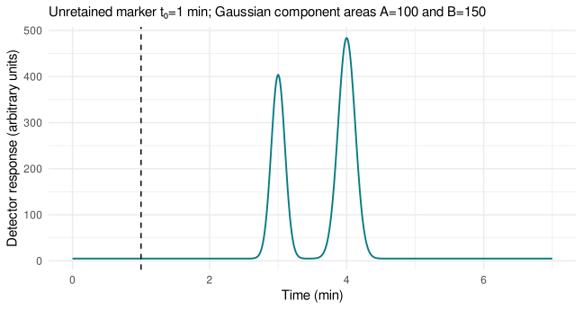
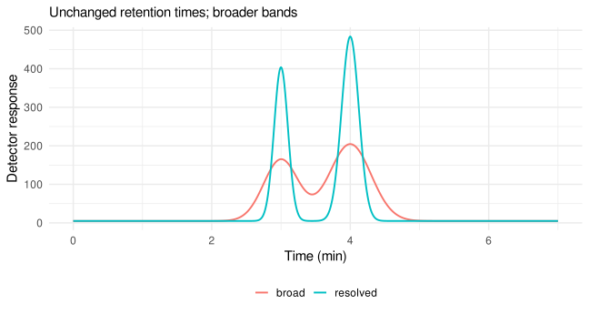
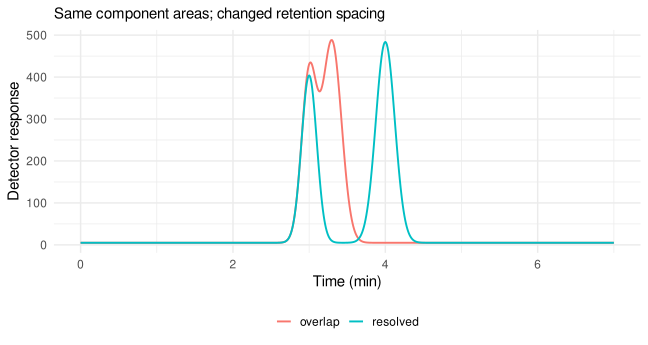
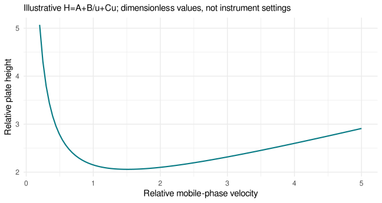

## About this lecture

Separate a mixture before assigning a detector response to an analyte.

- Connect phase exchange to retention.
- Calculate retention factors and resolution with defined widths.
- Decide what a chromatogram can support.

::: notes
Begin with the analytical problem: a detector can respond to more than one substance. Separation can make the response more selective, but it is not a guarantee of identity or purity. The exercise begins with small hand calculations, then the demo, then R.
:::

## A column picture is not a chromatogram

This is a **position snapshot** inside a column. The less-retained band is nearer the outlet.

{width="63%" fig-align="center" fig-alt="Two solute bands occupy different positions inside a column; the less-retained band is nearer the outlet."}

::: notes
The figure shows two bands at one instant, not two peaks on a time axis. Ask which reaches a detector at the right-hand outlet first. Bands also spread during migration. All drawings here are concepts, not exact instrument engineering.
:::

## Repeated exchange sets the average migration speed

Solute travels with the mobile phase and is delayed by stationary-phase residence.

{width="63%" fig-align="center" fig-alt="Repeated exchange between mobile and stationary phases changes a solute’s average migration speed."}

::: notes
Molecules repeatedly exchange between phases. More time in the stationary phase gives lower average speed under this simple equilibrium picture. Composition, stationary-phase chemistry and temperature can change relative retention.
:::

## Now read a detector trace

The chromatogram records **response versus elapsed time**.

The dashed reference is the unretained transit time $t_0=1.00$ min.

{width="63%" fig-align="center" fig-alt="A simulated chromatogram shows peaks near three and four minutes, with unretained time marked at one minute."}

::: notes
One row in the supplied trace is a time position in one run, not an independent sample. The dashed marker is not an analyte peak. Distinguish within-run sampling density from the number of injected or collected samples.
:::

## Subtract transit before describing retention

$k=(t_R-t_0)/t_0$. For A, $(3.00-1.00)/1.00=2.00$.

For B, $k=3.00$; relative selectivity is $\alpha=k_B/k_A=1.50$.

{width="63%" fig-align="center" fig-alt="Retention factors are calculated from times in the simulated resolved run."}

::: notes
The factor is dimensionless because all times use minutes. Dividing retention time by t0 without the subtraction would give three for A, which includes transit. The definition refers to stated method conditions.
:::

## Area, height and amount are different quantities

A broader peak can be **lower** while retaining the same integrated area.

Area still needs an appropriate calibration to become an amount.

{width="63%" fig-align="center" fig-alt="Broader Gaussian peaks have lower heights at unchanged component areas and retention times."}

::: notes
The simulated A and B areas stay at 100 and 150 response·min in all three runs. A larger detector response is not a universal count of molecules; response factors and detector selectivity matter.
:::

## Resolution needs a defined width

$R_s=2(t_{R2}-t_{R1})/(w_1+w_2)$ for **baseline widths**.

For this pair: $2(4.00-3.00)/(0.40+0.50)=2.222$.

{width="63%" fig-align="center" fig-alt="Two resolved peaks have baseline widths of 0.40 and 0.50 minutes and one minute between their retention times."}

::: notes
Ask students to identify which export column supplies the width. Half-height widths need a different coefficient. All time units must match. The formulas describe a peak model; they do not establish the chemical identity of the material.
:::

## Changing spacing changes separation

The overlap run retains both component areas but has $R_s=0.667$.

{width="63%" fig-align="center" fig-alt="Decreasing retention-time spacing produces overlapping contributions with unchanged component areas."}

::: notes
In the model only the spacing changes. If the detector responds to both substances, a combined area is not a compound-specific amount. An apparent maximum at an expected retention time does not prove that the candidate peak is pure.
:::

## Changing width also changes separation

The broad run keeps the original retention times but has $R_s=0.909$.

{width="63%" fig-align="center" fig-alt="Broader bands overlap despite unchanged mean retention times."}

::: notes
Now separate the cause from the previous example: the spacing is unchanged, but both bands are wider. Extra-column volume, injection conditions, dispersion and mass transfer can affect width in real methods.
:::

## An integration boundary is not new selectivity

Drawing a split between maxima does not independently identify each contribution.

{width="63%" fig-align="center" fig-alt="Overlapping components contribute to one detector trace, so a chosen integration boundary does not prove analyte specificity."}

::: notes
A constrained integration or deconvolution model can sometimes be justified, but the boundary alone is not evidence. Ask what new measurement would help: changed separation, an appropriate detector dimension, or a verified reference comparison.
:::

## Why a single threshold cannot prove purity

At fixed $R_s$, a much larger neighbouring component can contribute more to the target window.

{width="63%" fig-align="center" fig-alt="Peak overlap must be interpreted with relative amounts and peak shape as well as numerical resolution."}

::: notes
Values around 1.5 are a useful reference for similar Gaussian peaks, not universal proof of adequate quantification. Relative amounts, tails, detector selectivity and the required error matter. The demo holds A area fixed while changing B’s area so the distinction is visible.
:::

## Efficiency and selectivity solve different problems

For an ideal Gaussian, $N=16(t_R/w_b)^2$.

Narrower bands improve efficiency; changed interactions can alter selectivity.

{width="63%" fig-align="center" fig-alt="Band spacing and band broadening are different contributors to separation quality."}

::: notes
Do not swap baseline and half-height formulas. A highly efficient column cannot always rescue an unsuitable relative interaction. Keep the chemical separation question ahead of collecting instrument metrics.
:::

## Velocity trades off different broadening mechanisms

Conceptual model: $H=A+B/u+Cu$.

{width="63%" fig-align="center" fig-alt="An illustrative plate-height curve rises at both low and high relative mobile-phase velocities."}

::: notes
At very low velocity diffusion has more time; at high velocity finite mass transfer can broaden bands. These dimensionless values illustrate the shape, not actual optimum settings. Pressure and analysis time also affect method choice.
:::

## Use familiar R operations for the new quantities

```r
peaks |> mutate(k = (t_r_min - t0_min) / t0_min)
```

Keep run, compound and width definition attached to the calculation.

::: notes
Students already know mutate and grouped summaries. The learning is retention and width meaning, not a new programming package. Explain why a time-series row is not an independent replicate. The exercise includes complete worked R code after the tasks.
:::

## Predict before exploring

Double both baseline widths without changing retention times.

What happens to $R_s$, height and complete component area?

{width="63%" fig-align="center" fig-alt="The same component amounts can appear at different heights and separation quality when widths change."}

::: notes
Resolution halves; each Gaussian height halves at fixed area, while the complete areas stay constant. Then ask about a selected finite integration window: it may include a greater fraction from a neighbour. Use the exercise’s embedded demo rather than a separate app page.
:::

## Return to the analytical claim

Expected retention supports identity under matched conditions; it is not conclusive by itself.

Calibration, adequate separation and sample preparation must all support the reported amount.

{width="63%" fig-align="center" fig-alt="A well-separated simulated trace illustrates evidence needed before assigning a compound-specific calibrated area."}

::: notes
Draw the distinction between identity and quantity one last time. An absent obvious shoulder is not absence of a coeluting compound. Read Harris and Lucy by analytical-separation topic; IUPAC definitions are linked in the exercise.
:::

## Next: choose the transport and detector

[Exercise, embedded exploration and worked solutions](exercise.qmd) · [Practice quiz](quiz.qmd)

GC and HPLC build on these same retention and width ideas.

::: notes
Keep extended coding in the exercise. The deck is sized for its teaching argument rather than a slide-count quota. Use the hand questions and predictions for discussion where students need time.
:::
