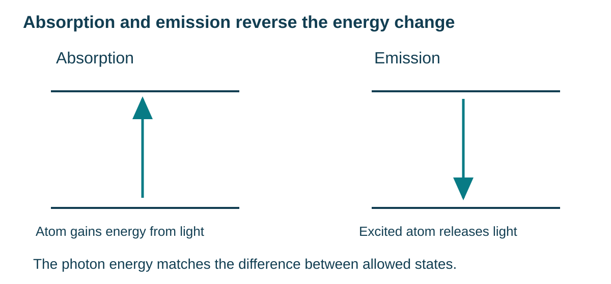
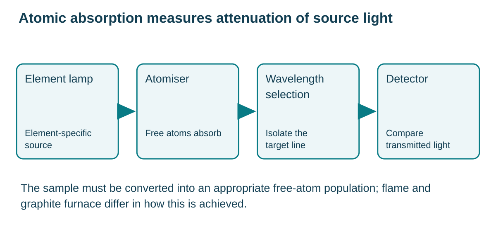
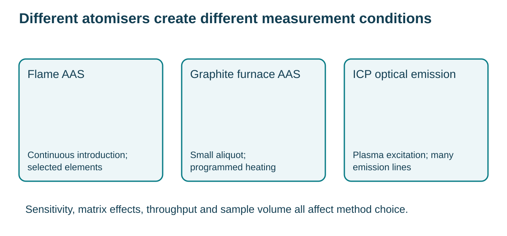
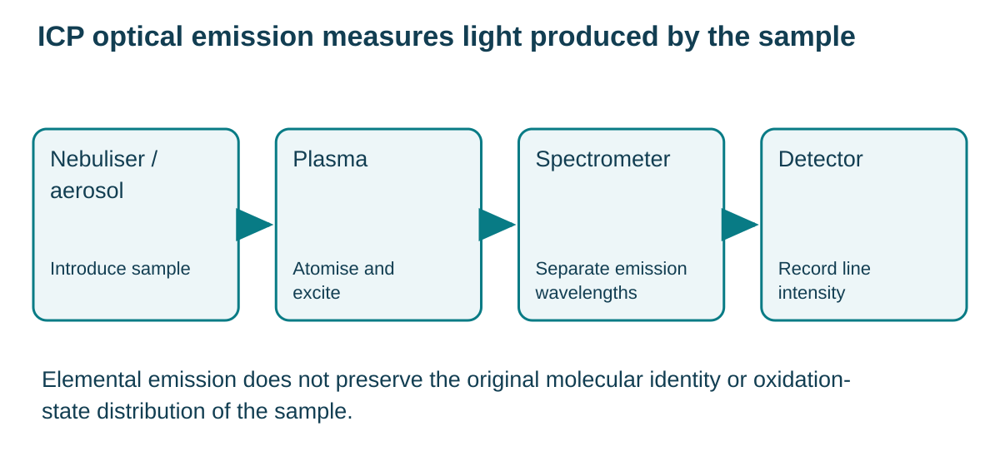
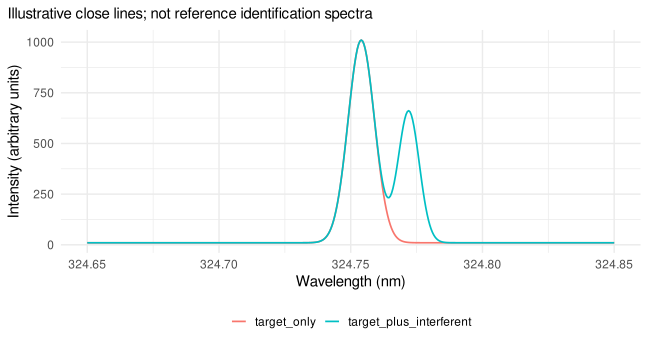
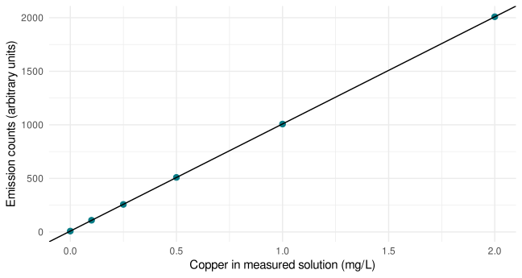
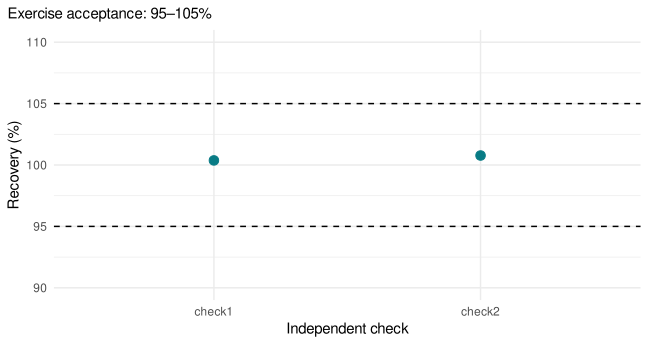
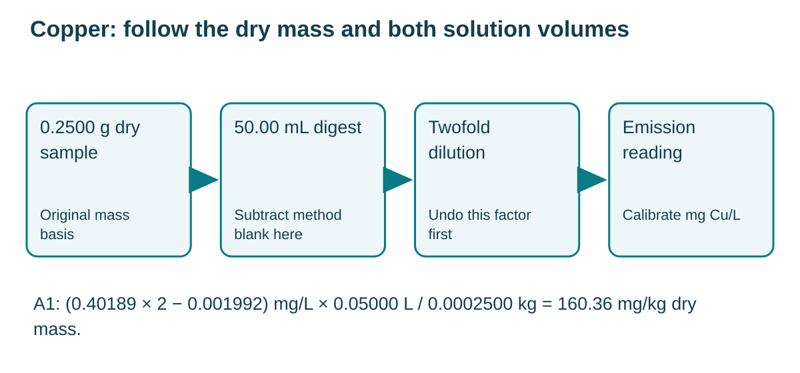
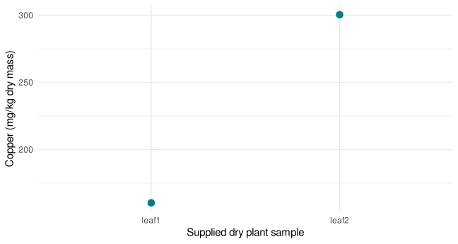
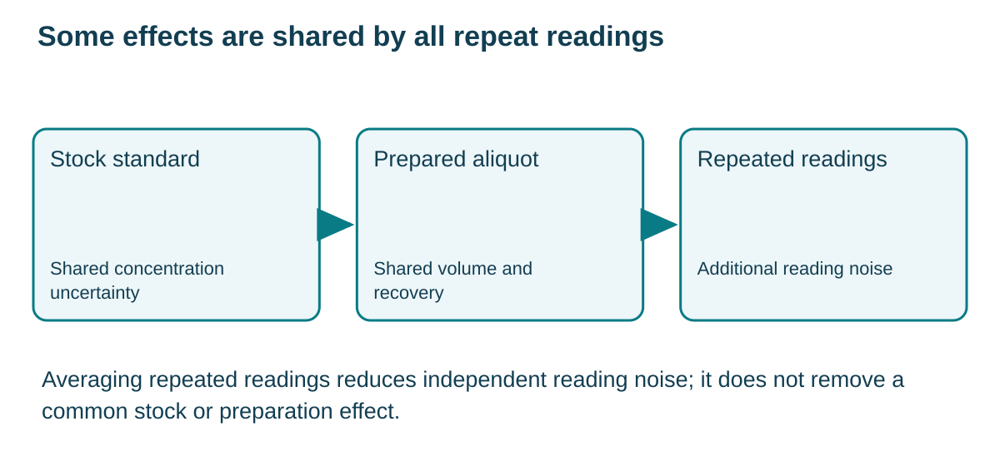

## Which information survives atomisation?

{fig-alt="Absorption moves an atom from lower to higher energy, while emission releases a photon during a transition from higher to lower energy."}

An element amount can survive; original molecular identity generally does not.

::: {.notes}
A plant copper result is not evidence of the original copper-binding molecule or oxidation state.
:::

## Absorption supplies the photon

{fig-alt="Absorption moves an atom from lower to higher energy, while emission releases a photon during a transition from higher to lower energy."}

A source photon promotes a suitable free atom to a higher state.

::: {.notes}
Energy must match an allowed transition. The relevant population depends on atomisation conditions.
:::

## Emission releases the photon

{fig-alt="Absorption moves an atom from lower to higher energy, while emission releases a photon during a transition from higher to lower energy."}

An excited population emits characteristic light during transitions.

::: {.notes}
Excitation is supplied by the atomisation/excitation environment. Not every introduced atom contributes the same response regardless of matrix.
:::

## Follow the AAS path

{fig-alt="The sample must be converted into an appropriate free-atom population; flame and graphite furnace differ in how this is achieved."}

Element source → atomiser → selected wavelength → detector.

::: {.notes}
The detector compares transmitted source light. Do not describe flame emission alone as the AAS measured signal.
:::

## The flame introduces material continuously

{fig-alt="Flame AAS, graphite furnace AAS and ICP optical emission differ in introduction, atomisation and detection conditions."}

Transport and atomisation affect sensitivity.

::: {.notes}
The selected source/wavelength, sample introduction and matrix compatibility belong to the measurement method.
:::

## The graphite furnace treats a small aliquot

{fig-alt="Flame AAS, graphite furnace AAS and ICP optical emission differ in introduction, atomisation and detection conditions."}

A heating program separates drying, matrix removal and atomisation.

::: {.notes}
Small volume and high sensitivity are not guarantees against matrix effects. Discuss the different introduction strategy without an exhaustive furnace-design survey.
:::

## Follow the ICP optical-emission path

{fig-alt="Elemental emission does not preserve the original molecular identity or oxidation-state distribution of the sample."}

Aerosol → plasma excitation → wavelength separation → detector.

::: {.notes}
This measures emitted light. It is not ICP-MS, which detects ions by mass-to-charge.
:::

## Many elements means many possible lines

{fig-alt="Elemental emission does not preserve the original molecular identity or oxidation-state distribution of the sample."}

Line choice and background still matter.

::: {.notes}
Multielement capability does not imply zero spectral overlap or zero matrix effects.
:::

## Look around the target line

{fig-alt="An illustrative neighbouring emission feature changes the spectrum around a target line; profiles are not identification references."}

Which signal would a broad integration window include?

::: {.notes}
The illustrative neighbouring feature can bias the selected line measurement. These are simulated profiles, not reference identification spectra.
:::

## An interference need not look like a separate peak

{fig-alt="An illustrative neighbouring emission feature changes the spectrum around a target line; profiles are not identification references."}

Transport and chemical effects can change the target population.

::: {.notes}
A stable reading does not prove correct recovery. Alternative lines, matrix-matched checks and suitable validation can address different issues.
:::

## Calibrate the introduced solution

{fig-alt="Copper emission counts increase approximately linearly over zero to two mg/L in introduced solution."}

Concentration axis: **mg copper/L measured solution**.

::: {.notes}
The solution is not yet on a dry-material basis. Fit counts as response and retain the intercept.
:::

## Check with independent material

{fig-alt="Two independent dissolved copper checks recover about 100.4 and 100.8 percent, within the exercise window."}

Both supplied checks meet the exercise 95–105% rule.

::: {.notes}
Recoveries are about 100.37 and 100.77 percent. They test the check solution conditions, not plant digestion completeness.
:::

## Trace the sample mass and volumes

{fig-alt="A1: (0.40189 × 2 − 0.001992) mg/L × 0.05000 L / 0.0002500 kg = 160.36 mg/kg dry mass."}

A1: 0.2500 g dry material → 50.00 mL digest → twofold dilution.

::: {.notes}
No full recovery validation is supplied. Result is conditional on quantitative transfer and digestion under the scenario.
:::

## Convert the sample signal

{fig-alt="Copper emission counts increase approximately linearly over zero to two mg/L in introduced solution."}

A1 measured solution ≈ **0.40189 mg/L copper**.

::: {.notes}
The calibration response range is zero to two mg/L. Check introduced solution concentration before back-calculating.
:::

## The method blank has a different dilution history

{fig-alt="A blank, independent reference check and a sample spike examine different parts of the measurement."}

Blank digest is measured undiluted.

::: {.notes}
Its measured concentration is about 0.0019922 mg/L. The sample has a further factor of two, but the blank does not.
:::

## Subtract on a common basis

{fig-alt="A1: (0.40189 × 2 − 0.001992) mg/L × 0.05000 L / 0.0002500 kg = 160.36 mg/kg dry mass."}

A1 digest: 0.40189 × 2 − 0.001992 = **0.80179 mg/L**.

::: {.notes}
First undo sample dilution, then subtract blank digest concentration. Multiplying a blank by a dilution it never underwent would be wrong.
:::

## Recover amount, then divide by original mass

{fig-alt="Conditional copper dry-mass results are about 160 and 300 mg/kg in two supplied plant samples."}

0.80179 mg/L × 0.05000 L / 0.0002500 kg = **160.36 mg/kg dry**.

::: {.notes}
Ask students to cancel units. A concentration in digest and a mass fraction in original material are different quantities.
:::

## A blank has no sample mass denominator

{fig-alt="Conditional copper dry-mass results are about 160 and 300 mg/kg in two supplied plant samples."}

No mg/kg plant result is assigned to the method blank.

::: {.notes}
Preserve its preparation role and report blank evidence without pretending it is a zero-mass sample concentration.
:::

## Passing a dissolved check cannot prove digestion recovery

{fig-alt="Two independent dissolved copper checks recover about 100.4 and 100.8 percent, within the exercise window."}

What material would better challenge the whole preparation?

::: {.notes}
A suitable reference material and/or appropriate recovery study, with evidence that the measurand and matrix are relevant.
:::

## Uncertainty needs more than counting noise

{fig-alt="Averaging repeated readings reduces independent reading noise; it does not remove a common stock or preparation effect."}

Mass, volume, calibration, blank variation and recovery can all contribute.

::: {.notes}
The worked elemental result is a conditional point estimate. Do not invent a complete uncertainty from the few numbers given.
:::

## Choose among instruments for the question

{fig-alt="Flame AAS, graphite furnace AAS and ICP optical emission differ in introduction, atomisation and detection conditions."}

Range, matrix, elements, sample volume, throughput and required uncertainty.

::: {.notes}
Avoid a universal ranking that declares one instrument best. Revisit flame, furnace and plasma differences.
:::

## Transfer the blank and dry-mass basis

{fig-alt="A1: (0.40189 × 2 − 0.001992) mg/L × 0.05000 L / 0.0002500 kg = 160.36 mg/kg dry mass."}

0.2000 g to 25.00 mL; fivefold dilution reads 0.0800 mg/L; blank digest 0.0100 mg/L.

::: {.notes}
Corrected digest is 0.3900 mg/L. Result is 48.75 mg/kg dry mass. Require the blank and dilution order.
:::

## Take the reasoning into R

[Open the student lesson](../lessons/atomic-methods.qmd).

Save the calculation and a chemical interpretation in your reproducible report.

[Interactive experiment](../demos/atomic-methods.html) · Predict, change, explain.

::: {.notes}
Harris and Lucy reading: atomic spectroscopy. Source and dataset assumptions are linked in the student page. Keep longer coding in the practical, rather than reading a script aloud. Slide count is not a duration target; allow thinking time where the question warrants it.
:::
