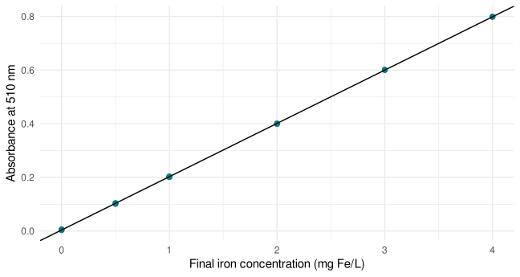
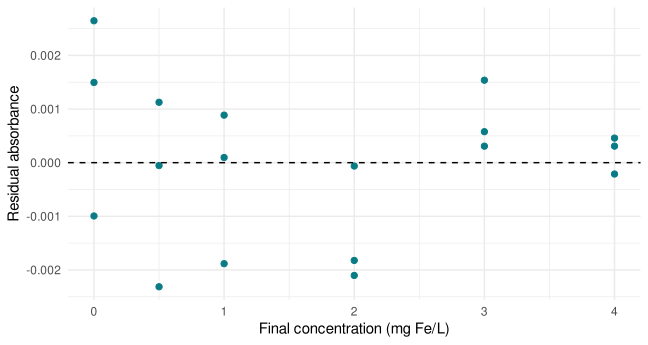
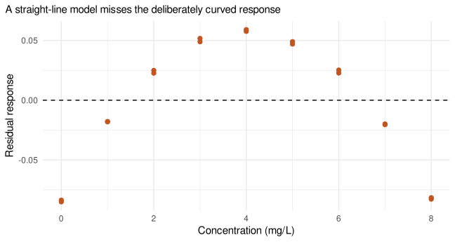
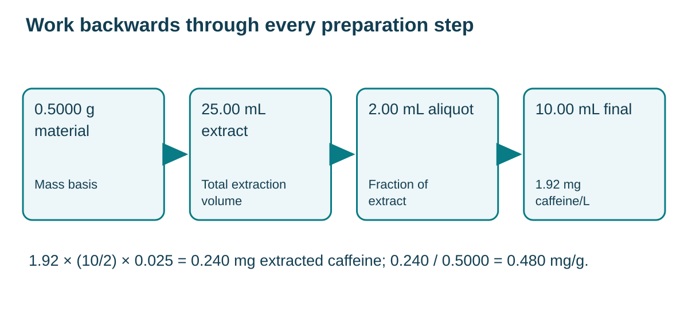
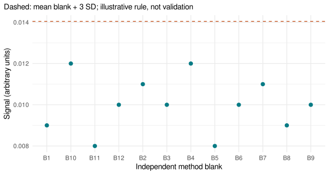
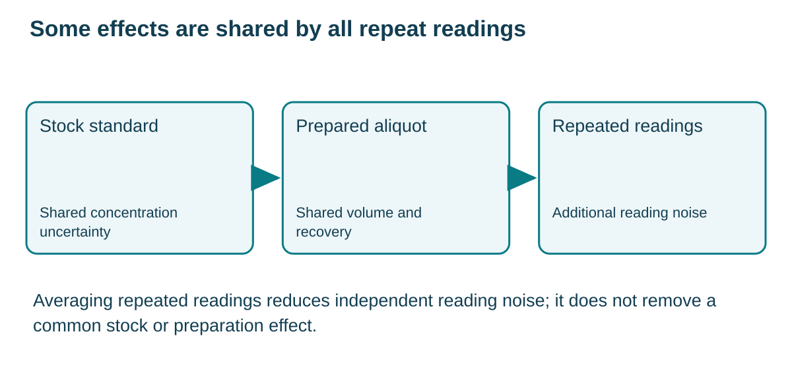

## What relation turns signal into concentration?

{fig-alt="Eighteen iron standards from zero to four mg/L define an absorbance line with a retained intercept."}

Known final concentrations give measured responses.

::: {.notes}
State the chemical basis: iron in a matched colour-development assay, response at 510 nm. We will use the chemistry in the UV unit.
:::

## Fit the measured response direction

{fig-alt="Eighteen iron standards from zero to four mg/L define an absorbance line with a retained intercept."}

$A=a+bc+e$.

::: {.notes}
Concentration is set and response is measured with error. Fitting concentration on absorbance is a different least-squares model.
:::

## Retrieve lm

```r
fit <- lm(absorbance ~ standard_mg_l, data = standards)
coef(fit)
```

::: {.notes}
The earlier computing course already used this workflow. Use it to focus on model assumptions rather than reteaching all of R.
:::

## Interpret the slope with units

{fig-alt="Eighteen iron standards from zero to four mg/L define an absorbance line with a retained intercept."}

Slope ≈ **0.198799 L/mg Fe**.

::: {.notes}
An increase of one mg Fe/L gives about 0.1988 absorbance units in the model. It is not a molar absorptivity without concentration conversion.
:::

## Retain the estimated intercept

{fig-alt="Eighteen iron standards from zero to four mg/L define an absorbance line with a retained intercept."}

Intercept ≈ **0.003874**.

::: {.notes}
A nonzero offset does not prove a particular cause. Do not force zero or blank-subtract an already blank-referenced response again.
:::

## Bracket the intended measurement range

{fig-alt="Eighteen iron standards from zero to four mg/L define an absorbance line with a retained intercept."}

These standards cover **0–4 mg Fe/L final**.

::: {.notes}
A good fit here does not establish response at forty mg/L. The range is stated for this teaching scenario, not universally validated.
:::

## Residuals are observations minus fitted responses

{fig-alt="Iron calibration residuals scatter around zero without an obvious curved pattern in the selected range."}

What pattern would challenge a straight line?

::: {.notes}
Curvature, changing spread or an unusual observation. Ask before revealing the faulty comparison dataset.
:::

## A high R² can hide systematic error

{fig-alt="A deliberately curved response leaves systematic patterned residuals after a straight-line fit."}

The second dataset is deliberately curved.

::: {.notes}
Even a visually high correlation can leave patterned residuals and biased inverse estimates.
:::

## Investigate before excluding a standard

{fig-alt="A deliberately curved response leaves systematic patterned residuals after a straight-line fit."}

A point is not wrong merely because it worsens the fit.

::: {.notes}
Check preparation, transcription, instrument response and protocol. Exclusion needs evidence and a recorded reason.
:::

## A narrower range needs evidence

{fig-alt="A deliberately curved response leaves systematic patterned residuals after a straight-line fit."}

Which standards and checks would validate the proposed range?

::: {.notes}
Do not remove upper points solely to improve appearance. Model and range selection must fit the analytical purpose.
:::

## Changing variance is another model concern

{fig-alt="Iron calibration residuals scatter around zero without an obvious curved pattern in the selected range."}

Ordinary least squares assumes the specified response-error structure.

::: {.notes}
If variance grows with concentration, weighting may be appropriate but requires a justified variance model. Recognising the limitation is core; advanced weighted fitting is optional.
:::

## Invert only after checking applicability

{fig-alt="Eighteen iron standards from zero to four mg/L define an absorbance line with a retained intercept."}

$\hat c=(\bar A-a)/b$.

::: {.notes}
For the provided three readings, mean absorbance is 0.480620 and final estimate 2.39813 mg Fe/L. Check range and independent QC before reporting it.
:::

## A concentration estimate is not the original sample result

{fig-alt="1.92 × (10/2) × 0.025 = 0.240 mg extracted caffeine; 0.240 / 0.5000 = 0.480 mg/g."}

The current unit is **mg Fe/L in the final coloured solution**.

::: {.notes}
Original concentration needs preparation factors. Ask students which record supplies those factors.
:::

## Three materials ask different QC questions

{fig-alt="A blank, independent reference check and a sample spike examine different parts of the measurement."}

Which would reveal introduced contamination?

::: {.notes}
A method blank. Then ask which checks calibration under independent known concentration and which probes incremental sample response.
:::

## Independence matters for a check standard

{fig-alt="A blank, independent reference check and a sample spike examine different parts of the measurement."}

The same wrong stock can make standards and checks agree.

::: {.notes}
An independently sourced material can challenge a shared preparation error. Matching matrix and measurand still matter.
:::

## Acceptance criteria precede the results

What action follows a failure?

::: {.notes}
Use a documented rule established for the intended procedure. Recalibration, investigation, remeasurement or withholding should follow evidence, not a desire to retain results.
:::

## A weak signal can be detectable but poorly quantified

{fig-alt="Twelve independent blank responses cluster near 0.010; a dashed line marks mean plus three standard deviations."}

Distinguishing a signal from blanks is a different requirement from precise quantification.

::: {.notes}
Do not use below-limit as a synonym for zero. Decision probabilities, uncertainty and method conditions matter.
:::

## Estimate blank variation from independent blanks

{fig-alt="Twelve independent blank responses cluster near 0.010; a dashed line marks mean plus three standard deviations."}

Mean = 0.0100; SD = **0.001348 signal units**.

::: {.notes}
The twelve method blanks belong to a separate ideal low-level example. Repeated readings of one blank do not measure all blank-preparation variation.
:::

## Keep a heuristic in its proper role

{fig-alt="Twelve independent blank responses cluster near 0.010; a dashed line marks mean plus three standard deviations."}

$3s_{blank}/b=0.02023$ mg/L; $10s_{blank}/b=0.06742$ mg/L.

::: {.notes}
Sensitivity is 0.200 in this separate example. These are illustrative concentration increments, not universally validated LOD and LOQ values.
:::

## A signal threshold includes the blank level

{fig-alt="Twelve independent blank responses cluster near 0.010; a dashed line marks mean plus three standard deviations."}

Threshold here: mean blank plus three SD.

::: {.notes}
Do not confuse the response threshold with a blank-relative concentration increment or subtract a blank twice.
:::

## Uncertainty remains after calibration inversion

{fig-alt="Averaging repeated readings reduces independent reading noise; it does not remove a common stock or preparation effect."}

Reading noise and uncertain slope/intercept both contribute.

::: {.notes}
Use the supplied inverse helper, which propagates coefficient covariance. A forward response prediction interval is not a concentration interval.
:::

## Use the supplied helper with its assumptions

```r
source("R/inverse-calibration.R")
inverse_calibration(fit, unknown_absorbance)
```

::: {.notes}
Independent normal equal-variance response errors, known standard concentrations and a well-determined positive slope. First-order approximation; not a general nonlinear/weighted inverse solver.
:::

## Interpret the interval on the correct scale

Final concentration ≈ **2.3981 mg Fe/L**; approximate 95% interval **2.3886–2.4077**.

::: {.notes}
The interval excludes sample preparation, volumes, sampling and matrix/recovery bias. Ask what must be added before interpreting it as a complete original-sample uncertainty.
:::

## Transfer: decide on three failures

{fig-alt="A blank, independent reference check and a sample spike examine different parts of the measurement."}

Outside range; failed independent check; below quantification requirement.

::: {.notes}
Outside range needs appropriate new measurement; failed check requires investigation and withheld affected results; weak response needs an appropriate qualified report rather than a manufactured zero.
:::

## Take the reasoning into R

[Open the student lesson](../lessons/calibration-qc.qmd).

Save the calculation and a chemical interpretation in your reproducible report.

[Interactive experiment](../demos/calibration-qc.html) · Predict, change, explain.

::: {.notes}
Harris and Lucy reading: 5. Source and dataset assumptions are linked in the student page. Keep longer coding in the practical, rather than reading a script aloud. Slide count is not a duration target; allow thinking time where the question warrants it.
:::
