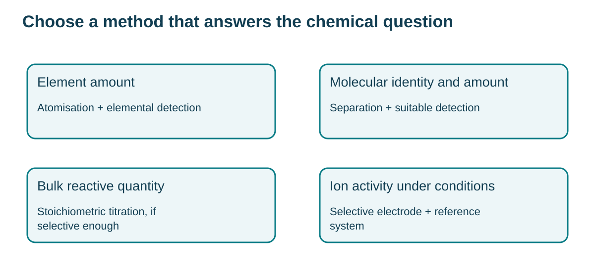
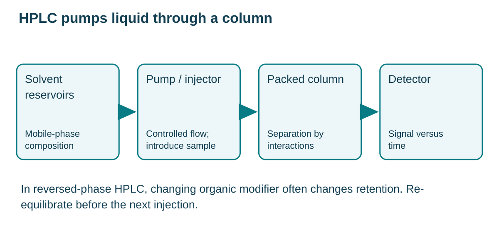
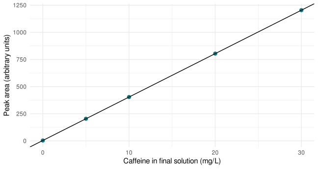
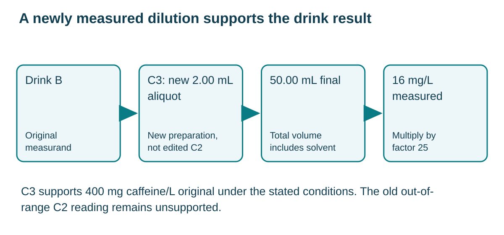
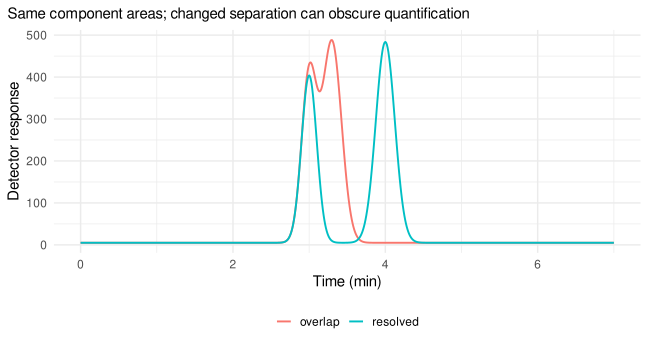
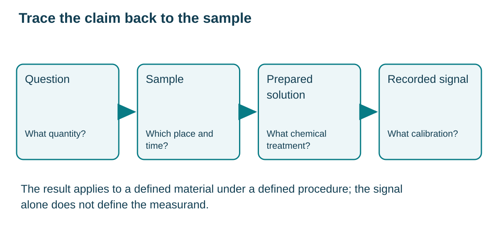
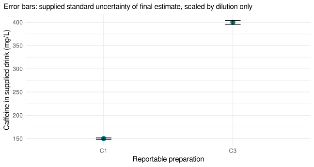
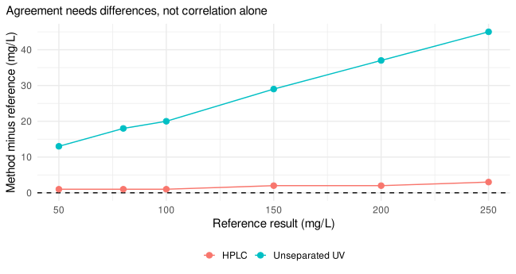
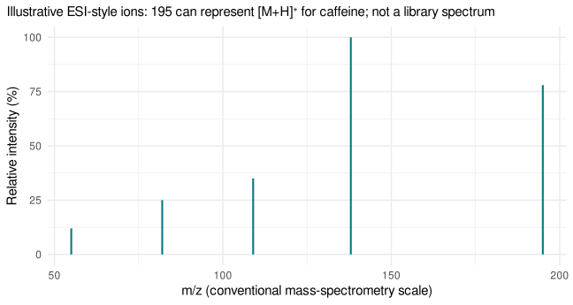

## Start with the claim you need to defend

{fig-alt="Different analytical questions call for elemental detection, molecular separation, titration or ion-activity measurement."}

Caffeine concentration in supplied drinks, with explicit limitations.

::: {.notes}
This case uses an independent calibration and new preparation records. Do not reuse old coefficients simply because the analyte has the same name.
:::

## Choose a method for the chemical quantity

{fig-alt="Different analytical questions call for elemental detection, molecular separation, titration or ion-activity measurement."}

Elemental copper and molecular caffeine require different evidence.

::: {.notes}
An atomising elemental technique cannot preserve the molecular identity needed to establish caffeine.
:::

## A selective enough signal still needs calibration

{fig-alt="In reversed-phase HPLC, changing organic modifier often changes retention. Re-equilibrate before the next injection."}

Separation, identity evidence and response calibration work together.

::: {.notes}
The case supplies retention evidence and separation flags. They support a conditional caffeine interpretation under the stated scenario.
:::

## Read this calibration and range

{fig-alt="The independent final-case line is area equals four plus forty times caffeine concentration, over zero to thirty mg/L."}

Area = **4 + 40 × concentration**; 0–30 mg/L final.

::: {.notes}
These are idealised teaching standards. Their zero residual does not imply zero real uncertainty; separate uncertainty inputs are supplied.
:::

## Check independently before using it

{fig-alt="A blank, independent reference check and a sample spike examine different parts of the measurement."}

The 15.00 mg/L check recovers **100.67%**.

::: {.notes}
The supplied acceptance window is ninety-five to one hundred five percent. Passing this check does not validate every matrix or recovery step.
:::

## Inspect preparation history

{fig-alt="C3 supports 400 mg caffeine/L original under the stated conditions. The old out-of-range C2 reading remains unsupported."}

Which factor applies to each sample?

::: {.notes}
C1 and C2 use five millilitres to fifty; C3 uses a new two millilitre aliquot to fifty. C3 is new evidence, not an edited factor on C2.
:::

## C1 supports a conditional result

{fig-alt="The independent final-case line is area equals four plus forty times caffeine concentration, over zero to thirty mg/L."}

Area 604 → 15 mg/L final → **150 mg/L drink A**.

::: {.notes}
The ratio of final to aliquot volume is ten. Check range, separation and QC in addition to the arithmetic.
:::

## C2 needs a new measurement

{fig-alt="The independent final-case line is area equals four plus forty times caffeine concentration, over zero to thirty mg/L."}

Area 1604 gives a candidate 40 mg/L final, outside range.

::: {.notes}
The code may calculate a candidate for diagnostic purposes, but the exported reportable concentration must be withheld.
:::

## C3 supplies that new preparation

{fig-alt="C3 supports 400 mg caffeine/L original under the stated conditions. The old out-of-range C2 reading remains unsupported."}

Area 644 → 16 mg/L final; factor 25 → **400 mg/L drink B**.

::: {.notes}
C3 is within range and adequately separated under the scenario. Do not retroactively accept C2 as valid extrapolation.
:::

## C4 fails selectivity despite passing range

{fig-alt="The same component areas appear resolved or overlapping when their retention-time spacing changes."}

An unresolved component contributes to the integrated peak.

::: {.notes}
Withhold the caffeine amount. Better separation or justified selective evidence is needed; a larger number of decimal places adds no information.
:::

## Export decisions with the values

{fig-alt="The result applies to a defined material under a defined procedure; the signal alone does not define the measurand."}

Withheld results are missing estimates with reasons, not zero concentrations.

::: {.notes}
The output CSV should retain preparation ID, original sample ID, factor and decision. A later reader should be able to audit the result.
:::

## Read the uncertainty bars correctly

{fig-alt="Accepted preparations give 150 and 400 mg/L original caffeine; bars show limited scaled standard uncertainties."}

C1: standard uncertainty 1.5 mg/L. C3: 4.0 mg/L.

::: {.notes}
These scale supplied final-concentration standard uncertainties by dilution. They are not ninety-five percent limits and omit volumes and preparation recovery.
:::

## Do not infer perfect uncertainty from rounded ideal data

{fig-alt="The independent final-case line is area equals four plus forty times caffeine concentration, over zero to thirty mg/L."}

A zero calibration residual does not prove a perfect method.

::: {.notes}
The case deliberately supplies standard uncertainties independently. Require an account of missing sources before a fit-for-purpose claim.
:::

## Compare methods through discrepancies

{fig-alt="Nonspecific UV positive discrepancies grow with reference concentration; HPLC discrepancies remain much smaller."}

Does a strong association establish agreement?

::: {.notes}
No. A biased method can track concentration closely. Examine differences and performance requirements.
:::

## A concentration-dependent difference needs investigation

{fig-alt="Nonspecific UV positive discrepancies grow with reference concentration; HPLC discrepancies remain much smaller."}

The nonspecific UV discrepancy grows across reference samples.

::: {.notes}
It may motivate selectivity and matrix investigations. The graph alone does not prove the underlying chemical cause. Reference uncertainty matters.
:::

## What does MS contribute?

![For a singly protonated molecule, [M+H]⁺ is about one mass unit above neutral M. Fragments and multiple charges require interpretation.](../assets/course/mass-spectrometer.svg){fig-alt="For a singly protonated molecule, [M+H]⁺ is about one mass unit above neutral M. Fragments and multiple charges require interpretation."}

Ions carry information about mass-to-charge and fragmentation.

::: {.notes}
The optional overview clarifies identity evidence and coupled detectors. It is not a new quantitative workflow or an exhaustive analyser survey.
:::

## The source determines which ions can appear

![For a singly protonated molecule, [M+H]⁺ is about one mass unit above neutral M. Fragments and multiple charges require interpretation.](../assets/course/mass-spectrometer.svg){fig-alt="For a singly protonated molecule, [M+H]⁺ is about one mass unit above neutral M. Fragments and multiple charges require interpretation."}

Neutral molecular mass is not automatically the observed m/z.

::: {.notes}
Electrospray can produce protonated molecules and other ions; multiple charge states, adducts and fragments need interpretation.
:::

## Interpret one plausible caffeine ion

{fig-alt="Illustrative ion sticks include m/z 195; the pattern is not an authentic caffeine library spectrum."}

Nominal neutral mass 194; singly protonated [M+H]⁺ near m/z **195**.

::: {.notes}
Do not call m/z 195 universal proof of caffeine identity. The supplied spectrum is illustrative, not an authentic reference match.
:::

## Combine independent dimensions of evidence

![For a singly protonated molecule, [M+H]⁺ is about one mass unit above neutral M. Fragments and multiple charges require interpretation.](../assets/course/mass-spectrometer.svg){fig-alt="For a singly protonated molecule, [M+H]⁺ is about one mass unit above neutral M. Fragments and multiple charges require interpretation."}

Retention, suitable ion evidence, standards and blanks can strengthen an assignment.

::: {.notes}
More dimensions still require validated interpretation. Quantification needs calibration in addition to identity evidence.
:::

## Write an auditable conclusion

{fig-alt="Accepted preparations give 150 and 400 mg/L original caffeine; bars show limited scaled standard uncertainties."}

What is supported, what is withheld, and what action is needed?

::: {.notes}
Expected supported values are one hundred fifty and four hundred mg/L under the model. Drink C needs improved separation; C2 is superseded by a valid new preparation.
:::

## Render without hidden session state

{fig-alt="The result applies to a defined material under a defined procedure; the signal alone does not define the measurand."}

Start from original data, saved code and preparation records.

::: {.notes}
A peer should render from a fresh folder. Missing files, absolute paths or console-only objects reveal a portability failure.
:::

## Transfer the evidence, not just the equation

{fig-alt="The independent final-case line is area equals four plus forty times caffeine concentration, over zero to thirty mg/L."}

Area 804; 4.00 mL to 40.00 mL; accepted separation and QC.

::: {.notes}
Final concentration twenty mg/L; original two hundred mg/L. If an unresolved second absorber contributes, withhold the simple caffeine interpretation.
:::

## What would change your decision?

{fig-alt="Different analytical questions call for elemental detection, molecular separation, titration or ion-activity measurement."}

Name the additional chemical or measurement evidence required.

::: {.notes}
Ask for specific next steps, not just more data: new dilution, better separation, appropriate reference material, recovery study or validated uncertainty component.
:::

## Take the reasoning into R

[Open the student lesson](../lessons/defending-results.qmd).

Save the calculation and a chemical interpretation in your reproducible report.

[Interactive experiment](../demos/defending-results.html) · Predict, change, explain.

::: {.notes}
Harris and Lucy reading: integration and selected mass spectrometry. Source and dataset assumptions are linked in the student page. Keep longer coding in the practical, rather than reading a script aloud. Slide count is not a duration target; allow thinking time where the question warrants it.
:::
