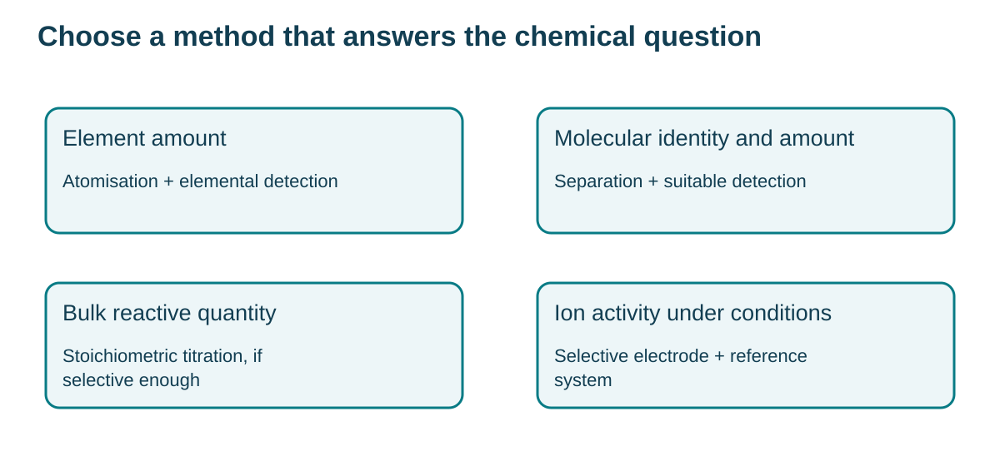
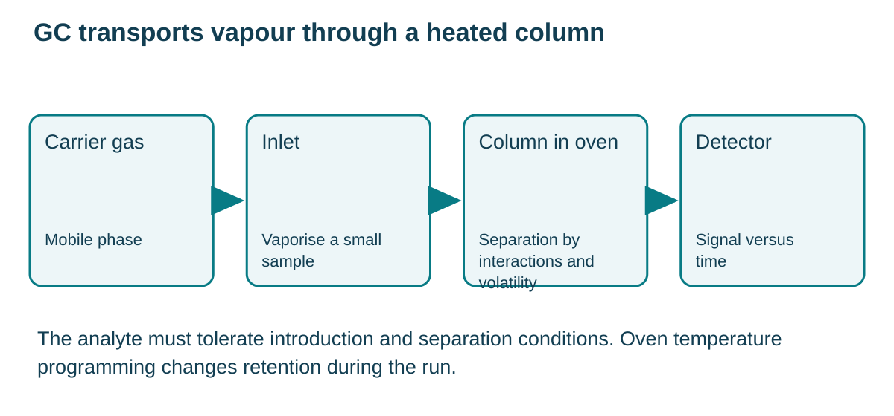
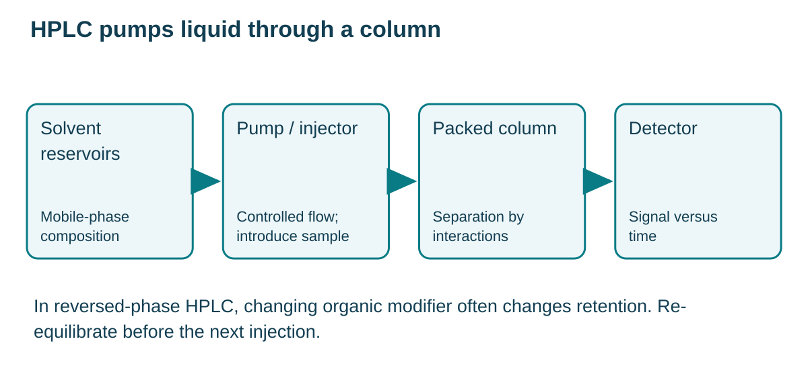
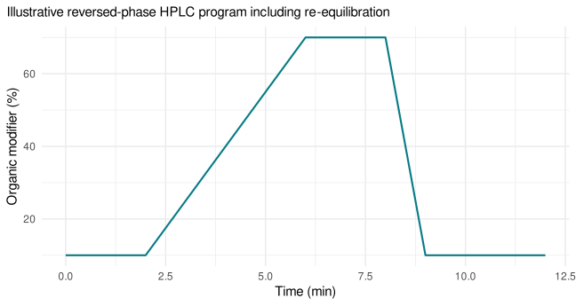
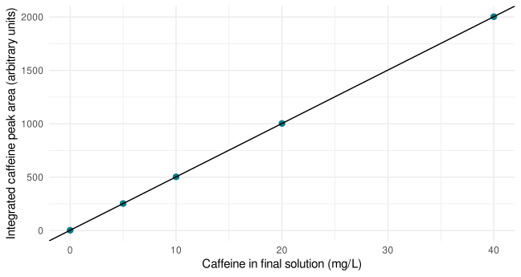
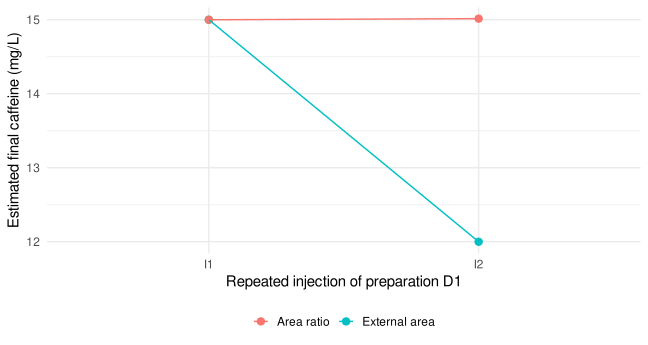
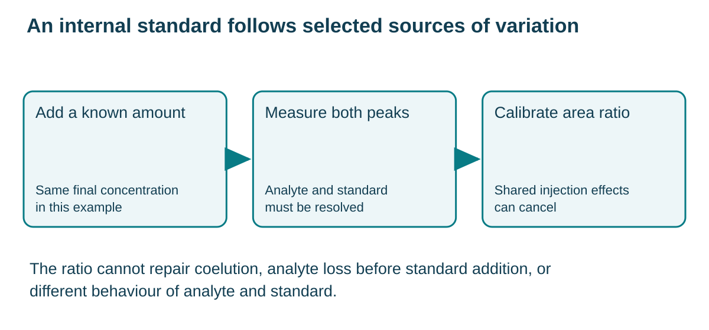
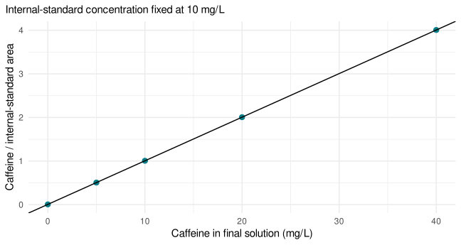
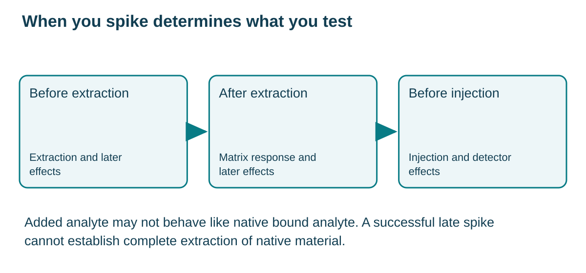
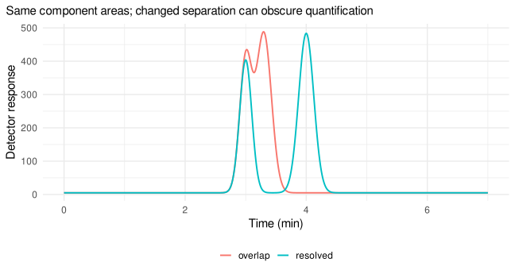

## Both methods separate; their mobile phases differ

{fig-alt="Different analytical questions call for elemental detection, molecular separation, titration or ion-activity measurement."}

Can the analyte enter, survive and separate under the method conditions?

::: {.notes}
Begin with the analyte, matrix and required result, not a preference for an instrument.
:::

## Follow the GC sample

{fig-alt="The analyte must tolerate introduction and separation conditions. Oven temperature programming changes retention during the run."}

Carrier gas → inlet → column in oven → detector.

::: {.notes}
The analyte must reach the gas phase under the chosen conditions without an unacceptable loss or transformation.
:::

## Volatility is about the introduced analyte

{fig-alt="The analyte must tolerate introduction and separation conditions. Oven temperature programming changes retention during the run."}

A headspace method can sample volatiles above a nonvolatile matrix.

::: {.notes}
The entire original material need not be volatile. Introduction and sampling partitioning still determine what the result represents.
:::

## Temperature programming changes retention

{fig-alt="The analyte must tolerate introduction and separation conditions. Oven temperature programming changes retention during the run."}

Stationary-phase interactions also matter.

::: {.notes}
Retention order is not a pure boiling-point list. The oven program belongs to the complete GC method.
:::

## Follow the HPLC sample

{fig-alt="In reversed-phase HPLC, changing organic modifier often changes retention. Re-equilibrate before the next injection."}

Reservoir → controlled flow and injection → column → detector.

::: {.notes}
The solute must be soluble and stable under the selected liquid-phase conditions.
:::

## Reversed-phase conditions provide one interaction regime

{fig-alt="In reversed-phase HPLC, changing organic modifier often changes retention. Re-equilibrate before the next injection."}

A relatively nonpolar stationary phase meets a more polar mobile phase.

::: {.notes}
Organic modifier often reduces retention for appropriately retained compounds. Ionisation and solvent chemistry can alter behaviour, so avoid an absolute rule.
:::

## Isocratic and gradient methods ask different practical questions

{fig-alt="An illustrative HPLC program rises from ten to seventy percent organic, then returns and re-equilibrates."}

A gradient changes composition during a run.

::: {.notes}
An isocratic method holds it fixed. Gradients can address a broad retention range but need appropriate equilibration and control.
:::

## Return to the initial conditions

{fig-alt="An illustrative HPLC program rises from ten to seventy percent organic, then returns and re-equilibrates."}

Which part prepares the next injection?

::: {.notes}
The program returns to ten percent organic and holds for re-equilibration. Repeating a run without matching the starting state can change retention.
:::

## A detector is part of the selectivity

{fig-alt="In reversed-phase HPLC, changing organic modifier often changes retention. Re-equilibrate before the next injection."}

UV, flame-ionisation and mass-spectrometric responses are different.

::: {.notes}
UV needs absorption at the chosen wavelength; FID gives ion current for many organics; MS records ions by m/z. An area is method-dependent.
:::

## Calibrate the integrated area

{fig-alt="External HPLC calibration maps caffeine peak area to final-solution concentration from zero to forty mg/L."}

Known caffeine in final solution: **0–40 mg/L**.

::: {.notes}
Assume suitable baseline and separation under the teaching conditions. Do not count CSV rows as area.
:::

## Interpret the external model

{fig-alt="External HPLC calibration maps caffeine peak area to final-solution concentration from zero to forty mg/L."}

Area = **3 + 50 × concentration**.

::: {.notes}
The offset is retained. The model maps response to final-solution concentration, not directly to the original beverage.
:::

## What if the injection introduces less solution?

{fig-alt="Repeated injections give external estimates of fifteen and twelve mg/L, but ratio estimates near fifteen mg/L for both."}

External area can change even when vial concentration does not.

::: {.notes}
Use repeated injections I1 and I2 of the same preparation D1. Their external estimates are fifteen and twelve mg/L.
:::

## Add a distinguishable internal standard

{fig-alt="The ratio cannot repair coelution, analyte loss before standard addition, or different behaviour of analyte and standard."}

Every final solution here has **10 mg/L internal standard**.

::: {.notes}
The compound must be distinguishable from native analyte and matrix, and suitable for the effects it is intended to follow.
:::

## A ratio can cancel a shared factor

{fig-alt="The ratio cannot repair coelution, analyte loss before standard addition, or different behaviour of analyte and standard."}

If both areas change proportionally, their ratio changes much less.

::: {.notes}
This is conditional on shared response behaviour and no interfering integrated peaks. It is not a universal correction.
:::

## Calibrate the ratio under matched standard concentration

{fig-alt="Caffeine-to-internal-standard area ratio is linear in concentration when internal-standard concentration is held fixed."}

$R=A_{caffeine}/A_{IS}=0.006+0.100c$.

::: {.notes}
Fixed IS concentration makes ratio versus analyte concentration appropriate here. Varying IS concentrations require a concentration-ratio model.
:::

## Reuse the familiar model fit

```r
fit_ratio <- lm(area_ratio ~ caffeine_mg_l, data = standards)
```

::: {.notes}
The principal learning is the experimental design and interpretation, not a new modelling package.
:::

## Compare the repeated injections

{fig-alt="Repeated injections give external estimates of fifteen and twelve mg/L, but ratio estimates near fifteen mg/L for both."}

Ratio estimates: **15.000 and 15.015 mg/L final**.

::: {.notes}
The shared injection effect mostly cancels. A small difference remains because the teaching signals include an offset.
:::

## Return to the original drink

{fig-alt="The ratio cannot repair coelution, analyte loss before standard addition, or different behaviour of analyte and standard."}

A tenfold dilution gives approximately **150 mg/L original**.

::: {.notes}
These are repeated injections, not independent preparations or drinks. Do not turn two injections into two independently obtained samples.
:::

## A late standard cannot report an early loss

{fig-alt="Added analyte may not behave like native bound analyte. A successful late spike cannot establish complete extraction of native material."}

When was the internal standard added?

::: {.notes}
If it was added after extraction, it cannot establish the recovery of native caffeine through extraction. Even early addition requires equivalent behaviour.
:::

## A ratio cannot repair overlapping peaks

{fig-alt="The same component areas appear resolved or overlapping when their retention-time spacing changes."}

An interfering compound can contaminate the analyte or standard area.

::: {.notes}
I3 has unresolved separation and is withheld despite an algebraically calculable ratio.
:::

## A ratio cannot make failed QC disappear

{fig-alt="A blank, independent reference check and a sample spike examine different parts of the measurement."}

I4 belongs to an unsatisfactory QC condition.

::: {.notes}
Withhold and investigate. Do not report the value simply because the peak and ratio fall inside the nominal calibration range.
:::

## Encode the reporting decision

```r
reportable <- resolved & qc_pass & in_range
```

::: {.notes}
The flags must reflect actual separation and QC records. They are not arbitrary switches that make a desired answer reportable.
:::

## Choose between plausible methods

{fig-alt="Different analytical questions call for elemental detection, molecular separation, titration or ion-activity measurement."}

Volatile solvent mixture versus a heat-sensitive, nonvolatile aqueous mixture.

::: {.notes}
GC is a plausible starting point for the solvent mixture; LC for the nonvolatile heat-sensitive compounds. Matrix, stability and detector requirements may refine the choice.
:::

## Transfer the ratio calibration

{fig-alt="Caffeine-to-internal-standard area ratio is linear in concentration when internal-standard concentration is held fixed."}

Areas 903 and 600; same IS concentration; original dilution factor 5.

::: {.notes}
Ratio 1.505; final caffeine 14.99 mg/L; original 74.95 mg/L. Ask why coelution would invalidate the calculation.
:::

## Take the reasoning into R

[Open the student lesson](../lessons/gc-hplc.qmd).

Save the calculation and a chemical interpretation in your reproducible report.

[Interactive experiment](../demos/gc-hplc.html) · Predict, change, explain.

::: {.notes}
Harris and Lucy reading: gas and liquid chromatography. Source and dataset assumptions are linked in the student page. Keep longer coding in the practical, rather than reading a script aloud. Slide count is not a duration target; allow thinking time where the question warrants it.
:::
