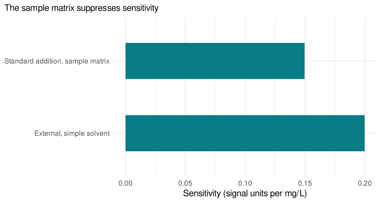
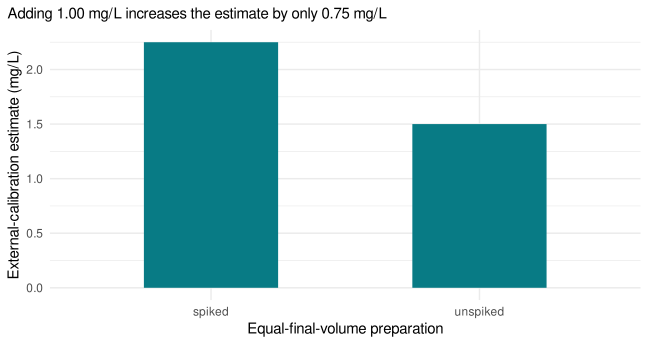
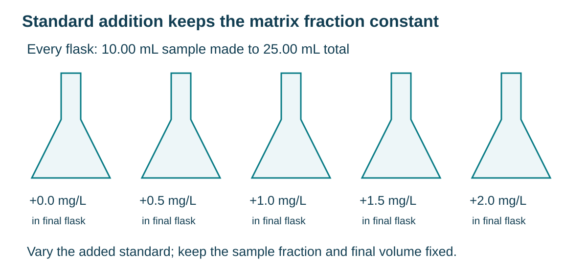
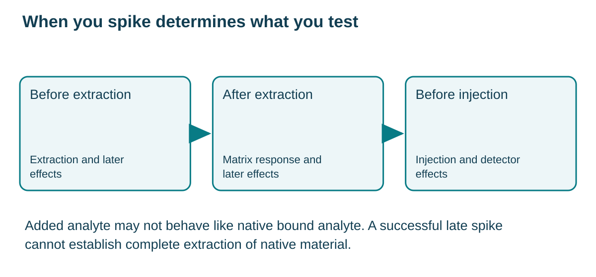
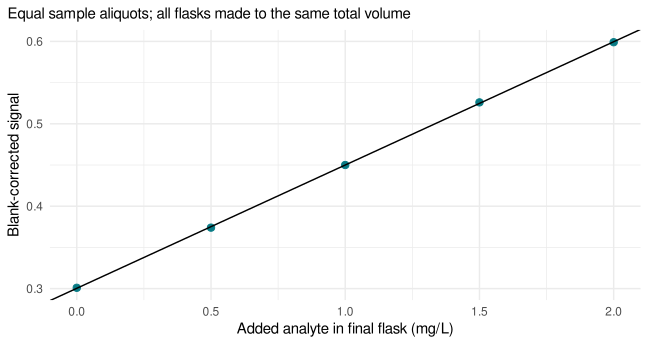
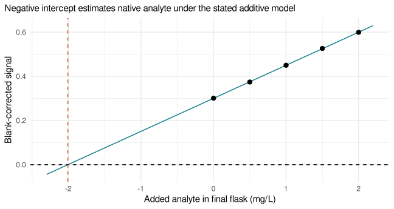

## Why can a good external line give a low result?

{fig-alt="Sample-matrix sensitivity is about 0.1496 response units per mg/L, below the external-standard slope of 0.1998."}

The sample changes the response per unit analyte.

::: {.notes}
Introduce multiplicative matrix suppression. A correct fit in simple solvent is not evidence that sensitivity is unchanged in sample.
:::

## Separate multiplicative and additive effects

{fig-alt="Sample-matrix sensitivity is about 0.1496 response units per mg/L, below the external-standard slope of 0.1998."}

Changed sensitivity and unrelated background are different problems.

::: {.notes}
Standard addition can address some sensitivity differences; it does not automatically subtract an unknown interferent.
:::

## A spike tests incremental response

{fig-alt="Adding 1.00 mg/L increases the external estimate by 0.75 mg/L, giving 75 percent incremental recovery."}

What should adding a known amount change?

::: {.notes}
The increase, after matched dilution and preparation, should reflect the supplied analyte increment under the method assumptions.
:::

## Put all terms on the same volume basis

{fig-alt="Five flasks have equal sample aliquots and equal final volume, but increasing standard additions expressed as final-flask concentration."}

Both final flasks have the same sample fraction and total volume.

::: {.notes}
If volumes differ, raw concentration differences can mix dilution with recovery. Here added concentration is explicitly final-flask concentration.
:::

## Calculate the observed recovery

{fig-alt="Adding 1.00 mg/L increases the external estimate by 0.75 mg/L, giving 75 percent incremental recovery."}

Estimate rises from 1.50 to 2.25 mg/L after adding 1.00 mg/L.

::: {.notes}
The incremental recovery is seventy-five percent. State that no universal acceptance window is supplied for all matrices.
:::

## Interpret 75% correctly

{fig-alt="Added analyte may not behave like native bound analyte. A successful late spike cannot establish complete extraction of native material."}

It is evidence about the added analyte from its addition point onward.

::: {.notes}
It does not prove that every native analyte molecule experiences exactly the same loss.
:::

## A late addition misses early extraction losses

{fig-alt="Added analyte may not behave like native bound analyte. A successful late spike cannot establish complete extraction of native material."}

Which step did the spike not pass through?

::: {.notes}
A post-extraction spike cannot establish extraction recovery. Even a pre-extraction free spike may differ from native bound analyte.
:::

## Build a fixed-volume standard-addition series

{fig-alt="Five flasks have equal sample aliquots and equal final volume, but increasing standard additions expressed as final-flask concentration."}

Every flask: 10.00 mL sample made to 25.00 mL.

::: {.notes}
Vary standard addition, not the final matrix fraction. Added concentration is expressed in the final flask.
:::

## Write the sample contribution in the final flask

{fig-alt="Five flasks have equal sample aliquots and equal final volume, but increasing standard additions expressed as final-flask concentration."}

$c_{native,final}=c_s V_s/V_f$.

::: {.notes}
The original sample is diluted to forty percent of its original concentration. This contribution remains the same across flasks.
:::

## State the response model

$y=b(c_sV_s/V_f+c_{added,final})$.

::: {.notes}
Background has already been corrected. Sensitivity is assumed constant across flasks and equal for native and added analyte. The model, not the graph alone, enables inference.
:::

## Fit the familiar straight line

{fig-alt="Blank-corrected response rises with final-flask added analyte; the intercept includes native sample analyte."}

```r
lm(blank_corrected_signal ~ spike_mg_l_final, data = additions)
```

::: {.notes}
Reuse lm. The new idea is the experimental design and chemical meaning of its intercept.
:::

## Read the slope

{fig-alt="Sample-matrix sensitivity is about 0.1496 response units per mg/L, below the external-standard slope of 0.1998."}

Matrix slope ≈ **0.1496**, versus external ≈ **0.1998**.

::: {.notes}
Units are signal units per mg/L. The sample suppresses response in the teaching model.
:::

## Read the intercept

{fig-alt="Blank-corrected response rises with final-flask added analyte; the intercept includes native sample analyte."}

Response at zero added analyte ≈ **0.3004**.

::: {.notes}
Zero added analyte still leaves native analyte in every sample aliquot. This is not the same as a zero-analyte blank.
:::

## Locate the negative intercept

{fig-alt="The standard-addition line extrapolates to a negative x-intercept near minus 2.008 mg/L in the final flask."}

$x_0=-a/b\approx-2.0080$ mg/L.

::: {.notes}
It is a model-based extrapolation. No negative solution is prepared.
:::

## Undo the dilution of the sample aliquot

{fig-alt="Five flasks have equal sample aliquots and equal final volume, but increasing standard additions expressed as final-flask concentration."}

2.0080 × 25.00/10.00 = **5.020 mg/L original**.

::: {.notes}
The magnitude of the intercept refers to the final flask. Omitting the volume correction leaves the wrong sample basis.
:::

## Compare external calibration

{fig-alt="Sample-matrix sensitivity is about 0.1496 response units per mg/L, below the external-standard slope of 0.1998."}

The external answer is about **3.761 mg/L original**.

::: {.notes}
The lower matrix sensitivity explains a low external result under this model. The comparison is not proof of the same mechanism in all future samples.
:::

## Extrapolation requires its own justification

{fig-alt="The standard-addition line extrapolates to a negative x-intercept near minus 2.008 mg/L in the final flask."}

Why is this different from reporting an ordinary unknown beyond range?

::: {.notes}
The negative intercept follows a designed additive model with fixed sample fraction. It is still uncertain and sensitive to model failure. Ordinary high unknowns need new measurements.
:::

## An additive interferent can survive standard addition

{fig-alt="Blank-corrected response rises with final-flask added analyte; the intercept includes native sample analyte."}

A positive non-analyte signal can shift the intercept.

::: {.notes}
Even an excellent straight line can then overestimate native analyte. Background correction must be chemically appropriate.
:::

## Changing final volume changes the design

{fig-alt="Five flasks have equal sample aliquots and equal final volume, but increasing standard additions expressed as final-flask concentration."}

Do not use a fixed-volume intercept formula without its fixed-volume conditions.

::: {.notes}
Different final volumes alter native concentration and matrix fraction. A suitable alternative calculation must account for them.
:::

## Uncertainty belongs to the inferred intercept too

{fig-alt="The standard-addition line extrapolates to a negative x-intercept near minus 2.008 mg/L in the final flask."}

Slope, intercept, their covariance and volume factors contribute.

::: {.notes}
This core exercise reports a conditional point estimate. The response interval at zero added analyte is not automatically an interval for original concentration.
:::

## Do not turn one recovery into a universal correction

{fig-alt="Added analyte may not behave like native bound analyte. A successful late spike cannot establish complete extraction of native material."}

What evidence would support applying a correction to another sample?

::: {.notes}
Matrix consistency, spike/native equivalence, validated behaviour and correction uncertainty would be needed. A convenient ratio is insufficient.
:::

## Transfer the design

{fig-alt="Five flasks have equal sample aliquots and equal final volume, but increasing standard additions expressed as final-flask concentration."}

5.00 mL to 20.00 mL; $y=0.240+0.120c_{added,final}$.

::: {.notes}
Negative intercept is minus two mg/L; original concentration is eight mg/L. Require the dilution explanation.
:::

## Take the reasoning into R

[Open the student lesson](../lessons/matrix-recovery.qmd).

Save the calculation and a chemical interpretation in your reproducible report.

[Interactive experiment](../demos/matrix-recovery.html) · Predict, change, explain.

::: {.notes}
Harris and Lucy reading: calibration and spectrophotometric applications. Source and dataset assumptions are linked in the student page. Keep longer coding in the practical, rather than reading a script aloud. Slide count is not a duration target; allow thinking time where the question warrants it.
:::
