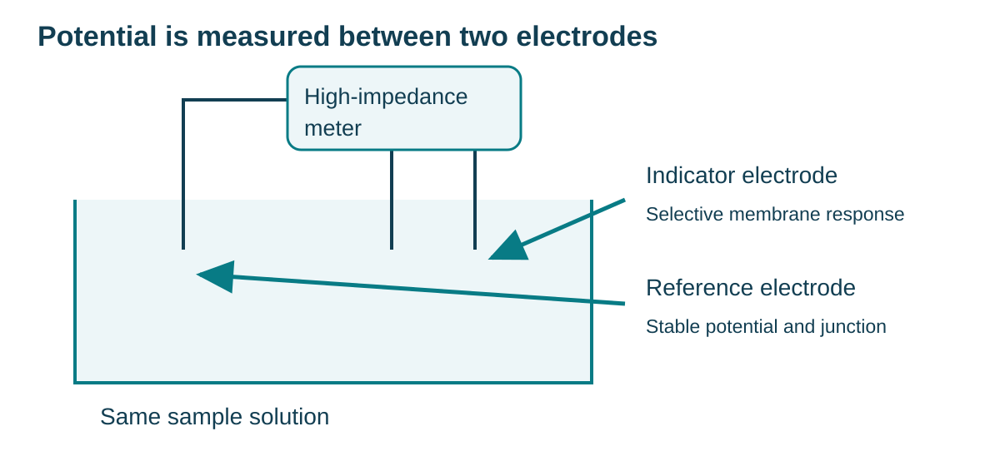
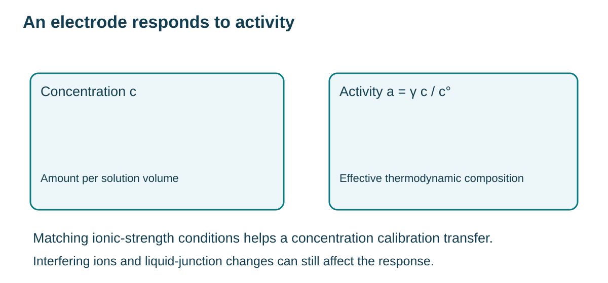
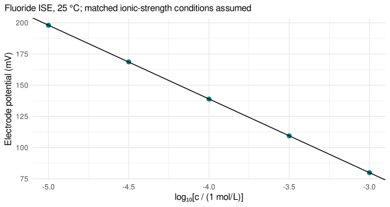
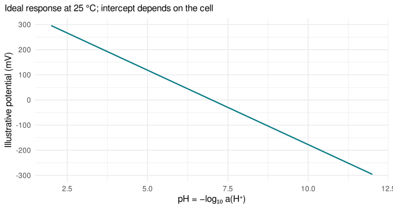
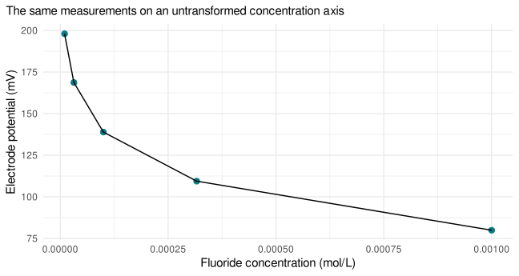
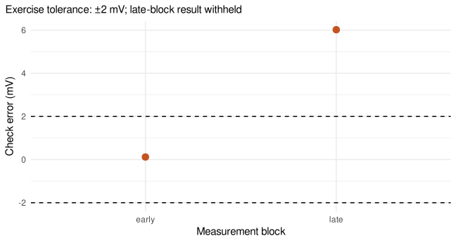

## A voltage belongs to a cell

{fig-alt="An indicator electrode and reference electrode contact the same sample and connect to a high-input-impedance meter. There is negligible net measurement current."}

Which two functions are required?

::: {.notes}
Indicator and reference electrodes. A combined electrode packages both functions; it does not remove the reference.
:::

## The indicator responds; the reference anchors

{fig-alt="An indicator electrode and reference electrode contact the same sample and connect to a high-input-impedance meter. There is negligible net measurement current."}

The measured potential also includes the reference and junction.

::: {.notes}
Changes in either can affect the reading. A voltage is not an intrinsic concentration label.
:::

## Why use a high-input-impedance meter?

{fig-alt="An indicator electrode and reference electrode contact the same sample and connect to a high-input-impedance meter. There is negligible net measurement current."}

Read potential with negligible net measurement current.

::: {.notes}
Contrast with deliberately current-measuring electrochemical methods. Do not imply a potentiometric electrode is a current detector.
:::

## Activity gives the thermodynamic response

{fig-alt="Activity is dimensionless and related to concentration by an activity coefficient and standard concentration. Matching ionic strength supports calibration transfer."}

$a_i=\gamma_i c_i/c^\circ$.

::: {.notes}
Activity is dimensionless. A concentration calibration transfers only when the activity relationship is appropriate to standards and sample.
:::

## Write the logarithmic relationship

$E=K+(2.303RT/zF)\log_{10} a_i$.

::: {.notes}
The sign here includes signed ion charge and the chosen potential convention. At twenty-five Celsius the monovalent magnitude is about 59.16 mV per decade.
:::

## Anion and cation slopes need a convention

{fig-alt="Fluoride potential decreases linearly with log concentration, with slope minus 59.10 mV per decade."}

For this fluoride example, increasing concentration lowers the potential.

::: {.notes}
Do not infer a chemistry error solely from a sign without checking instrument polarity and cell convention.
:::

## Match conditions before using concentration

{fig-alt="Activity is dimensionless and related to concentration by an activity coefficient and standard concentration. Matching ionic strength supports calibration transfer."}

Ionic-strength adjustment helps; it does not remove every interference.

::: {.notes}
Discuss activity coefficients, complexes and junction changes. The electrode can respond to free species rather than total element.
:::

## pH is already logarithmic

{fig-alt="Illustrative pH potential decreases by 59.16 mV per pH unit at 25 degrees Celsius; the cell sets its intercept."}

$pH=-\log_{10}a_{H^+}$.

::: {.notes}
One pH unit is a tenfold activity change. Avoid treating pH itself as an ordinary concentration in mol/L.
:::

## Buffers establish the pH calibration

{fig-alt="Illustrative pH potential decreases by 59.16 mV per pH unit at 25 degrees Celsius; the cell sets its intercept."}

Use appropriate buffers and measurement temperature.

::: {.notes}
The illustrated ideal intercept is not universal. The cell and calibration establish the actual response.
:::

## Inspect the fluoride standards

{fig-alt="The same fluoride measurements form a curved relationship on an untransformed concentration axis."}

Range here: 10⁻⁵ to 10⁻³ mol/L at matched conditions.

::: {.notes}
This is the supplied scenario range, not a universal electrode range or a full validation.
:::

## Transform the explanatory quantity

```r
mutate(log_c = log10(fluoride_mol_l))
```

::: {.notes}
Numerically this takes concentration in mol/L relative to one mol/L. Zero and negative concentrations cannot be ordinary log-calibration points.
:::

## The correct axes reveal the model

{fig-alt="Fluoride potential decreases linearly with log concentration, with slope minus 59.10 mV per decade."}

The same observations are nearly linear against log concentration.

::: {.notes}
Ask why a straight line on the untransformed concentration axis would be inappropriate.
:::

## Read the slope per decade

{fig-alt="Fluoride potential decreases linearly with log concentration, with slope minus 59.10 mV per decade."}

Fitted slope = **−59.10 mV per decade**.

::: {.notes}
A factor of ten in concentration is a one-unit change on the explanatory axis. The fitted intercept is about minus 97.42 mV.
:::

## Invert in two steps

First $(E-a)/b$; then $c=10^{(E-a)/b}$ mol/L.

::: {.notes}
For the measured 121.2 mV, the exponent is about minus 3.699. Forgetting the power of ten leaves a log value rather than concentration.
:::

## Report the accepted early sample

{fig-alt="Fluoride potential decreases linearly with log concentration, with slope minus 59.10 mV per decade."}

121.2 mV → **2.00 × 10⁻⁴ mol/L**.

::: {.notes}
Check that this lies within the supplied calibration range. Identity and matrix compatibility remain assumptions.
:::

## Check the calibration at a known concentration

{fig-alt="The early fluoride check has error 0.12 mV and passes; the later check has error 6.02 mV and fails the two-mV tolerance."}

The check is 1.00 × 10⁻⁴ mol/L; exercise tolerance ±2.0 mV.

::: {.notes}
The expected response is 138.98 mV. The check is separate from merely asking whether the fit is straight.
:::

## The early block passes

{fig-alt="The early fluoride check has error 0.12 mV and passes; the later check has error 6.02 mV and fails the two-mV tolerance."}

Observed 139.1 mV; error **+0.12 mV**.

::: {.notes}
Use the preselected rule. Do not re-estimate a tolerance after observing the data.
:::

## The later block fails

{fig-alt="The early fluoride check has error 0.12 mV and passes; the later check has error 6.02 mV and fails the two-mV tolerance."}

Observed 145.0 mV; error **+6.02 mV**.

::: {.notes}
Withhold the affected later sample. Investigate, establish satisfactory calibration and checks, then remeasure.
:::

## A drift does not identify its cause

{fig-alt="An indicator electrode and reference electrode contact the same sample and connect to a high-input-impedance meter. There is negligible net measurement current."}

Conditioning, junction, temperature and matrix changes are candidates.

::: {.notes}
The graph alone does not establish which occurred. Avoid automatically subtracting the observed check error from every later sample.
:::

## Uncertainty changes shape through the inverse

{fig-alt="Fluoride potential decreases linearly with log concentration, with slope minus 59.10 mV per decade."}

Symmetric voltage limits can become asymmetric concentration limits.

::: {.notes}
Exponentiation maps additive voltage uncertainty into multiplicative concentration uncertainty. Never attach a voltage SD directly to a concentration result.
:::

## Place other electrochemical signals

Potential: potentiometry. Current: amperometry or voltammetry. Charge: coulometry.

::: {.notes}
Different signals need different measurement models. Coulometric amount additionally requires the intended reaction to account for the charge.
:::

## Transfer: a 17.8 mV decrease

{fig-alt="Fluoride potential decreases linearly with log concentration, with slope minus 59.10 mV per decade."}

Predict the concentration factor before calculating.

::: {.notes}
With slope minus 59.10, factor is about 2.001. The accepted estimate becomes about four times ten to minus four mol/L.
:::

## Would this measure total fluorine?

{fig-alt="Activity is dimensionless and related to concentration by an activity coefficient and standard concentration. Matching ionic strength supports calibration transfer."}

Free-ion response does not automatically include every chemical form.

::: {.notes}
Ask what preparation and speciation evidence would be needed. Return to the measurand rather than treating the instrument name as the answer.
:::

## Take the reasoning into R

[Open the student lesson](../lessons/potentiometry.qmd).

Save the calculation and a chemical interpretation in your reproducible report.

[Interactive experiment](../demos/potentiometry.html) · Predict, change, explain.

::: {.notes}
Harris and Lucy reading: selected electrochemistry and electrodes. Source and dataset assumptions are linked in the student page. Keep longer coding in the practical, rather than reading a script aloud. Slide count is not a duration target; allow thinking time where the question warrants it.
:::
