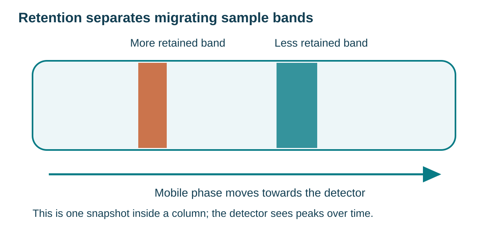
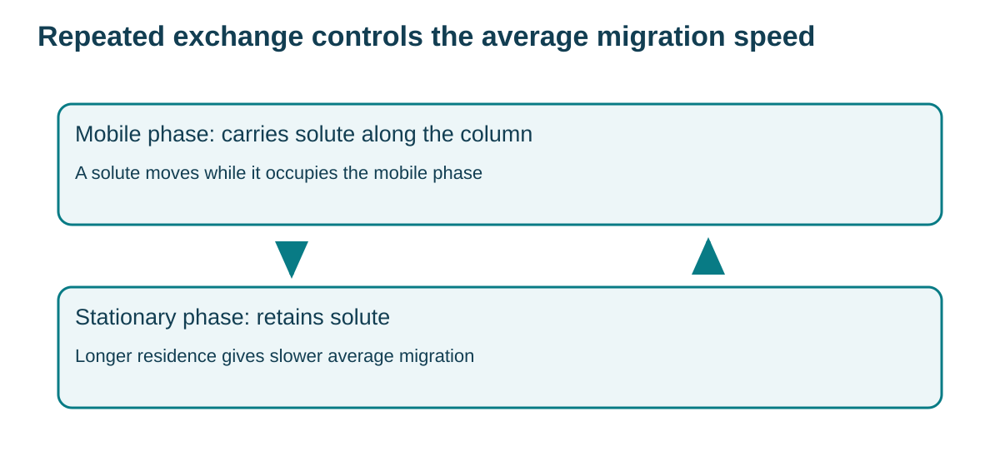
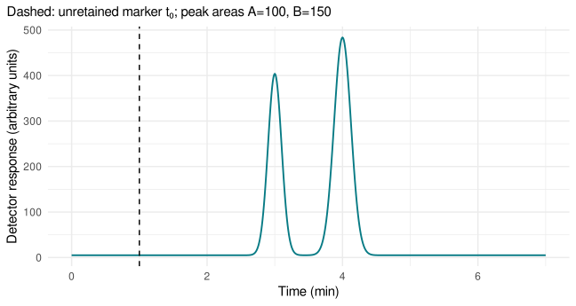
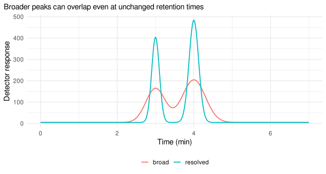
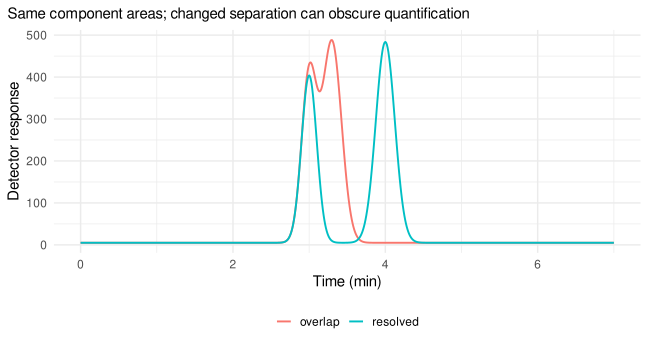
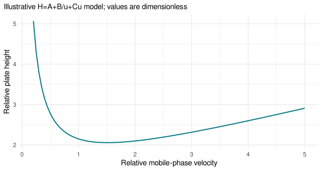

## A detector sees what arrives together

{fig-alt="A snapshot shows two separated bands moving through a column. The less retained band is further towards the outlet; time-resolved detection gives peaks."}

How can we make a mixed response more selective?

::: {.notes}
Separate components in time before detection. Retention and width both matter; a detector need not distinguish every coeluting compound.
:::

## A column snapshot is not a chromatogram

{fig-alt="A snapshot shows two separated bands moving through a column. The less retained band is further towards the outlet; time-resolved detection gives peaks."}

This picture is position inside a column at one time.

::: {.notes}
The less retained band is further towards the outlet. A chromatogram instead measures the outlet response across time.
:::

## Repeated exchange controls average migration

{fig-alt="Solutes repeatedly exchange between mobile and stationary phases. A greater stationary-phase residence fraction delays average migration."}

Solute moves while it occupies the mobile phase.

::: {.notes}
Greater stationary-phase residence slows average migration. This is a conceptual equilibrium picture, not a statement that molecules stop exchanging.
:::

## Interactions create retention and selectivity

{fig-alt="Solutes repeatedly exchange between mobile and stationary phases. A greater stationary-phase residence fraction delays average migration."}

Conditions can change the relative residence of two compounds.

::: {.notes}
Mobile-phase composition, stationary phase and temperature can affect the balance differently for different solutes.
:::

## Read the chromatogram axes

{fig-alt="A simulated chromatogram has unretained time one minute and resolved component peaks near three and four minutes."}

Response versus elapsed run time.

::: {.notes}
One row is a time position within a run, not an independently collected sample. Many CSV rows do not supply many independent replicates.
:::

## Identify the transit time

{fig-alt="A simulated chromatogram has unretained time one minute and resolved component peaks near three and four minutes."}

The dashed marker is $t_0=1.00$ min.

::: {.notes}
It represents unretained transit, not an analyte peak. Distinguish the marker from the measured components.
:::

## Subtract transit before calculating retention

{fig-alt="A simulated chromatogram has unretained time one minute and resolved component peaks near three and four minutes."}

$k=(t_R-t_0)/t_0$.

::: {.notes}
For peak A at three minutes, k is two, not three. The factor is dimensionless when times use matching units.
:::

## Compare the two retention factors

{fig-alt="A simulated chromatogram has unretained time one minute and resolved component peaks near three and four minutes."}

A: $k=2$; B: $k=3$; selectivity $\alpha=1.5$.

::: {.notes}
Both k and alpha refer to the stated conditions. Greater retention alone is not a promise of useful separation.
:::

## Peak area and height are different quantities

{fig-alt="Broader component peaks overlap more despite unchanged retention times and component areas."}

Which can remain the same while a peak becomes lower?

::: {.notes}
Integrated area can stay constant when a fixed amount is spread over a longer time, under a stable linear response and correct baseline.
:::

## Calibration still supplies the amount relation

{fig-alt="A simulated chromatogram has unretained time one minute and resolved component peaks near three and four minutes."}

A larger peak is not a universal count of molecules.

::: {.notes}
Response factor, introduced amount and detector selectivity matter. A standard calibrates under defined conditions.
:::

## Resolution includes spacing and width

$R_s=2(t_{R2}-t_{R1})/(w_1+w_2)$.

::: {.notes}
These widths are baseline widths, not half-height widths. Keep all time units consistent.
:::

## Calculate the resolved pair

{fig-alt="A simulated chromatogram has unretained time one minute and resolved component peaks near three and four minutes."}

2 × (4.0 − 3.0)/(0.4 + 0.5) = **2.222**.

::: {.notes}
Require students to identify widths and retention times from the supplied peak summary.
:::

## A familiar threshold needs conditions

{fig-alt="A simulated chromatogram has unretained time one minute and resolved component peaks near three and four minutes."}

Near 1.5 can be useful for similar Gaussian peaks; adequacy depends on the task.

::: {.notes}
Unequal peak amounts, tailing and interference can make one threshold insufficient. Do not declare purity from the number alone.
:::

## Changed spacing reduces resolution

{fig-alt="The same component areas appear resolved or overlapping when their retention-time spacing changes."}

The overlap run has $R_s=0.667$.

::: {.notes}
Both component areas are unchanged in the simulated model. A combined detector response can now be difficult to assign.
:::

## An integration boundary is not chemical selectivity

{fig-alt="The same component areas appear resolved or overlapping when their retention-time spacing changes."}

Does drawing a split recover independent evidence?

::: {.notes}
No: assigning a combined response to components requires a justified model or additional evidence. A vertical split alone can create misleading precision.
:::

## Changed width also reduces resolution

{fig-alt="Broader component peaks overlap more despite unchanged retention times and component areas."}

The broad run keeps retention times but has $R_s=0.909$.

::: {.notes}
This shows why retention time differences alone do not guarantee adequate separation.
:::

## Separate efficiency from selectivity

{fig-alt="A snapshot shows two separated bands moving through a column. The less retained band is further towards the outlet; time-resolved detection gives peaks."}

Narrower bands and different relative retention solve different problems.

::: {.notes}
A more efficient column cannot always rescue unsuitable phase selectivity. Discuss injection and extra-column dispersion as other width sources.
:::

## Estimate plate efficiency only with a stated model

For ideal Gaussian peaks, $N=16(t_R/w_b)^2$.

::: {.notes}
Use the baseline-width version with its assumptions. Half-height widths require the appropriate coefficient. Do not swap export columns silently.
:::

## Why can very slow flow broaden bands?

{fig-alt="A dimensionless illustrative plate-height curve is high at both low and high mobile-phase velocity."}

Diffusion acts over a longer time.

::: {.notes}
Use the low-velocity region of the illustrative H=A+B/u+Cu curve. Values are dimensionless and not measured instrument settings.
:::

## Why can very fast flow broaden bands?

{fig-alt="A dimensionless illustrative plate-height curve is high at both low and high mobile-phase velocity."}

Finite mass transfer can prevent efficient exchange.

::: {.notes}
Use the high-velocity region. An apparent optimum depends on column and method; pressure and run time matter too.
:::

## Identity needs more than expected retention

{fig-alt="The same component areas appear resolved or overlapping when their retention-time spacing changes."}

Another component can arrive at the same time.

::: {.notes}
A reference standard, method consistency and additional selective evidence can strengthen assignment. Coelution can remain hidden.
:::

## Transfer the definitions

{fig-alt="Broader component peaks overlap more despite unchanged retention times and component areas."}

t₀=0.80; tR=2.40 and 3.20; baseline widths=0.40 and 0.60 min.

::: {.notes}
Answers k one two, k two three, alpha one point five, resolution one point six. Ask how doubling both widths changes resolution: halves it, without changing k or alpha.
:::

## Choose the next action from the failure

{fig-alt="Solutes repeatedly exchange between mobile and stationary phases. A greater stationary-phase residence fraction delays average migration."}

Is it spacing, width, identity evidence or calibration that is missing?

::: {.notes}
Avoid a generic change-everything response. Match a proposed measurement or method adjustment to the observed limitation.
:::

## Take the reasoning into R

[Open the student lesson](../lessons/separations.qmd).

Save the calculation and a chemical interpretation in your reproducible report.

[Interactive experiment](../demos/separations.html) · Predict, change, explain.

::: {.notes}
Harris and Lucy reading: analytical separations. Source and dataset assumptions are linked in the student page. Keep longer coding in the practical, rather than reading a script aloud. Slide count is not a duration target; allow thinking time where the question warrants it.
:::
