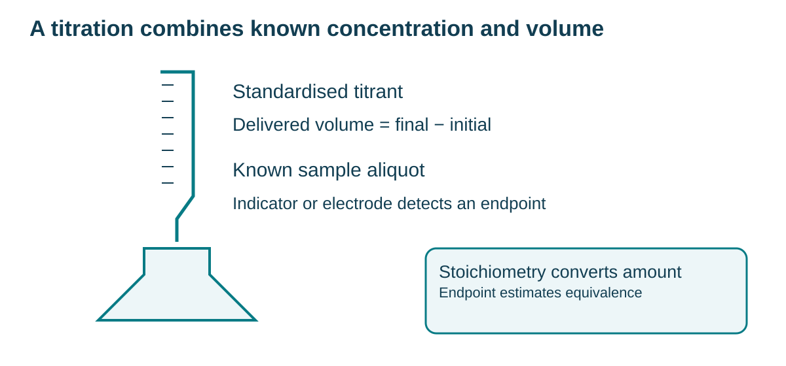
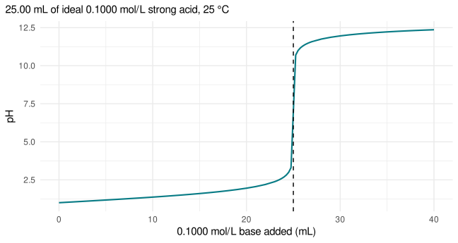
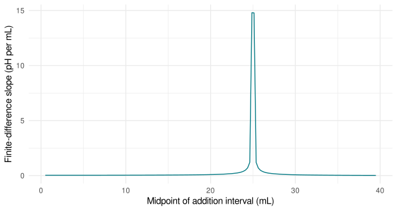
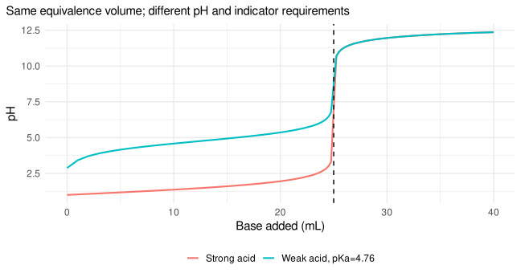
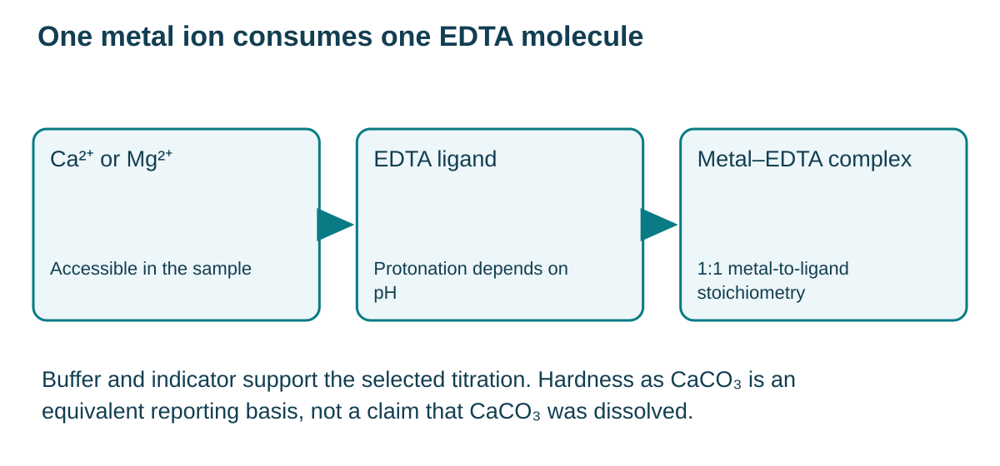
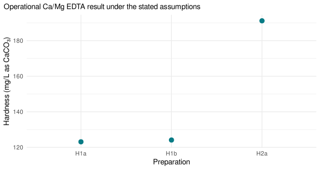

## A known reagent counts an unknown amount

{fig-alt="A burette delivers standardised titrant to a known sample aliquot. Endpoint detection estimates the stoichiometric equivalence point."}

What makes delivered volume chemically meaningful?

::: {.notes}
Known titrant concentration and reaction stoichiometry. The indicator or electrode estimates the endpoint; it does not replace the reaction.
:::

## Know the titrant concentration

A nominal concentration is not automatically a standardised concentration.

::: {.notes}
The example supplies standardised 0.1000 mol/L base. Real preparation and standardisation uncertainty belong in the result.
:::

## Read delivered volume

{fig-alt="A burette delivers standardised titrant to a known sample aliquot. Endpoint detection estimates the stoichiometric equivalence point."}

Delivered volume = final reading − initial reading.

::: {.notes}
An initial position need not be zero. Ask students what a burette reading records and why the final reading alone can be misleading.
:::

## Separate equivalence from endpoint

{fig-alt="A burette delivers standardised titrant to a known sample aliquot. Endpoint detection estimates the stoichiometric equivalence point."}

Equivalence is stoichiometric. The endpoint is observed or estimated.

::: {.notes}
An indicator, electrode or algorithm gives a procedure-defined estimate. Explain endpoint bias using a systematic overrun.
:::

## Write the reaction first

$\mathrm{H^+ + OH^- \rightarrow H_2O}$. One mole consumes one mole.

::: {.notes}
The concentration formula follows from the one-to-one stoichiometry. Other stoichiometries need their coefficients, not a memorised volume shortcut.
:::

## Calculate a worked acid concentration

{fig-alt="Ideal strong-acid titration pH rises sharply near 25 mL base added; equivalence pH is seven at 25 degrees Celsius."}

$c_a=c_b V_{eq}/V_a$ = 0.1000 × 25.00/25.00 = **0.1000 mol/L**.

::: {.notes}
The acid aliquot is 25.00 mL. Supplied endpoint estimate is 25.00 mL. Explain when volumes may remain in matching millilitre units and when mole calculations require litres.
:::

## Explain the curve before equivalence

{fig-alt="Ideal strong-acid titration pH rises sharply near 25 mL base added; equivalence pH is seven at 25 degrees Celsius."}

What species mainly determines pH here?

::: {.notes}
Excess strong acid. The ideal model also includes water equilibrium; it matters near equivalence.
:::

## Explain the curve after equivalence

{fig-alt="Ideal strong-acid titration pH rises sharply near 25 mL base added; equivalence pH is seven at 25 degrees Celsius."}

What now controls pH?

::: {.notes}
Excess strong base. The total volume is changing, so excess amount is divided by the current solution volume.
:::

## Neutrality is conditional

{fig-alt="Ideal strong-acid titration pH rises sharply near 25 mL base added; equivalence pH is seven at 25 degrees Celsius."}

This ideal strong-acid/strong-base equivalence has pH 7 at 25 °C.

::: {.notes}
It is not a universal endpoint rule. A weak acid will provide a counterexample.
:::

## Differentiate using the actual volume spacing

{fig-alt="Finite-difference pH slope peaks close to 25 mL, with the actual addition spacing included."}

Finite difference: $\Delta pH/\Delta V$.

::: {.notes}
The supplied table has smaller additions near equivalence. Treating every step as one millilitre distorts the derivative.
:::

## A numerical maximum is not complete validation

{fig-alt="Finite-difference pH slope peaks close to 25 mL, with the actual addition spacing included."}

Noise and step spacing affect the slope peak.

::: {.notes}
Use the exploratory derivative to locate a region. A real endpoint method must be specified and evaluated against the chemical question.
:::

## Same amount, different equilibrium

{fig-alt="Strong and weak acids have the same equivalence volume here but different pH curves and indicator requirements."}

Which acid requires more base at equivalence?

::: {.notes}
They have the same initial amount and one-to-one stoichiometry, so the equivalence volumes are equal. Acid strength changes the curve, not the supplied amount.
:::

## Choose an indicator for the actual curve

{fig-alt="Strong and weak acids have the same equivalence volume here but different pH curves and indicator requirements."}

A transition interval must lie in an appropriate steep region.

::: {.notes}
For the weak acid, conjugate base affects equivalence pH. Do not choose an indicator solely because its colour is easy to see.
:::

## The buffer region has a chemical cause

{fig-alt="Strong and weak acids have the same equivalence volume here but different pH curves and indicator requirements."}

Weak acid and its conjugate base coexist before equivalence.

::: {.notes}
The comparison weak acid has supplied pKa 4.76. No exhaustive polyprotic derivation is needed for the core task.
:::

## EDTA gives another stoichiometric count

{fig-alt="Buffer and indicator support the selected titration. Hardness as CaCO₃ is an equivalent reporting basis, not a claim that CaCO₃ was dissolved."}

One accessible metal ion consumes one EDTA ligand.

::: {.notes}
The simplified hardness case counts accessible calcium and magnesium. Other metals can interfere if they also consume EDTA.
:::

## pH changes effective binding

{fig-alt="Buffer and indicator support the selected titration. Hardness as CaCO₃ is an equivalent reporting basis, not a claim that CaCO₃ was dissolved."}

Ligand protonation and metal side reactions affect the conditional equilibrium.

::: {.notes}
A large overall formation constant is not sufficient to establish performance under arbitrary acidity. Buffer and indicator belong to the procedure.
:::

## Name the reporting basis

{fig-alt="Buffer and indicator support the selected titration. Hardness as CaCO₃ is an equivalent reporting basis, not a claim that CaCO₃ was dissolved."}

Hardness **as CaCO₃** uses an equivalent molar mass.

::: {.notes}
It does not establish that carbonate was present or separately identify calcium and magnesium. We supply molar mass 100.09 g/mol.
:::

## Correct the measured consumption

{fig-alt="A burette delivers standardised titrant to a known sample aliquot. Endpoint detection estimates the stoichiometric equivalence point."}

H1a: 6.30 − 0.10 − 0.05 = **6.15 mL**.

::: {.notes}
The first two numbers are final and initial burette positions. The third is matched blank consumption, on the same delivered-volume basis.
:::

## Calculate the metal amount

{fig-alt="Buffer and indicator support the selected titration. Hardness as CaCO₃ is an equivalent reporting basis, not a claim that CaCO₃ was dissolved."}

0.01000 mol/L × 0.00615 L = **6.15 × 10⁻⁵ mol**.

::: {.notes}
This amount refers to the 50.00 mL sample aliquot. Retain full precision and convert to the reporting equivalent only after establishing amount.
:::

## Convert to the sample basis

{fig-alt="Three preparations give about 123, 124 and 191 mg/L hardness as calcium carbonate."}

6.15 × 10⁻⁵ mol × 100.09 g/mol / 0.05000 L = **123.11 mg/L as CaCO₃**.

::: {.notes}
Show the gram-to-milligram conversion explicitly in discussion.
:::

## Keep repeated preparations distinct

{fig-alt="Three preparations give about 123, 124 and 191 mg/L hardness as calcium carbonate."}

H1a and H1b are separate preparations of H1.

::: {.notes}
They probe preparation repeatability; they are not independent collected waters. H2a is another supplied sample.
:::

## What can bias a titration result?

{fig-alt="A burette delivers standardised titrant to a known sample aliquot. Endpoint detection estimates the stoichiometric equivalence point."}

Endpoint overrun, wrong titrant concentration, blank consumption, interference.

::: {.notes}
Ask for the direction of error for one example. A forgotten positive blank consumption raises the result in this model.
:::

## Transfer the reaction and basis

{fig-alt="Buffer and indicator support the selected titration. Hardness as CaCO₃ is an equivalent reporting basis, not a claim that CaCO₃ was dissolved."}

25.00 mL water; 4.10 mL delivered EDTA; 0.10 mL blank; 0.01000 mol/L.

::: {.notes}
Allow the calculation. Corrected four millilitres yields 160.14 mg/L as CaCO3. Require the reporting basis in the answer.
:::

## Take the reasoning into R

[Open the student lesson](../lessons/titration.qmd).

Save the calculation and a chemical interpretation in your reproducible report.

[Interactive experiment](../demos/titration.html) · Predict, change, explain.

::: {.notes}
Harris and Lucy reading: selected equilibrium and titration topics. Source and dataset assumptions are linked in the student page. Keep longer coding in the practical, rather than reading a script aloud. Slide count is not a duration target; allow thinking time where the question warrants it.
:::
