## What number are we trying to report?

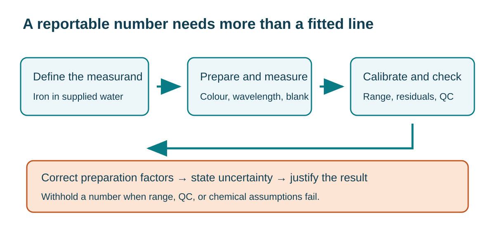{fig-alt="From the supplied water sample through preparation, calibration, and checking to a reported concentration."}

**mg elemental Fe/L in the supplied filtered water.** What must be true before
that number is meaningful?

::: {.notes}
Ask students to distinguish a signal from a chemical result. The waters are
simulated, filtered and fortified. Assume all dissolved iron is quantitatively
reduced and complexed, with no loss. This is not a digestion or total-recovery
claim for arbitrary environmental water. The full unit and project are linked
from the course home page.
:::

## Chemistry creates the absorber

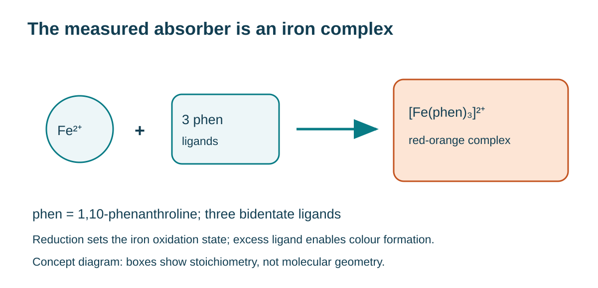{fig-alt="Fe²⁺ plus three phenanthroline ligands forms the red-orange iron complex."}

Reduction, acidity, and excess ligand affect the amount of coloured complex.

::: {.notes}
Phen means 1,10-phenanthroline. Each ligand is bidentate. The diagram illustrates
stoichiometry, not geometry. Ask what incomplete reduction would do to the
result. Do not equate measured iron after reduction with original Fe(II).
Background: https://staff.buffalostate.edu/nazareay/che301/l9.pdf .
:::

## Follow the light

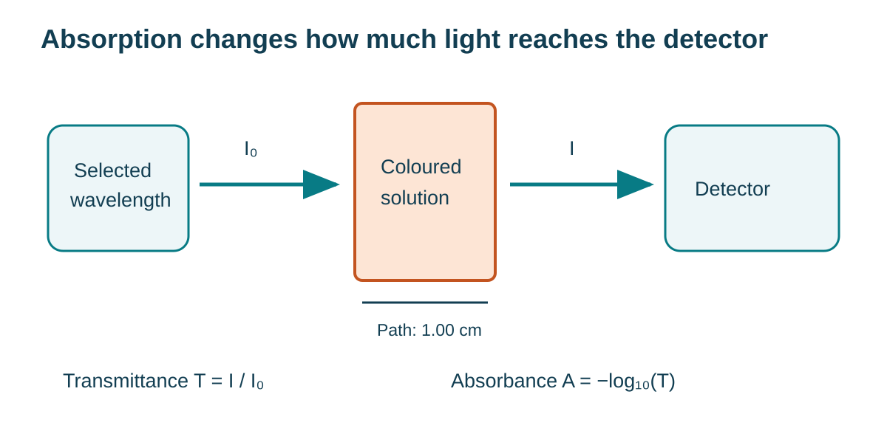{fig-alt="Selected light enters a one-centimetre cuvette. The detector measures the transmitted light relative to the reference."}

The reference is a reagent blank. These files are already blank-referenced.

::: {.notes}
I zero is the matched reference intensity; I is transmitted intensity through
the prepared sample. Discuss the purpose of a reagent blank and why a further
subtraction changes an already referenced measurement. Compare an empty cell,
solvent reference, and a matched reagent blank verbally.
:::

## Why choose 510 nm?

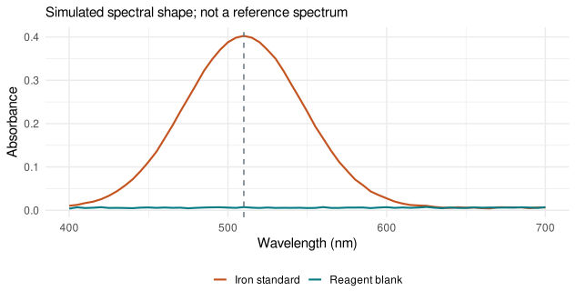{fig-alt="The simulated iron-standard spectrum peaks near 510 nm and the reagent-blank response is small."}

A strong response and a flat local maximum help. **Does the maximum prove
selectivity?**

::: {.notes}
It does not: other components may absorb. These curves are a simulated Gaussian
envelope, not authentic identification spectra. Rows are wavelengths within a
scan, not independent replicates. Connect to the known approximate visible
maximum of the iron(II) complex; the university example uses 508 nm.
:::

## Absorbance and concentration

$$A=-\log_{10}(I/I_0), \qquad A=\varepsilon l c$$

At fixed wavelength and path, a suitable dilute solution gives a proportional
response. Our calibration uses **mg Fe/L**, not mol/L.

**Predict:** if $T=0.50$, $A\approx0.301$. If absorbance doubles, what happens
to transmittance?

::: {.notes}
Transmittance becomes approximately 0.25. Emphasise that doubling absorbance
squares transmittance. We use an empirical calibration slope in L/mg Fe, not
a molar absorptivity. Chemical equilibrium, stray light, and excessive absorbance
can break a simple linear relationship.
:::

## Fit what we measured

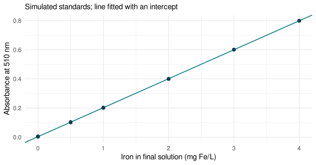{fig-alt="Standards between zero and four mg Fe/L and their fitted absorbance response."}

`lm(absorbance ~ standard_mg_l, data = standards)`

::: {.notes}
Retrieve the earlier calibration lesson. Eighteen independent final standard
solutions, three per concentration, are measured once each. The unweighted line
retains its intercept: a=0.003873883 and b=0.198799368. Do not force zero or reverse
the regression. Units of slope are L/mg Fe.
:::

## A good line needs a diagnostic

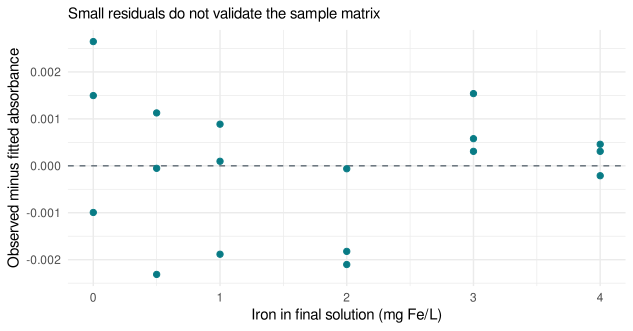{fig-alt="Residual absorbance versus concentration; no obvious curvature in this teaching dataset."}

What would curvature mean? What could small residuals still fail to reveal?

::: {.notes}
Inspect curvature, spread and unusual points. The assumptions are constant
response variance and negligible standard concentration uncertainty. Small
residuals cannot validate recovery or sample-specific interferences. Do not
remove inconvenient observations simply to improve the fit.
:::

## What counts as replication?

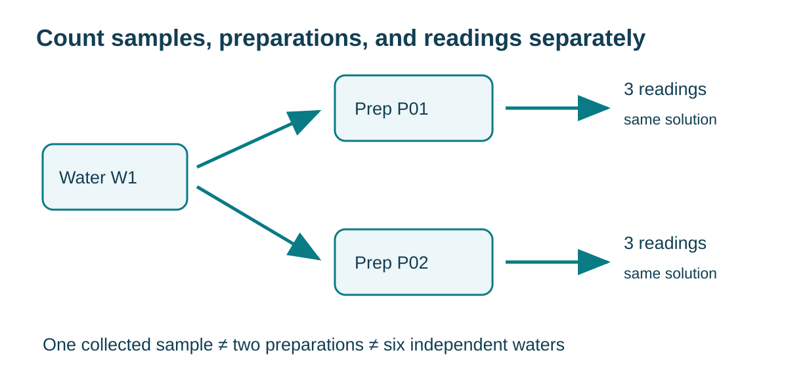{fig-alt="One collected water sample gives two independent preparations, each measured three times."}

Six readings are not six independently collected waters.

::: {.notes}
P01 and P02 share W1. Repeated readings describe reading repeatability; preparing
another aliquot probes additional variation. Both still use the same calibration.
Do not divide every contribution by the square root of six.
:::

## Match by preparation ID

```r
means |>
  left_join(preparations, by = "preparation_id")
```

- Require one preparation record per ID.
- Require a preparation record for every measured ID.
- Inspect the joined rows and units.

**The two CSV files deliberately have different row orders.**

::: {.notes}
This is the principal new table operation. Have students predict the error from
joining by row position. The lesson includes stopifnot checks for unique keys
and complete matches. Row order has no chemical meaning.
:::

## Correct the preparation factor

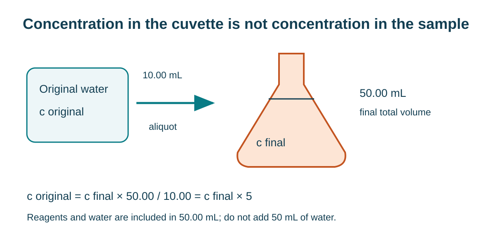{fig-alt="Ten millilitres made up to a total of fifty millilitres gives a factor of five."}

P01: $\bar A=0.480620$ → **2.398 mg Fe/L final** → **11.99 mg Fe/L original**.

::: {.notes}
Invert A=a+bc, then multiply by final volume over aliquot volume. Total final
volume includes reagents. Keep all numerical precision in code. State the
concentration basis: elemental iron in the original supplied filtered water.
:::

## An old out-of-range reading needs new evidence

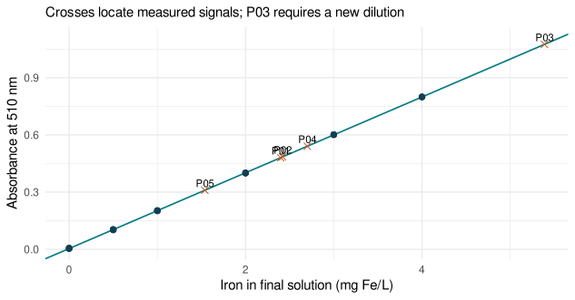{fig-alt="P03 lies beyond the standard range; the newly prepared and measured P04 lies within it."}

P04 uses a **new 5.00 mL aliquot**, made to 50.00 mL. Its result is about
**27.00 mg Fe/L original**.

::: {.notes}
P03 mean A=1.07507 exceeds the validated teaching range. P04 mean A=0.54061 is
within range; its factor is 10. Editing the dilution factor on P03 cannot create
a new measurement. Crosses on this illustration locate response levels using
the line's algebraic inverse; unsupported values are not exported as results.
:::

## Independent QC can stop reporting

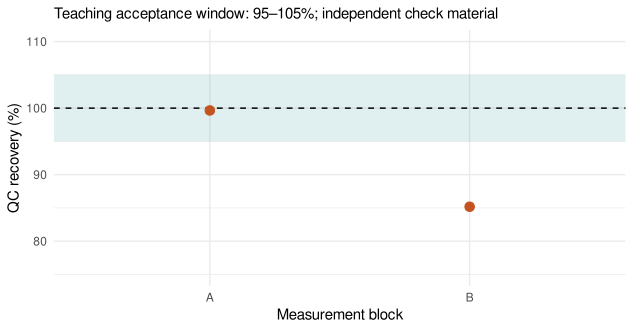{fig-alt="Independent QC recovers about 99.6 percent in block A and 85.2 percent in later block B; only A meets the exercise criterion."}

Withhold P05 from block B. Investigate and remeasure after satisfactory QC.

::: {.notes}
Acceptance is a supplied 95–105 percent recovery window for this exercise.
Calibration from A is checked before use in later B. Do not retroactively
invalidate A or automatically correct B by dividing by the failed QC recovery.
QC failure signals a problem but does not identify the cause.
:::

## Uncertainty survives averaging

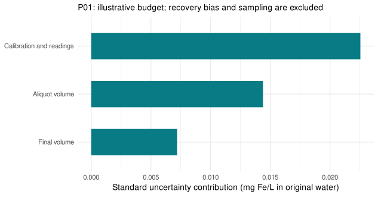{fig-alt="Illustrative P01 standard uncertainty contributions: calibration and readings, final volume, and aliquot volume."}

P01: **11.991 mg Fe/L; standard uncertainty 0.028 mg Fe/L** under the stated model.

::: {.notes}
The supplied helper includes response and slope/intercept uncertainty through
a first-order inverse-calibration calculation. Independent volume uncertainties
are added by root-sum-of-squares. This is not a 95 percent half-width. Sampling,
recovery, matrix bias and standard concentration uncertainty are omitted.
The approximate 95 percent interval 2.3886–2.4077 applies only to final solution
concentration before volume uncertainty is added.
:::

## What can we report?

| Preparation | Original mg Fe/L | Decision |
| --- | ---: | --- |
| P01, W1 | 11.99 | Report under assumptions |
| P02, W1 | 12.10 | Separate preparation of W1 |
| P03, W2 | Withheld | Outside range |
| P04, W2 | 27.00 | Newly measured preparation |
| P05, W3 | Withheld | Later block QC failed |

Explain each decision using evidence, not just the fitted equation.

::: {.notes}
Use the CSV to inspect full precision. Do not present the duplicate preparations
as independent collected samples or average uncertainty as if calibrations were
independent. The limited uncertainty budget is not full method validation.
:::

## Transfer the reasoning

A **new** preparation uses 2.00 mL made up to 50.00 mL, measured in accepted
block A. Readings: 0.399, 0.401, 0.400.

1. Check the mean and range.
2. Estimate the final concentration.
3. Apply the preparation factor.
4. State what is missing from a full uncertainty statement.

::: {.notes}
Mean=0.400; final estimate=1.9925924 mg Fe/L; factor=25; original estimate=49.8148
mg Fe/L. The proposed point answer is 49.81. It does not have an evaluated
preparation uncertainty because new volume uncertainties were not supplied.
:::

## Rebuild the whole argument

{fig-alt="Analytical workflow from a defined question through preparation and checks to a result with uncertainty."}

Render your R Markdown report from a fresh session. Include the chemical
assumptions and reasons for every withheld result.

::: {.notes}
Students should retain source, data, output CSV and HTML. Ask which error no
amount of R code can repair without new chemical evidence. Examples: failed
recovery or an old saturated reading. Refer to the full lesson for hints.
:::

## Reading and figure sources

Harris and Lucy: molecular absorption, spectrophotometers, calibration, and
experimental uncertainty. The planned course edition is not yet confirmed.

[Iron-complex laboratory background](https://staff.buffalostate.edu/nazareay/che301/l9.pdf)

[NIST guidance on inverse calibration](https://www.itl.nist.gov/div898/handbook/pmd/section5/pmd521.htm)

All diagrams are original course illustrations. All plotted data are simulated;
plots are rebuilt from the supplied R project.

[Interactive experiment](../demos/uv-visible.html) · Predict, change, explain.

::: {.notes}
Read by textbook topic rather than assuming an edition for the planned course.
The linked background supports the iron-complex example; the supplied data and
spectral envelope are simulated, not measurements from that source. The lesson
contains the practical and the helper's assumptions.
:::
