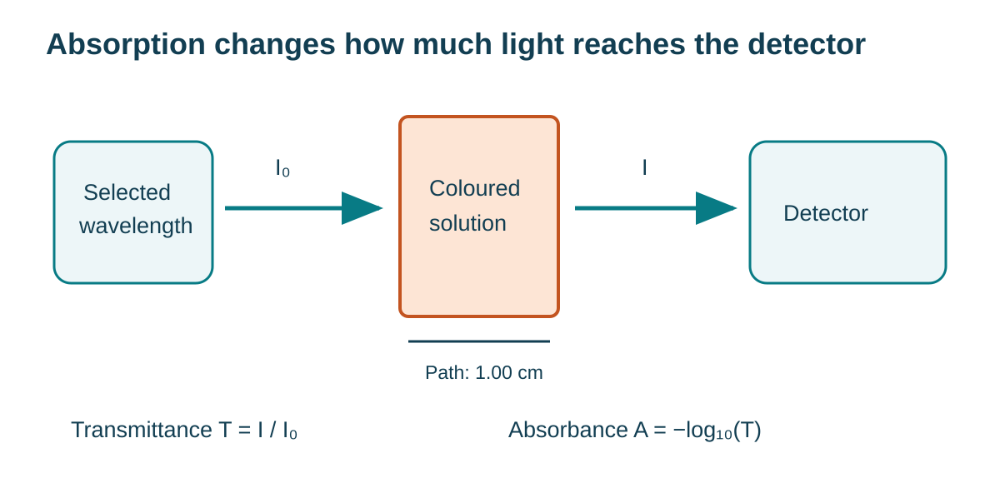
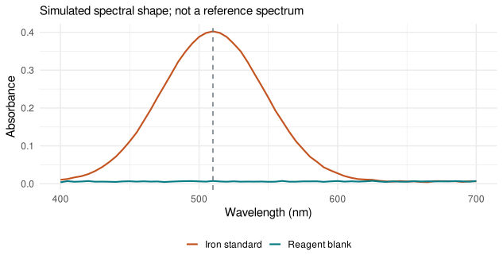
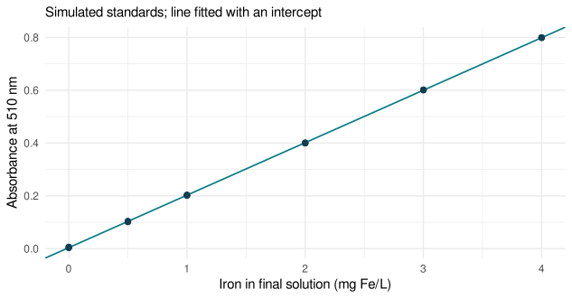
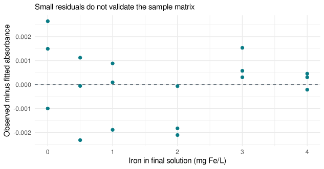
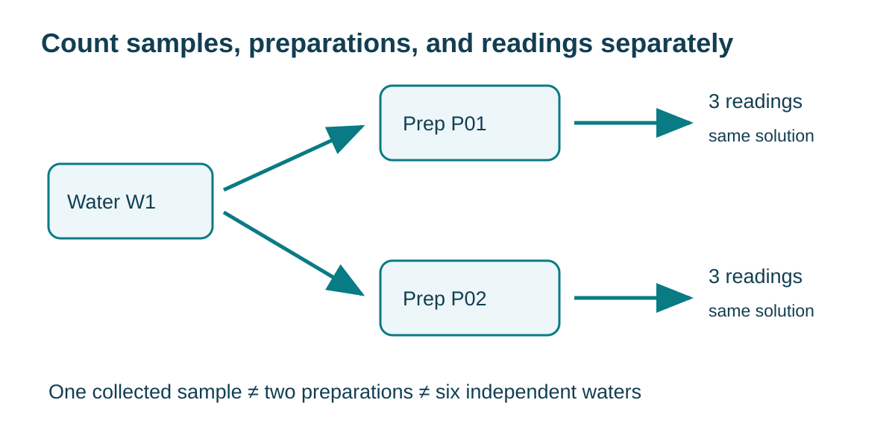
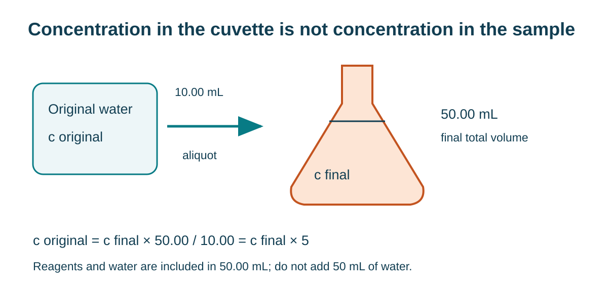
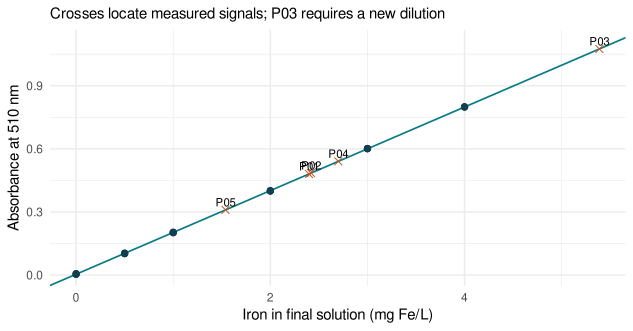
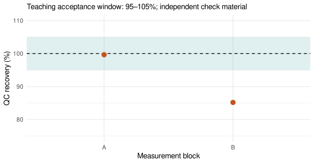
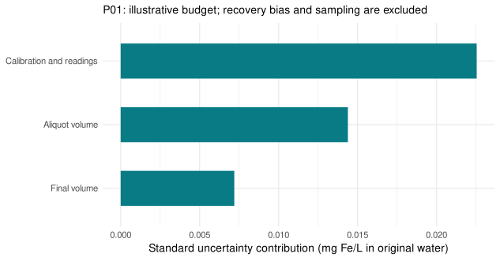

## Goal

Connect an absorbing chemical species to a defensible iron concentration. Retrieve plotting and regression in R; extend these with keyed preparation joins and inverse-calibration uncertainty.

## Background


How much dissolved iron is in the supplied filtered water, and which results
are supported by the measurements? We will make a coloured iron complex, use
its light absorption to estimate concentration, then check the preparation
factor, calibration, and independent quality-control result.

Use your familiar R project, CSV, plotting, and straight-line skills. The new
steps are **matching preparation records by ID** and **accounting for uncertainty
when converting a signal to concentration**.

[Download the complete project](../downloads/uv-visible-project.zip), extract it,
and open `analyticalchem.Rproj`. Keep `report.Rmd` at the project root.
The project needs R packages `readr`, `dplyr`, `ggplot2`, `knitr`, and `rmarkdown`.
See the [R reference](../reference/r.qmd) for package setup.

All measurements here are **simulated**. This is an analysis exercise; use an
approved practical protocol for any actual laboratory work.

### Make an absorber we can measure

Iron(II) reacts with 1,10-phenanthroline, abbreviated **phen**, to form a
red-orange complex:

$$\mathrm{Fe^{2+} + 3\,phen \rightleftharpoons [Fe(phen)_3]^{2+}}$$

Three bidentate ligands coordinate one iron ion. We measure the complex near
510 nm. Reduction maintains the iron(II) state; controlled acidity and excess
ligand support colour formation. [University laboratory background](https://staff.buffalostate.edu/nazareay/che301/l9.pdf)

{fig-alt="One Fe²⁺ combines with three phen ligands. Boxes describe stoichiometry, not molecular geometry."}

For this exercise, assume quantitative reduction and complex formation and no
iron loss. The measurand is **mg Fe/L in the supplied filtered water**, including
iron converted to Fe(II) in the assumed preparation. It is not the original
Fe(II) concentration before treatment. No evidence about particulate iron or
digestion recovery is supplied.

**Predict:** if reduction is incomplete, will the result be biased high or low?
Explain using the species that absorbs the light.

### Connect the apparatus to absorbance

At a selected wavelength, light passes through a cuvette. The detector measures
transmitted intensity $I$ relative to reference intensity $I_0$:

$$T = I/I_0, \qquad A = -\log_{10}(T)$$

A reagent blank contains the preparation reagents without the analyte and
accounts for their background under matched conditions. Absorbance in these
files is already referenced to a reagent blank. **Do not blank-correct it again.**

{fig-alt="Selected light crosses a 1.00 cm path; the detector measures transmitted light."}

A transmittance of 0.50 corresponds to absorbance 0.301. If twice as much
analyte doubles absorbance within the linear range, it does not halve
transmittance: $T=10^{-A}$.

For an appropriate dilute solution at fixed wavelength and path length,
Beer–Lambert behaviour is $A=\varepsilon l c$, with $c$ in mol/L when using a
molar absorptivity. Here our calibration uses **mg of elemental Fe/L**, so its
slope has units L/mg Fe. Do not substitute that slope into a molar equation
without converting the concentration basis.

## By hand

**B1.** Convert transmittance 0.50 into absorbance. What transmittance follows
if absorbance doubles? To test whether halving transmission is a general rule,
repeat the reasoning for transmittance 0.80. [Hint](#hint-b1)

**B2.** A line is $A=0.004+0.199c$. An unknown gives $A=0.4806$. Estimate final concentration and the original concentration for 10.00 mL made up to 50.00 mL. State the concentration basis. [Hint](#hint-b2)

**B3.** A later independent check recovers 85.2% against an exercise acceptance window of 95–105%. Can an in-range sample from that block be reported? [Hint](#hint-b3)

**B4.** A separate ideal absorber has supplied molar absorptivity
$\varepsilon=2000$ L mol⁻¹ cm⁻¹ and path 1.00 cm. If absorbance is 0.600,
calculate molar concentration. Why must the iron calibration slope in L/mg Fe
not be substituted numerically for this molar absorptivity? [Hint](#hint-b4)

## Explore {#explore}

Predict first; change one setting at a time. This model isolates optical effects; it does not simulate a complete validated method.

```{=html}
<link rel="stylesheet" href="../demos/dist/demo.css">
<div data-demo="uv-visible"></div>
<script src="../demos/dist/uv-visible.js"></script>
```

**E1.** Reset the demo so stray light is zero and wavelength is 510 nm.
Double path length from 1.00 to 2.00 cm with recalibration on. Explain changes
in absorbance, transmission and inverse concentration. Repeat with recalibration
off, distinguishing the algebraic candidate from a reportable result.
[Hint](#hint-e1)

**E2.** Reset again. Move wavelength from 510 to 450 nm while retaining
recalibration and zero stray light. Which quantities change, and which remain
the same in the matched model? [Hint](#hint-e2)

**E3.** From reset, add stray light and inspect both response and standard
residual plots. Does refitting a straight line remove the underlying curvature?
Distinguish a nonzero residual from failure of the supplied 0.005-absorbance
exercise check. Export a scenario; move its CSV into your project `output/`
folder and reproduce the standard residual plot in R. [Hint](#hint-e3)

## In R

### R1. Choose the wavelength from a spectrum

Plot both traces. Explain the proposed wavelength and what one row represents. [Hint](#hint-r1)

```r
library(readr)
library(dplyr)
library(ggplot2)
spectra <- read_csv("data/spectra.csv", show_col_types = FALSE)
ggplot(spectra, aes(wavelength_nm, absorbance, colour = trace)) +
  geom_line() +
  labs(x = "Wavelength (nm)", y = "Absorbance", colour = "Solution") +
  theme_minimal()
```

{fig-alt="The illustrative standard has a maximum near 510 nm; the reagent blank is small."}

The spectral shape supports choosing 510 nm for a strong response. A maximum
also makes a small wavelength-setting error less consequential than on a steep
spectral flank. It does not prove that other sample components cannot absorb.
This simulated envelope is not a reference spectrum for identifying a compound.

Each row is a wavelength in one scan. These rows do not give hundreds of
independently prepared standards.

### R2. Fit the familiar calibration

Interpret slope and intercept with units and inspect the residual pattern. State what this diagnostic cannot establish about a sample matrix. [Hint](#hint-r2)

```r
standards <- read_csv("data/standards.csv", show_col_types = FALSE)
fit <- lm(absorbance ~ standard_mg_l, data = standards)
coef(fit)
a <- unname(coef(fit)[1])
b <- unname(coef(fit)[2])
ggplot(standards, aes(standard_mg_l, absorbance)) +
  geom_point() +
  geom_abline(intercept = a, slope = b) +
  labs(x = "Iron in final solution (mg Fe/L)",
       y = "Absorbance at 510 nm") +
  theme_minimal()
```

{fig-alt="Eighteen simulated calibration solutions cover 0–4 mg Fe/L."}

The fitted relationship is approximately $A=0.003874+0.198799c$.
The nonzero intercept is estimated, not forced to zero. Its existence alone
does not identify the source of the offset.

The concentration is deliberately set; absorbance is the response. Fitting
`standard_mg_l ~ absorbance` describes a different regression. Estimate an
unknown using the inverse of our fitted response model:

$$\hat c_{final} = (\bar A_{unknown}-a)/b$$

```r
standards <- standards |> mutate(residual = residuals(fit))
ggplot(standards, aes(standard_mg_l, residual)) +
  geom_hline(yintercept = 0, linetype = "dashed") +
  geom_point() +
  labs(x = "Iron in final solution (mg Fe/L)",
       y = "Observed minus fitted absorbance") +
  theme_minimal()
```

{fig-alt="Residuals reveal departures from the line, not whether the sample matrix is compatible."}

Look for curvature, changing spread, and unusual observations. Small residuals
on standards cannot establish recovery or selectivity in an unknown water.
Do not remove a point simply to improve the fit.

### R3. Match the measurement to its preparation

Check key uniqueness and matches, then explain why the deliberately reversed preparation-table order must not affect the join. [Hint](#hint-r3)

P01 and P02 are separate preparations of W1, each read three times. We will
first analyse P01. P03 and P04 belong to W2; P04 is a newly measured preparation
with a smaller aliquot. P05 belongs to a later measurement block.

{fig-alt="W1 is one supplied water sample with two preparations and three readings per preparation."}

```r
readings <- read_csv("data/readings.csv", show_col_types = FALSE)
preparations <- read_csv("data/preparations.csv", show_col_types = FALSE)
stopifnot(!anyDuplicated(preparations$preparation_id),
          all(readings$preparation_id %in% preparations$preparation_id))
means <- readings |>
  group_by(preparation_id) |>
  summarise(m = n(), mean_absorbance = mean(absorbance),
            .groups = "drop")
joined <- means |> left_join(preparations, by = "preparation_id")
joined
```

`left_join()` attaches the matching preparation information to each measurement
summary using the ID. It does not assume that the files have the same row order.
The checks require one preparation record per key and a match for every measured
preparation. Inspect IDs, row count, units, and missing values after joining.

For P01, mean absorbance is 0.480620, corresponding to about **2.398 mg Fe/L in
the final coloured solution**.

### R4. Return to the original water concentration

Calculate P01 on the original-water basis and explain which volume the correction uses. [Hint](#hint-r4)

{fig-alt="A 10.00 mL aliquot is made up to 50.00 mL total, including all reagents and solvent."}

$$\hat c_{original}=\hat c_{final}\frac{V_{final}}{V_{aliquot}}$$

For P01, $V_{final}=50.00$ mL and $V_{aliquot}=10.00$ mL. Multiply by 5,
giving about **11.99 mg Fe/L in the supplied water**. The final volume is the
total volume, not the amount of water added.

**Predict:** P04 uses 5.00 mL made up to 50.00 mL. Should its final concentration
be multiplied by 5 or 10? Which recorded field tells you?

### R5. Check range before reporting a number

Identify the unsupported old preparation and distinguish it from the newly measured dilution. [Hint](#hint-r5)

For this exercise, require every repeated reading to lie between the fitted
responses at the lowest and highest calibration concentrations. This is a
supplied working-range rule, not a general validation of the method.

```r
response_limits <- predict(fit, newdata = data.frame(standard_mg_l = c(0, 4)))
range_check <- readings |>
  group_by(preparation_id) |>
  summarise(in_range = all(absorbance >= response_limits[1] &
                          absorbance <= response_limits[2]), .groups = "drop")
range_check
```

{fig-alt="P03 exceeds the calibrated response range; P04 is a newly measured dilution within range."}

P03 is outside range. Its old signal cannot be rescued by changing a dilution
factor in the table. P04 is a **new measurement** of a new aliquot: its mean
absorbance is 0.540610 and its dilution factor is 10. This gives about
**27.00 mg Fe/L** for W2 under the stated assumptions.

### R6. Use an independent quality-control check

Apply the stated block checks and export only supported concentration estimates, retaining identifiers and reasons in your explanation. [Hint](#hint-r6)

An independently sourced check solution contains 2.00 mg Fe/L in the final
solution. Our exercise acceptance window is 95–105% recovery. It checks the
calibration in block A and again before the later block B.

```r
qc <- read_csv("data/qc.csv", show_col_types = FALSE)
qc_summary <- qc |>
  group_by(block) |>
  summarise(mean_absorbance = mean(absorbance),
            reference_mg_l = first(reference_mg_l), .groups = "drop") |>
  mutate(estimated_mg_l = (mean_absorbance - a) / b,
         recovery_percent = 100 * estimated_mg_l / reference_mg_l,
         qc_pass = recovery_percent >= 95 & recovery_percent <= 105)
qc_summary
```

{fig-alt="Block A passes the exercise QC rule; the later block B fails."}

A recovers about **99.6%**. B recovers about **85.2%**. Withhold P05 from B,
even though its signal is inside the calibration range. Investigate, correct
the problem, establish satisfactory calibration and QC, and remeasure the
sample. Do not automatically divide results by 0.852: the cause of the failure
is not established. A passing simple check also does not prove that every
sample matrix is free from interference.

Now combine the two checks so unsupported estimates cannot appear as results:

```r
results <- joined |>
  left_join(range_check, by = "preparation_id") |>
  left_join(qc_summary |> select(block, qc_pass), by = "block") |>
  mutate(reportable = in_range & qc_pass,
         final_mg_l = if_else(reportable,
                              (mean_absorbance - a) / b, NA_real_),
         original_mg_l = final_mg_l * final_ml / aliquot_ml)
results |> select(preparation_id, sample_id, original_mg_l, reportable)
write_csv(results, "output/student-concentrations.csv", na = "NA")
```

Missing values here mean **withheld analytical estimates**, not zero iron.
Include the reason for withholding in your report.

### R7. Extend the earlier course with uncertainty

Calculate P01 standard uncertainty and distinguish it from the helper's approximate 95% final-solution interval. State the omitted sources. [Hint](#hint-r7)

Repeated readings do not remove uncertainty in the calibration or in the
preparation volumes. A simple concentration estimate also needs uncertainty
from the fitted slope and intercept. [NIST calibration guidance](https://www.itl.nist.gov/div898/handbook/pmd/section5/pmd521.htm)

Run the supplied helper for P01; you do not need to write a function:

```r
source("R/inverse-calibration.R")
p01_readings <- readings |> filter(preparation_id == "P01")
u_p01 <- inverse_calibration(fit, p01_readings$absorbance)
u_p01
```

It returns the point estimate, an approximate **standard uncertainty** from
response and calibration, and an approximate 95% interval for final
concentration. For P01, these are about 2.3981 mg Fe/L, 0.00451 mg Fe/L, and
2.3886–2.4077 mg Fe/L respectively. These are different summaries: standard
uncertainty is not a 95% half-width.

The helper assumes a correct linear model, independent normal response errors
with constant variance, negligible calibration-concentration uncertainty, and
the same reading variance for standards and unknowns. It uses a first-order
approximation appropriate for this well-determined slope. It does not validate
those assumptions for another dataset. Forward `predict()` intervals alone are
not concentration intervals; the helper propagates through the inverse relation.

Add independent supplied volume uncertainties using the relation below.
Here $u$ denotes standard uncertainty:

$$u(c_{original})=\sqrt{(D u(c_{final}))^2+
\left(c_{original}\frac{u(V_{final})}{V_{final}}\right)^2+
\left(c_{original}\frac{u(V_{aliquot})}{V_{aliquot}}\right)^2}$$

```r
p01 <- results |> filter(preparation_id == "P01")
D <- p01$final_ml / p01$aliquot_ml
u_original <- sqrt(
  (D * u_p01$u_cal_mg_l)^2 +
  (p01$original_mg_l * p01$u_final_ml / p01$final_ml)^2 +
  (p01$original_mg_l * p01$u_aliquot_ml / p01$aliquot_ml)^2)
u_original
```

{fig-alt="Response and calibration dominate this illustrative uncertainty budget for P01."}

One suitable statement is: **P01 gave 11.991 mg Fe/L with a standard uncertainty
of 0.028 mg Fe/L from the stated calibration, reading, and volume model.**
This is not a full method uncertainty or a 95% interval. The budget excludes
sampling, matrix bias, incomplete recovery, and uncertain standard concentrations.
Keep full precision for calculations and round only reported values.

P01 and P02 share a calibration and come from the same collected sample.
Do not average their uncertainty estimates as though they were independent
calibrations, or describe six readings as six water samples.

### R8. Your report and transfer task

Produce the report and calculate the new preparation below. Explain its reporting conditions as well as its concentration. [Hint](#hint-r8)

1. Render the supplied `report.Rmd` unchanged, then save an edited copy at the
   project root. Explain the absorber, wavelength, concentration basis, and
   assumed preparation chemistry.
2. Add the spectral, calibration, and residual plots with your interpretations.
3. Complete the ID join, range checks, and QC checks. Report P01, P02, and P04
   separately and explain why P03 and P05 do not have reportable concentrations.
4. Add P01's uncertainty calculation and state the omissions. Explain why the
   SD of its three absorbances alone is insufficient.
5. For a **new** preparation, a 2.00 mL aliquot was made up to 50.00 mL. Its
   three readings are 0.399, 0.401, and 0.400 in accepted block A. Estimate the
   original concentration. Compare its preparation factor with P01's.
6. Restart R and render using
   `rmarkdown::render("report.Rmd", output_dir = "reports")` from the console.
   Keep the source, input data, CSV results, and HTML report together.

::: {.callout-tip collapse="true"}
## Numerical checks

P01 ≈ 11.99 mg Fe/L, P02 ≈ 12.10 mg Fe/L, P04 ≈ 27.00 mg Fe/L.
P03 needs remeasurement; P05 is withheld after QC failure.
For the new preparation, $\bar A=0.400$, $D=25$, and the original concentration
is approximately **49.81 mg Fe/L**. This is a point estimate, not a complete
uncertainty statement.
:::

::: {.callout-note collapse="true"}
## Check your reasoning

- **Incomplete reduction?** Less absorbing Fe(II) complex can give a low result.
- **Why not subtract the blank again?** The supplied absorbances already use it
  as the reference. A further subtraction would change the measurement basis.
- **Why is a good line insufficient?** Sample range, recovery, selectivity,
  preparation, and current QC still matter.
- **Does a QC failure identify its cause?** No. It signals that results need to
  be withheld and the measurement process investigated.
- **Can more scans replace more samples?** No. Wavelength positions and repeated
  readings are not independently collected waters.
:::

Selected textbook reading: Harris and Lucy, topics on molecular absorption,
spectrophotometers, calibration, and experimental uncertainty. Read by topic;
the edition for the planned course remains to be confirmed.


## Hints

::: {#hint-b1 .callout-tip collapse="true" title="B1: invert the logarithm"}
Use $A=-\log_{10}T$, then $T=10^{-A}$. Doubling the exponent squares the
transmittance; it does not subtract a fixed fraction.
:::

::: {#hint-b2 .callout-tip collapse="true" title="B2: final before original"}
Rearrange the fitted response as $c=(A-a)/b$. The preparation factor is final
total volume divided by sample aliquot, with matching volume units.
:::

::: {#hint-b3 .callout-tip collapse="true" title="B3: evidence gates are separate"}
An in-range response does not repair a failed independent QC condition.
:::

::: {#hint-b4 .callout-tip collapse="true" title="B4: inspect the concentration unit"}
Use $c=A/(\varepsilon l)$. A coefficient per mol/L requires concentration in
mol/L; the empirical iron line instead uses mg elemental Fe/L.
:::

::: {#hint-e1 .callout-tip collapse="true" title="E1: hold other optical effects fixed"}
In the stray-free model, doubled path doubles absorbance and squares
transmittance. With an unchanged cell/wavelength calibration, interpret the
candidate separately from the matching and range decisions.
:::

::: {#hint-e2 .callout-tip collapse="true" title="E2: sensitivity versus concentration"}
The illustrative envelope has lower sensitivity at 450 nm. Compare the new
response with standards recalibrated under the same wavelength and path.
:::

::: {#hint-e3 .callout-tip collapse="true" title="E3: inspect only the standard rows"}
A response floor is nonlinear. Fit `absorbance ~ concentration_mg_l` only after
filtering the export to `record_type == "standard"`; sample truth is not a
calibration standard. The optional import in the solution is guarded so your
ordinary R workflow still runs without a downloaded CSV.
:::

::: {#hint-r1 .callout-tip collapse="true" title="R1: row meaning"}
A wavelength position within one scan is not an independently prepared solution.
A spectral maximum improves response but does not prove chemical specificity.
:::

::: {#hint-r2 .callout-tip collapse="true" title="R2: measured response direction"}
[`lm`](https://stat.ethz.ch/R-manual/R-devel/library/stats/html/lm.html) fits
absorbance on known concentration. Look for curvature and changing spread before
inverting; retaining an intercept does not establish the physical cause of an offset.
:::

::: {#hint-r3 .callout-tip collapse="true" title="R3: key matching"}
[`left_join`](https://dplyr.tidyverse.org/reference/mutate-joins.html) uses IDs,
not row positions. Unique preparation keys avoid duplicated measurement rows;
complete matches avoid losing the correct dilution volumes.
:::

::: {#hint-r4 .callout-tip collapse="true" title="R4: return through the volume chain"}
P01's mean absorbance is 0.480620. Use the fitted coefficients at full precision,
then multiply by 50.00/10.00. Final volume includes reagents and solvent.
:::

::: {#hint-r5 .callout-tip collapse="true" title="R5: old reading versus new evidence"}
P03's signal exceeds the standard range. P04 has its own measurement and a new
5.00 mL aliquot; changing the number attached to P03 would not supply that evidence.
:::

::: {#hint-r6 .callout-tip collapse="true" title="R6: retain the failure reason"}
`if_else()` leaves unsupported estimates as `NA_real_`. Block A and later B
have different check evidence; failed B does not retrospectively invalidate A.
:::

::: {#hint-r7 .callout-tip collapse="true" title="R7: identify the scale and coverage"}
The helper's final-concentration standard uncertainty, its approximate 95%
interval and the combined original-concentration standard uncertainty are
three different summaries. Do not use one name for all of them.
:::

::: {#hint-r8 .callout-tip collapse="true" title="R8: transfer the measured preparation"}
The new readings average 0.400. Its aliquot is 2.00 mL, not P01's 10.00 mL;
its factor is 50.00/2.00. Use accepted block A and the stated assay assumptions.
:::

## Solutions

::: {.callout-note collapse="true" title="By hand and optical exploration"}
**B1.** $A=-\log_{10}(0.50)=0.30103$. Doubling gives 0.60206, so
$T=10^{-0.60206}=\mathbf{0.25}$. This happens to equal half of 0.50, but the
general relationship is squaring, not halving. Starting instead at 0.80 gives
$A=0.09691$ and doubled absorbance gives $T=0.80^2=\mathbf{0.64}$, not 0.40.

**B2.** Final concentration is $(0.4806-0.004)/0.199=\mathbf{2.39497}$ mg Fe/L.
The original-water factor is $50.00/10.00=5$, giving **11.9749 mg Fe/L**. The
slightly rounded hand line differs from the later fitted data line; neither
answer refers to mg complex/L.

**B3.** Withhold the affected later-block sample despite an in-range signal.
Investigate, establish satisfactory calibration/checks, and remeasure. The
85.2% recovery does not identify the failure cause or establish a valid universal
correction by division.

**B4.** $c=0.600/(2000\times1.00)=\mathbf{3.00\times10^{-4}}$ mol/L.
This is a separate supplied absorber example. The iron slope in L/mg Fe uses
an elemental mass concentration; a molar absorptivity uses mol/L and a stated
path. Conversion of the concentration basis is required before comparing their
numerical values.

**E1.** At reset, input is 2.4 mg Fe/L. Doubling path doubles ideal absorbance
from 0.47712 to 0.95424 and squares transmission. Recalibration at the selected
path still returns **2.400 mg Fe/L**. With recalibration off, the old 1 cm line
gives a candidate **4.800 mg Fe/L**: the demo withholds it because cell conditions
differ and the candidate exceeds the prepared 0–4 mg/L range. A candidate is not
made reportable merely because an algebraic inverse exists.

**E2.** Sensitivity and absorbance decrease; transmission increases. The matched
stray-free calibration returns the same **2.400 mg Fe/L** concentration in this
noise-free model. It cannot establish real precision or selectivity at the new
wavelength.

**E3.** Unabsorbed stray light creates a transmission floor. The underlying
response bends down relative to Beer–Lambert even after fitting a straight
line to the standards. A small departure might remain within the exercise's
0.005-absorbance check; a larger one fails it. Passing that threshold is not a
complete method validation. To reproduce exported standard residuals, save the
CSV in `output/uv-visible-demo.csv` and optionally run:

```r
demo_path <- "output/uv-visible-demo.csv"
if (file.exists(demo_path)) {
  demo <- read_csv(demo_path, show_col_types = FALSE)
  demo_standards <- demo |> filter(record_type == "standard")
  demo_fit <- lm(absorbance ~ concentration_mg_l, data = demo_standards)
  demo_standards <- demo_standards |> mutate(residual = residuals(demo_fit))
  ggplot(demo_standards, aes(concentration_mg_l, residual)) +
    geom_hline(yintercept = 0, linetype = "dashed") + geom_point() +
    labs(x = "Prepared standard (mg Fe/L)", y = "Residual absorbance") +
    theme_minimal()
}
```
:::

::: {.callout-note collapse="true" title="R1–R8: full analysis and reporting interpretation"}
**R1.** The standard has its illustrative maximum near 510 nm and the reagent
blank is small. A strong local maximum supports sensitivity and reduces the
first-order effect of a small wavelength-setting error relative to a steep
flank. It does not show that the sample has no other absorbing component.
Rows are positions in one spectral scan, not many independent standards.

**R2.** The fitted intercept is about **0.003873883**, slope **0.198799368 L/mg
Fe**. Residuals are small without an obvious curved pattern in these simulated
standards. Retain the intercept rather than force zero. The residual pattern
neither identifies the offset's cause nor establishes recovery/selectivity in
an unknown sample matrix. Reversing the regression is a different fit.

**R3.** The key checks establish one preparation record per ID and a match for
every measured preparation. `left_join(..., by = "preparation_id")` therefore
attaches the correct aliquot, final volume and block despite reversed table
order. P01/P02 are two preparations of W1, each with three repeated readings;
they are not six separately collected waters.

**R4.** P01 mean absorbance is 0.480620. Inverting the fitted line gives
**2.3981269 mg Fe/L final**, then multiplying by five gives **11.9906346 mg Fe/L
original**. This uses total final volume, including all reagents and solvent.

**R5.** P03 is outside range and needs appropriate new measurement. P04 is a
new 5.00 mL aliquot made to 50.00 mL, measured at mean absorbance 0.540610. Its
factor is ten, giving **26.9988844 mg Fe/L original**. It does not validate the
old P03 reading by retroactive relabelling.

**R6.** Block A recovers **99.647%** and passes the supplied 95–105% rule;
later B recovers **85.176%** and fails. P01, P02 and P04 are supported under the
stated assumptions, at about **11.99, 12.10 and 27.00 mg Fe/L original**.
P03/P05 are withheld for range/QC respectively. Their `NA` concentrations are
not zero analyte. A passing check still does not establish every sample's matrix
behaviour or original digestion recovery.

**R7.** P01 final-concentration standard uncertainty is **0.00450904 mg Fe/L**;
its approximate 95% interval is **2.388568–2.407686 mg Fe/L final** under the
helper's independent normal, equal-variance response model, negligible standard-
concentration uncertainty and well-determined positive slope. Scaling the
standard uncertainty by dilution and combining the independent volume terms
produces **0.0276962 mg Fe/L original**. A suitable statement is 11.991 mg Fe/L
with standard uncertainty 0.028 mg Fe/L under this limited model, not a 95%
half-width. Sampling, matrix bias, incomplete native recovery and standard-
concentration uncertainty remain omitted. Shared calibration means uncertainty
from two preparations must not be averaged as though both calibrations were
independent.

**R8.** The separate new preparation averages 0.400. Its factor is 25:

```r
transfer_final_mg_l <- (mean(c(0.399, 0.401, 0.400)) - a) / b
transfer_original_mg_l <- transfer_final_mg_l * 50.00 / 2.00
transfer_original_mg_l
```

The point estimate is **49.81481 mg Fe/L original**, conditional on the accepted
block, matching chemistry and in-range new reading. Its own preparation
uncertainties are not supplied, so the point answer does not establish a full
uncertainty. The final report should retain raw files, preparation IDs, model,
plots, withheld reasons and rendered HTML, and run again from a fresh R session.
:::

## Where this leads

[Matrix effects and recovery](../matrix-recovery/lec.qmd) asks why a correct
calibration in simple standards can fail in a sample. Use the
[practice quiz](quiz.qmd) to distinguish absorber, concentration basis, dilution,
QC and uncertainty before moving on.
