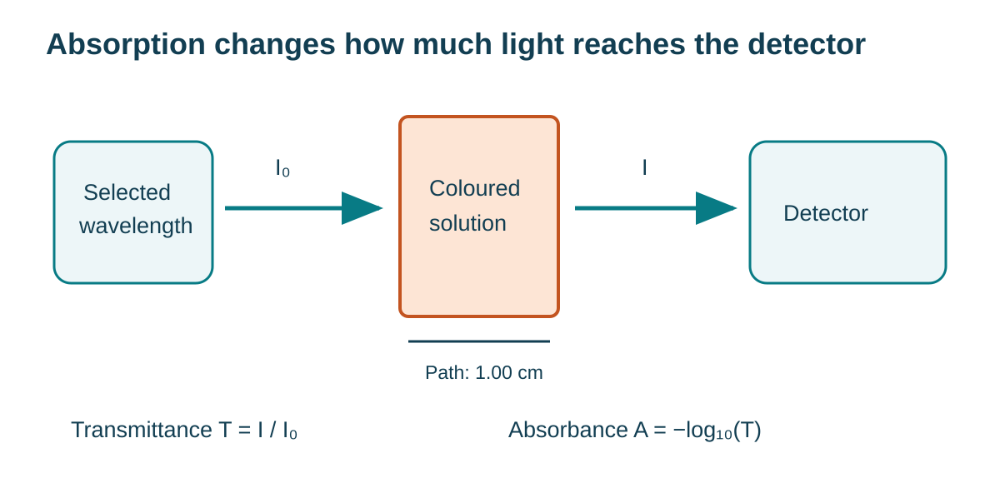
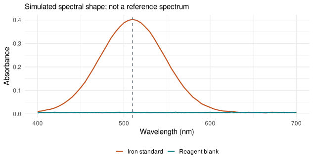
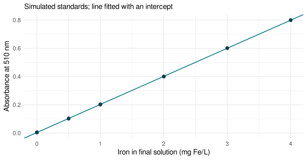
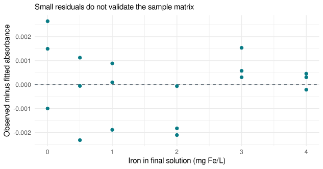
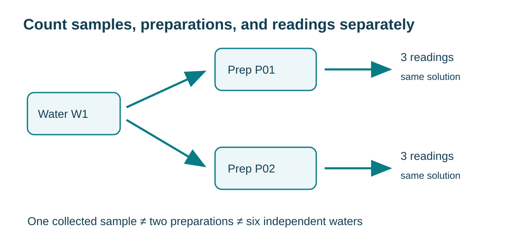
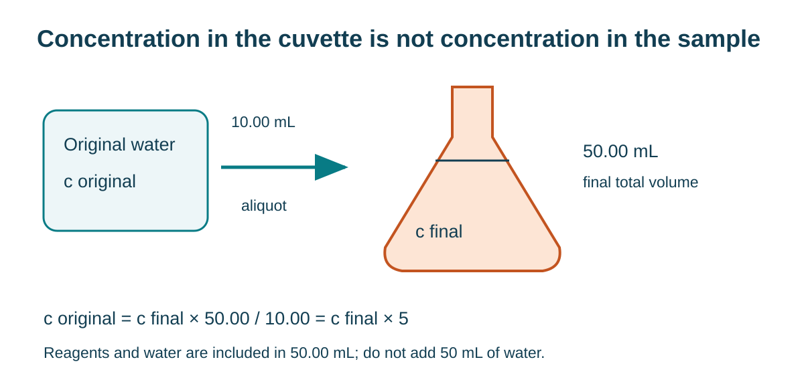
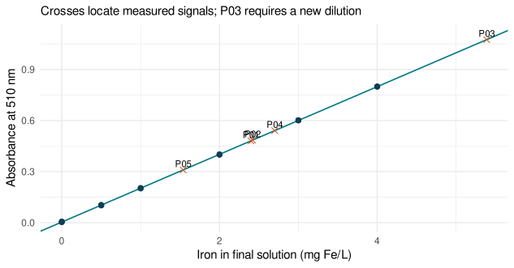
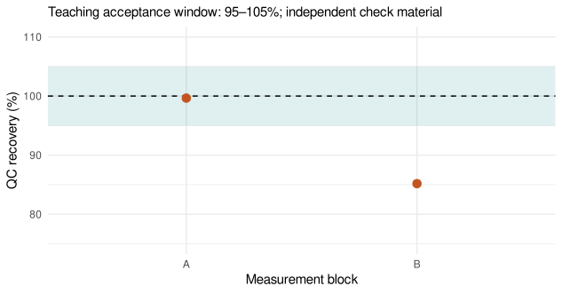
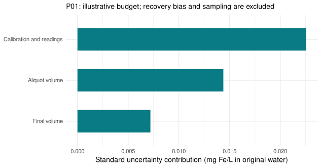
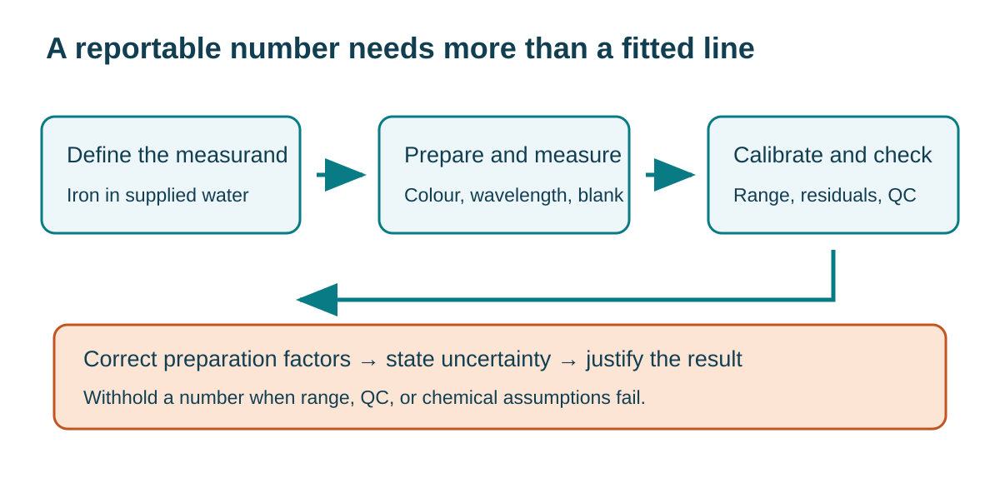

## About this lecture

A coloured solution gives an absorbance. We want **mg elemental Fe/L in the supplied filtered water**.

- Explain what absorbs and how light is measured.
- Fit a justified calibration and return to the original sample basis.
- Decide what range, QC and uncertainty evidence permit us to report.

::: notes
Retrieve the straight-line calibration from introcomputing. The chemical absorber and preparation now matter: students must connect the response to the intended measurand. All data are simulated. The exercise includes by-hand calculations before R.
:::

## The chemical absorber

Iron is reduced to Fe(II), then complexed with excess 1,10-phenanthroline (phen).

We assume quantitative conversion and no analyte loss.

{width="65%" fig-align="center" fig-alt="Iron(II) combines with three phenanthroline ligands to form a coloured complex."}

::: notes
Three bidentate ligands bind one iron ion. The diagram shows stoichiometry, not molecular geometry. The result after reduction is not the original Fe(II) fraction. Ask what incomplete reduction would do: it can bias the inferred amount low. Background: https://staff.buffalostate.edu/nazareay/che301/l9.pdf .
:::

## What the detector measures

$T=I/I_0$, then $A=-\log_{10}T$.

A reagent blank establishes the reference under matched conditions.

{width="65%" fig-align="center" fig-alt="Selected light passes through a coloured solution and transmitted intensity is measured."}

::: notes
Distinguish source/reference intensity from transmitted light. These supplied absorbances are already reagent-blank referenced. Another subtraction would change their basis. A whole-procedure method blank can answer a different contamination question.
:::

## Why select a wavelength?

A strong response near **510 nm** supports useful sensitivity.

A maximum does not prove the sample has no other absorber.

{width="65%" fig-align="center" fig-alt="An illustrative iron-standard spectrum has a maximum near 510 nm."}

::: notes
The spectral envelope is a simulated Gaussian illustration, not a reference spectrum for identification. A maximum also makes small wavelength errors less consequential than a steep flank. Wavelength positions within a scan are not independent samples.
:::

## Beer–Lambert connects light and composition

$A=\varepsilon l c$ at fixed wavelength, with appropriate chemical and instrumental conditions.

For a molar absorptivity, $c$ is in mol/L. Our empirical line instead uses **mg Fe/L**.

::: notes
Explain why concentration basis matters. A fitted slope in L/mg Fe is not numerically a molar absorptivity. Fixed path and chemical state matter; stray light and chemical changes can break the relation. Give the exercise tiny calculation A=.6 at epsilon2000 and path1 -> c=.0003 mol/L.
:::

## Doubling absorbance does not halve transmission

$T=0.80\Rightarrow A\approx0.09691$.

If $A$ doubles, $T=10^{-A}$ becomes **0.64**, not 0.40.

{width="65%" fig-align="center" fig-alt="Selected light passes through a coloured solution and transmitted intensity is measured."}

::: notes
Ask students to predict first. Squaring 0.80 gives 0.64, clearly different from halving to 0.40. The special case T=0.50 would square to 0.25 and happen to equal halving, so it cannot by itself demonstrate the general distinction. The logarithm is why proportional absorbance corresponds to exponential attenuation; B1 compares both starting values.
:::

## Fit the quantity we deliberately varied

Known final concentrations are the explanatory variable; absorbance is the response.

```r
fit <- lm(absorbance ~ standard_mg_l, data = standards)
```

{width="65%" fig-align="center" fig-alt="Prepared final-solution iron standards and their retained-intercept calibration."}

::: notes
Eighteen independent prepared standard solutions span zero to four mg Fe/L final, each measured once. Reversing the regression is a different least-squares problem. Retain the fitted intercept rather than forcing zero.
:::

## Interpret the fitted relationship

$A=0.003874+0.198799c_{final}$.

The slope has units **L/mg Fe**; the offset is estimated from the data.

{width="65%" fig-align="center" fig-alt="Prepared final-solution iron standards and their retained-intercept calibration."}

::: notes
Use full precision in code and rounded values in prose. The nonzero offset does not identify its cause. Concentration zero does not guarantee an exactly zero observed reading. Highlight one known standard and ask for its expected response.
:::

## Residuals ask whether the line misses structure

Residual = observed response − fitted response.

Inspect curvature, changing spread and unusual points before accepting the model.

{width="65%" fig-align="center" fig-alt="Standard residuals plotted against prepared concentration."}

::: notes
A high R squared alone is insufficient. Small residuals here support the selected simple model, but do not establish recovery in an unknown matrix. Do not remove an inconvenient standard just to improve appearance.
:::

## Invert the response model

$\hat c_{final}=(\overline A-a)/b$.

P01 has $\overline A=0.480620$, giving **2.398 mg Fe/L final**.

::: notes
The inverse is algebraically simple but uncertain slope and intercept also contribute to its uncertainty. This remains final-solution concentration. Ask what additional record is required before reporting the original water concentration.
:::

## Count the experimental units

P01 and P02 are separate preparations of W1; each has three readings.

Six readings are not six independently collected waters.

{width="65%" fig-align="center" fig-alt="One collected water sample gives two preparations, each with three readings."}

::: notes
Readings describe instrument repeatability within a solution. Separate preparations probe additional variation. Both preparations share a calibration and original collected sample, so their uncertainty components are not all independent.
:::

## Carry the preparation record into the calculation

$c_{original}=c_{final} V_{final}/V_{aliquot}$.

P01: $2.398\times50.00/10.00\approx$ **11.99 mg Fe/L original**.

{width="65%" fig-align="center" fig-alt="A ten millilitre aliquot is made up to fifty millilitres total."}

::: notes
The total final volume includes reagents and solvent. Distinguish making up to fifty millilitres from adding fifty millilitres. In R match preparation records by ID; table row order has no chemical meaning.
:::

## A new dilution means a new measurement

P03 exceeds the calibrated response range.

P04 is a **new** 5.00 mL aliquot made to 50.00 mL and measured again.

{width="65%" fig-align="center" fig-alt="An old out-of-range preparation and a newly measured dilution have different evidence."}

::: notes
P03 mean absorbance is 1.07507, beyond range. Editing its dilution factor cannot fix that reading. P04 mean is .54061 and its factor is ten, giving about twenty-seven mg Fe/L original. Crosses in the figure locate signals diagnostically; unsupported concentrations remain withheld.
:::

## Independent QC can block an in-range result

Check material: **2.00 mg Fe/L**. Exercise acceptance: **95–105% recovery**.

The later block B fails, so P05 is withheld.

{width="65%" fig-align="center" fig-alt="Independent QC recovers 99.6 percent in block A and 85.2 percent in block B."}

::: notes
A recovers99.6%, later B85.2%. Passing a calibration at the beginning does not establish later performance. Investigate, correct, re-establish satisfactory checks and remeasure. Do not automatically divide samples by the failed QC ratio. The chosen window is an exercise rule, not universal validation.
:::

## Uncertainty survives repeat readings

P01: **11.991 mg Fe/L**, with standard uncertainty **0.028 mg Fe/L** from the stated model.

That number is not a 95% half-width.

{width="65%" fig-align="center" fig-alt="Contributions to P01 standard uncertainty from calibration and volumes."}

::: notes
The supplied helper includes reading noise and full slope/intercept covariance in an inverse first-order approximation. Independent volume components are added in quadrature. Sampling, recovery, matrix bias and standard concentration uncertainty are omitted. The limited budget is not full method validation.
:::

## A result needs its chemical assumptions

Which check addresses contamination? Which challenges the line? Which could detect a sample-specific matrix effect?

{width="65%" fig-align="center" fig-alt="The chemical result connects question, preparation, calibration and evidence."}

::: notes
Return to reagent/method blanks, independent check material and sample spikes. No one check answers all three questions. Have students identify a missing source before calling a result fit for purpose.
:::

## Explore the mechanism, then test a claim

[Embedded experiment](exercise.qmd#explore): change path or wavelength, then introduce stray light.

Predict the response before moving a control. Export a scenario and reproduce the calculation in R.

{width="65%" fig-align="center" fig-alt="Standard residuals plotted against prepared concentration."}

::: notes
Show the demo in the exercise rather than a separate application shell. Distinguish a simulated model truth from evidence available in an actual unknown. Ask whether recalibrating a straight line cures curvature; residuals reveal why it does not.
:::

## Take the complete argument into the exercise

[By hand, demo and R tasks](exercise.qmd) · [Check your reasoning](quiz.qmd)

Report the absorber, wavelength, concentration basis, preparation factor, checks and uncertainty limitations.

{width="65%" fig-align="center" fig-alt="The chemical result connects question, preparation, calibration and evidence."}

::: notes
The exercise supplies numbered B, E and R tasks, linked hints and full explanations. End with the reason each of P03/P05 is withheld. Selected reading: Harris and Lucy, molecular absorption, spectrophotometers, calibration and uncertainty. The course edition is not yet confirmed.
:::
